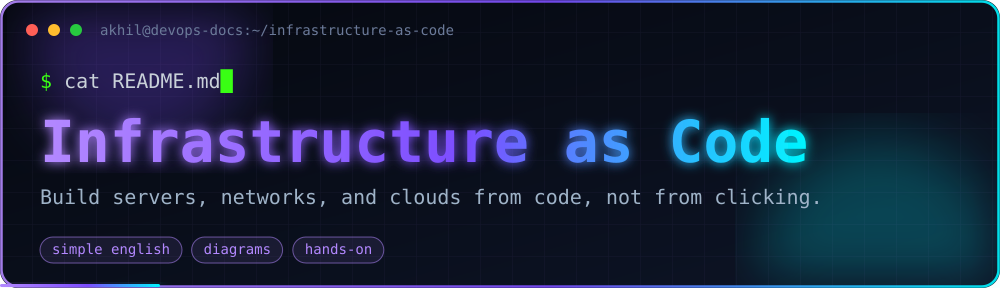

<p align="center"></p>

<p align="center">
  
  
  
</p>

---|-----|---------------------|
| 01 | [IaC concepts](docs/01-iac-concepts.md) | Declarative vs imperative, idempotency, drift |
| 02 | [Terraform basics](docs/02-terraform-basics.md) | Providers, resources, variables, outputs, plan and apply |
| 03 | [State, modules, workspaces](docs/03-terraform-state-modules-workspaces.md) | Remote state in S3, locking, reusable modules |
| 04 | [Ansible basics](docs/04-ansible-basics.md) | Inventory, playbooks, roles |
| 05 | [CloudFormation, Pulumi, and choosing tools](docs/05-cloudformation-and-pulumi-overview-and-choosing-tools.md) | Compare tools and pick one |

## ⚡ Quick cheat sheet

```bash
terraform init          # download providers
terraform fmt -recursive
terraform validate
terraform plan -out tf.plan
terraform apply tf.plan
terraform destroy

ansible all -i inventory.ini -m ping
ansible-playbook -i inventory.ini site.yml --check --diff
```

---
Part of the DevOps Hub by [@Akhilgoud01](https://github.com/Akhilgoud01) — ⭐ star if it helped
