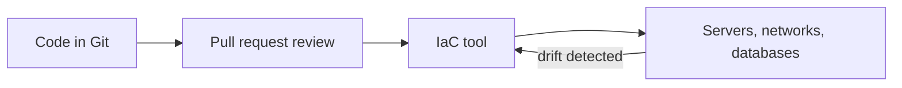
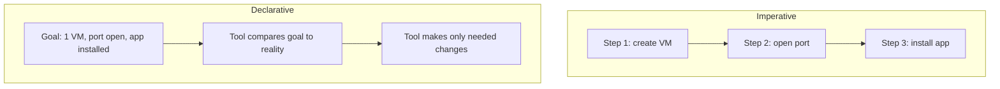
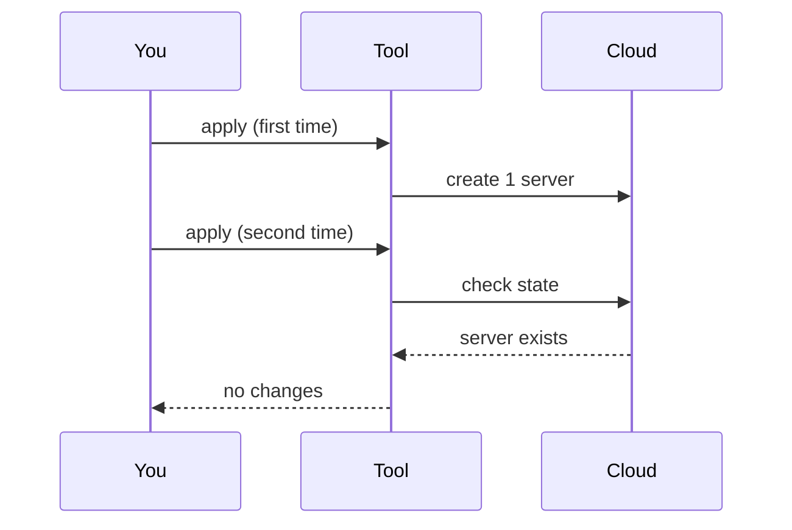
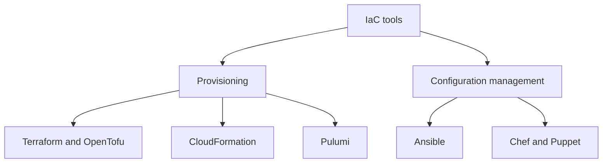

# 📐 IaC Concepts

> In one line: Infrastructure as Code means you describe servers, networks, and services in text files so they can be created, changed, and reviewed like software.

## 🧠 Simple explanation

Imagine building a LEGO castle. You can build it from memory and hope you remember every step next time. Or you can keep the instruction booklet. IaC is the booklet. Anyone can follow it and get the same castle, and when you want to change the castle, you change the booklet first.



## 🔑 Key concepts

- **Declarative**: you say *what* you want ("3 servers"). The tool decides how. Examples: Terraform, CloudFormation, Kubernetes YAML.
- **Imperative**: you say *how*, step by step ("create server, then install nginx"). Examples: Bash scripts, many Ansible tasks written with shell commands.
- **Idempotent**: running it many times gives the same result. If the server already exists, nothing new is made.
- **Drift**: the real system no longer matches the code, often because someone changed it by hand.
- **Immutable infrastructure**: do not patch servers. Replace them with a new image.
- **Mutable infrastructure**: you change servers in place.
- **Provisioning vs configuration management**: provisioning creates resources (Terraform). Configuration management sets up software inside them (Ansible).

| Point | Declarative | Imperative |
|-------|-------------|------------|
| You write | The end result | The steps |
| Rerun safety | High | Depends on your script |
| Example | `desired_count = 3` | `for i in 1..3; create server` |



### Idempotency in a picture



## 🛠️ Hands-on

A non-idempotent script (bad):

```bash
#!/usr/bin/env bash
mkdir /data              # fails the second time
echo "line" >> app.conf  # adds a duplicate line each run
```

An idempotent version (good):

```bash
#!/usr/bin/env bash
mkdir -p /data
grep -qxF "line" app.conf || echo "line" >> app.conf
```

The same idea in Ansible. This task is idempotent by design:

```yaml
- name: Make sure /data exists
  ansible.builtin.file:
    path: /data
    state: directory
```

Tool landscape:



Good habits from day one:

1. Keep all IaC in Git.
2. Use pull requests and a plan review before apply.
3. Never edit cloud resources by hand in the console (except in emergencies, then update the code).
4. Keep secrets out of code.
5. Run IaC from a pipeline, not from a laptop, when the team grows.

## ⚠️ Common mistakes

- **Mixing manual console changes with IaC.** This creates drift and surprises.
- **Writing huge single files.** Split code into modules or roles.
- **Storing passwords in the repo.** Use a secrets manager.
- **Skipping the preview step.** Always read the plan or dry-run output.
- **Treating servers as pets.** Prefer replaceable, rebuilt-from-code servers.

## ✅ Quick recap

- IaC = infrastructure described in files and stored in Git.
- Declarative says "what", imperative says "how".
- Idempotent means safe to run again and again.
- Drift is the enemy. Code review plus automation reduces it.

➡️ Next: [02 - Terraform basics](02-terraform-basics.md)
