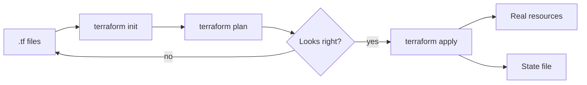
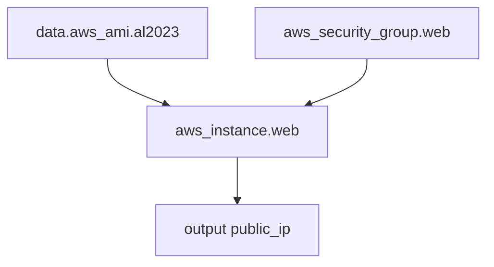

# 🌍 Terraform Basics

> In one line: Terraform reads your `.tf` files, compares them with reality, and creates or changes cloud resources to match.

## 🧠 Simple explanation

Terraform is like a building planner. You hand it a blueprint (your code). It checks what already exists, shows you a list of what it will build, change, or remove (the *plan*), and only after you say yes does it do the work (the *apply*).



## 🔑 Key concepts

- **Provider**: a plugin that talks to a platform (AWS, Azure, GCP, Kubernetes, GitHub).
- **Resource**: one thing to create, such as an EC2 instance or an S3 bucket.
- **Data source**: reads something that already exists (for example, the latest AMI).
- **Variable**: an input. Lets you reuse the same code with different values.
- **Output**: a value Terraform prints after apply (for example, a server IP).
- **Local**: a named value inside the module to avoid repetition.
- **State**: a file where Terraform records what it created. See the next doc.
- **HCL**: the HashiCorp Configuration Language used in `.tf` files.

Note: OpenTofu is an open-source fork of Terraform. The commands and code in this doc work with both. Replace `terraform` with `tofu`.

## 🛠️ Hands-on

### 1. Install and check

```bash
terraform version
aws sts get-caller-identity     # make sure your AWS credentials work
```

### 2. Project files

```text
demo/
├── main.tf
├── variables.tf
└── outputs.tf
```

`variables.tf`:

```hcl
variable "region" {
  type    = string
  default = "ap-south-1"
}

variable "instance_type" {
  type        = string
  description = "EC2 size"
  default     = "t3.micro"
}

variable "env" {
  type = string
}
```

`main.tf`:

```hcl
terraform {
  required_version = ">= 1.5"
  required_providers {
    aws = {
      source  = "hashicorp/aws"
      version = "~> 5.0"
    }
  }
}

provider "aws" {
  region = var.region
}

# find the newest Amazon Linux 2023 image
data "aws_ami" "al2023" {
  most_recent = true
  owners      = ["amazon"]
  filter {
    name   = "name"
    values = ["al2023-ami-*-x86_64"]
  }
}

resource "aws_security_group" "web" {
  name        = "${var.env}-web-sg"
  description = "Allow HTTP"

  ingress {
    from_port   = 80
    to_port     = 80
    protocol    = "tcp"
    cidr_blocks = ["0.0.0.0/0"]
  }

  egress {
    from_port   = 0
    to_port     = 0
    protocol    = "-1"
    cidr_blocks = ["0.0.0.0/0"]
  }
}

resource "aws_instance" "web" {
  ami                    = data.aws_ami.al2023.id
  instance_type          = var.instance_type
  vpc_security_group_ids = [aws_security_group.web.id]

  tags = {
    Name = "${var.env}-web"
    Env  = var.env
  }
}
```

`outputs.tf`:

```hcl
output "public_ip" {
  value = aws_instance.web.public_ip
}
```

### 3. The core workflow

```bash
terraform init                         # download the AWS provider
terraform fmt                          # tidy the code
terraform validate                     # check syntax
terraform plan -var="env=dev" -out=tf.plan
terraform apply tf.plan
terraform output public_ip
terraform destroy -var="env=dev"       # delete everything made by this code
```

In the plan you will see symbols:

| Symbol | Meaning |
|--------|---------|
| `+` | will be created |
| `~` | will be changed in place |
| `-` | will be destroyed |
| `-/+` | will be destroyed and created again |

### 4. Set variables in different ways

```bash
terraform apply -var="env=dev"
terraform apply -var-file="dev.tfvars"
export TF_VAR_env=dev && terraform apply
```

`dev.tfvars`:

```hcl
env           = "dev"
instance_type = "t3.small"
```

### 5. How Terraform orders work

Terraform builds a dependency graph. `aws_instance.web` uses `aws_security_group.web.id`, so the security group is made first.



### 6. Loops with `count` and `for_each`

```hcl
resource "aws_s3_bucket" "logs" {
  for_each = toset(["app", "audit", "billing"])
  bucket   = "my-company-${each.key}-logs-12345"
}
```

(S3 bucket names must be globally unique, so change the suffix.)

## ⚠️ Common mistakes

- **Running `apply` without reading the plan.** A `-/+` on a database can delete data.
- **Committing `terraform.tfstate` or `.tfvars` with secrets to Git.** Add them to `.gitignore`.
- **Not pinning provider versions.** Upgrades may break your code.
- **Hard-coding values** like region and AMI IDs. Use variables and data sources.
- **Forgetting `terraform destroy` on test projects.** You keep paying.

## ✅ Quick recap

- Write resources in HCL, then `init`, `plan`, `apply`.
- Variables are inputs, outputs are results.
- Terraform works out the order itself using dependencies.
- Always review the plan.

➡️ Next: [03 - State, modules, workspaces](03-terraform-state-modules-workspaces.md)
