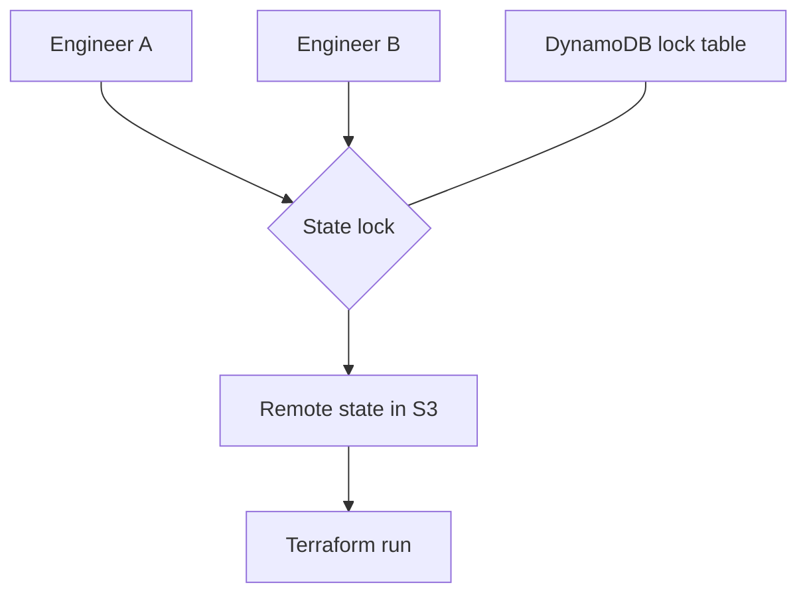
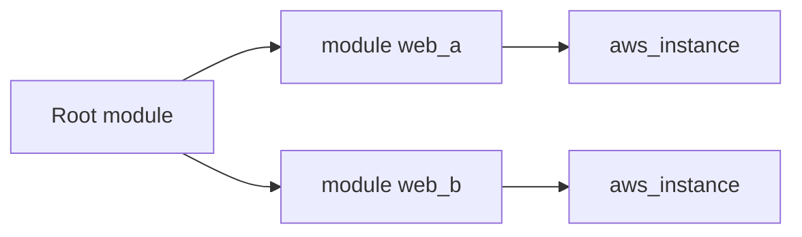

# 🗄️ Terraform State, Modules, and Workspaces

> In one line: State is Terraform's memory, modules are reusable building blocks, and workspaces let one code base manage several copies.

## 🧠 Simple explanation

State is like a shopping receipt. Terraform keeps it so it knows what it already bought. If you lose the receipt, Terraform thinks nothing exists and may try to buy it all again.

A module is like a LEGO kit. Instead of building a network from loose bricks every time, you use the "network kit" and only choose its size and name.



## 🔑 Key concepts

- **State file** (`terraform.tfstate`): JSON that maps your code to real resource IDs.
- **Local state**: stored on your laptop. Fine for learning, risky for teams.
- **Remote state**: stored in a shared place such as S3, Azure Blob, or Terraform Cloud.
- **State locking**: stops two people from applying at the same time.
- **Module**: a folder of `.tf` files that you call from other code.
- **Root module**: the folder where you run Terraform.
- **Workspace**: a separate state for the same code (for example `dev` and `prod`).
- **State contains secrets.** Passwords can appear in plain text. Encrypt it and limit access.

## 🛠️ Hands-on

### 1. Create the remote state storage (one time)

```bash
aws s3api create-bucket --bucket my-tfstate-12345 --region ap-south-1 \
  --create-bucket-configuration LocationConstraint=ap-south-1
aws s3api put-bucket-versioning --bucket my-tfstate-12345 \
  --versioning-configuration Status=Enabled
aws s3api put-bucket-encryption --bucket my-tfstate-12345 \
  --server-side-encryption-configuration \
  '{"Rules":[{"ApplyServerSideEncryptionByDefault":{"SSEAlgorithm":"AES256"}}]}'
```

### 2. Configure the S3 backend with locking

Newer Terraform (1.10 and later) can lock using S3 itself:

```hcl
terraform {
  backend "s3" {
    bucket       = "my-tfstate-12345"
    key          = "prod/network/terraform.tfstate"
    region       = "ap-south-1"
    encrypt      = true
    use_lockfile = true
  }
}
```

Older setups use a DynamoDB table instead:

```hcl
terraform {
  backend "s3" {
    bucket         = "my-tfstate-12345"
    key            = "prod/network/terraform.tfstate"
    region         = "ap-south-1"
    encrypt        = true
    dynamodb_table = "tf-locks"   # table with partition key LockID (string)
  }
}
```

```bash
terraform init            # asks to copy local state to S3 if one exists
```

### 3. Useful state commands

```bash
terraform state list
terraform state show aws_instance.web
terraform state mv aws_instance.web aws_instance.app   # rename without recreate
terraform state rm aws_instance.web                    # forget, do not delete
terraform import aws_s3_bucket.logs my-existing-bucket # adopt existing resource
terraform force-unlock <LOCK_ID>                       # only if a run crashed
```

### 4. Write a module

```text
infra/
├── main.tf
└── modules/
    └── web_server/
        ├── main.tf
        ├── variables.tf
        └── outputs.tf
```

`modules/web_server/variables.tf`:

```hcl
variable "name"          { type = string }
variable "instance_type" { type = string }
variable "ami_id"        { type = string }
```

`modules/web_server/main.tf`:

```hcl
resource "aws_instance" "this" {
  ami           = var.ami_id
  instance_type = var.instance_type
  tags          = { Name = var.name }
}
```

`modules/web_server/outputs.tf`:

```hcl
output "instance_id" { value = aws_instance.this.id }
```

Call it from the root:

```hcl
module "web_a" {
  source        = "./modules/web_server"
  name          = "web-a"
  instance_type = "t3.micro"
  ami_id        = data.aws_ami.al2023.id
}

module "web_b" {
  source        = "./modules/web_server"
  name          = "web-b"
  instance_type = "t3.small"
  ami_id        = data.aws_ami.al2023.id
}

output "ids" {
  value = [module.web_a.instance_id, module.web_b.instance_id]
}
```

Public modules come from the Terraform Registry:

```hcl
module "vpc" {
  source  = "terraform-aws-modules/vpc/aws"
  version = "~> 5.0"
  name    = "main"
  cidr    = "10.0.0.0/16"
}
```



### 5. Workspaces

```bash
terraform workspace list
terraform workspace new dev
terraform workspace new prod
terraform workspace select dev
terraform apply -var-file=dev.tfvars
```

Use the name inside code:

```hcl
tags = { Env = terraform.workspace }
```

Many teams prefer **separate folders and state keys per environment** (`envs/dev`, `envs/prod`) because it is clearer and safer than workspaces. Workspaces share the same code and backend settings.

## ⚠️ Common mistakes

- **Keeping state only on a laptop.** If the laptop dies, you lose control of your infrastructure.
- **Committing state to Git.** It can hold secrets.
- **Deleting the lock or using `force-unlock` while someone is applying.** This can corrupt state.
- **One giant state for everything.** A mistake can affect all systems. Split by area (network, database, apps).
- **Using unpinned module versions.** Pin with `version = "~> 5.0"`.

## ✅ Quick recap

- State links code to real resources. Store it remotely with locking and encryption.
- Modules make code reusable. Pass inputs, read outputs.
- Workspaces give separate states, but folders per environment are often clearer.

➡️ Next: [04 - Ansible basics](04-ansible-basics.md)
