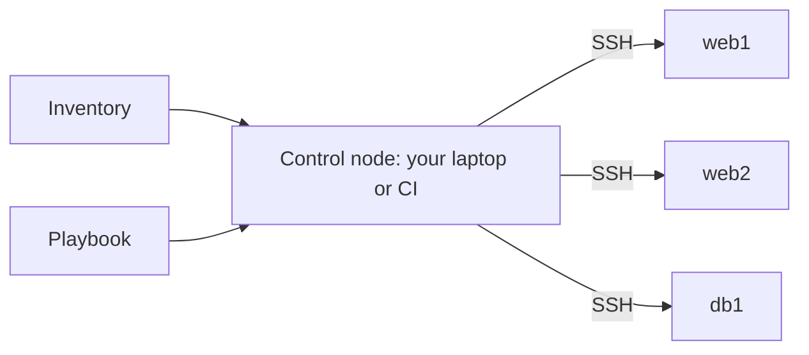
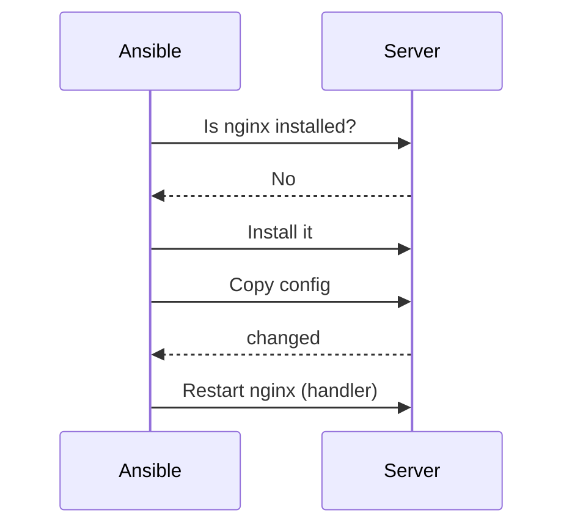

# 📜 Ansible Basics

> In one line: Ansible logs into your servers over SSH and sets them up exactly as your playbook says, with no agent to install.

## 🧠 Simple explanation

Terraform builds the empty house. Ansible furnishes it: installs packages, copies config files, starts services. Think of Ansible as a helpful person with a checklist who visits every house on your list and ticks off each item. If an item is already done, they skip it.



## 🔑 Key concepts

- **Control node**: the machine where you run Ansible.
- **Managed nodes**: the servers Ansible configures. They only need SSH and Python.
- **Inventory**: a list of servers, grouped (for example `web`, `db`).
- **Module**: a small tool for one job (`apt`, `copy`, `service`, `user`).
- **Task**: one call to a module.
- **Play**: a set of tasks run on a group of hosts.
- **Playbook**: a YAML file with one or more plays.
- **Role**: a standard folder layout to package tasks, templates, and variables for reuse.
- **Handler**: a task that runs only when notified (for example, restart nginx after the config changes).
- **Facts**: info Ansible collects about each host (OS, IP, memory).
- **Idempotent**: modules check first and change only if needed.

## 🛠️ Hands-on

### 1. Install and set up inventory

```bash
python3 -m pip install --user ansible
ansible --version
```

`inventory.ini`:

```ini
[web]
web1 ansible_host=192.0.2.10
web2 ansible_host=192.0.2.11

[db]
db1 ansible_host=192.0.2.20

[all:vars]
ansible_user=ubuntu
ansible_ssh_private_key_file=~/.ssh/id_ed25519
```

Test the connection:

```bash
ansible all -i inventory.ini -m ping
ansible web -i inventory.ini -a "uptime"
```

### 2. Write a playbook

`site.yml`:

```yaml
- name: Configure web servers
  hosts: web
  become: true            # use sudo
  vars:
    app_port: 80

  tasks:
    - name: Install nginx
      ansible.builtin.apt:
        name: nginx
        state: present
        update_cache: true

    - name: Copy site config
      ansible.builtin.template:
        src: site.conf.j2
        dest: /etc/nginx/conf.d/site.conf
        mode: "0644"
      notify: Restart nginx

    - name: Make sure nginx is running and starts on boot
      ansible.builtin.service:
        name: nginx
        state: started
        enabled: true

  handlers:
    - name: Restart nginx
      ansible.builtin.service:
        name: nginx
        state: restarted
```

`templates/site.conf.j2`:

```jinja
server {
    listen {{ app_port }};
    server_name {{ ansible_hostname }};
    location / {
        return 200 "Hello from {{ ansible_hostname }}\n";
    }
}
```

### 3. Run it

```bash
ansible-playbook -i inventory.ini site.yml --check --diff   # dry run
ansible-playbook -i inventory.ini site.yml                  # real run
ansible-playbook -i inventory.ini site.yml                  # again: "changed=0"
```

The second run showing `changed=0` proves idempotency.



### 4. Roles

```bash
ansible-galaxy init roles/nginx
```

```text
roles/nginx/
├── tasks/main.yml
├── handlers/main.yml
├── templates/
├── defaults/main.yml     # default variables
└── vars/main.yml
```

Use it:

```yaml
- hosts: web
  become: true
  roles:
    - nginx
```

### 5. Secrets with Vault

```bash
ansible-vault create secrets.yml
ansible-vault edit secrets.yml
ansible-playbook site.yml --ask-vault-pass
```

### 6. Terraform plus Ansible together


For many cloud setups, a dynamic inventory plugin (for example `amazon.aws.aws_ec2`) finds servers by tag, so you do not write IPs by hand.

## ⚠️ Common mistakes

- **Using `command` or `shell` for everything.** These are not idempotent unless you add `creates:` or `when:`. Prefer real modules.
- **Plain-text passwords in playbooks.** Use Ansible Vault or a secrets manager.
- **Forgetting `become: true`** for tasks that need root.
- **Using short module names** like `apt`. Prefer full names such as `ansible.builtin.apt`.
- **Not running `--check` first** on production.

## ✅ Quick recap

- Ansible is agentless and works over SSH.
- Inventory = who. Playbook = what. Role = reusable package.
- Handlers run only when something changed.
- A second run with no changes proves the playbook is idempotent.

➡️ Next: [05 - CloudFormation, Pulumi, and choosing tools](05-cloudformation-and-pulumi-overview-and-choosing-tools.md)
