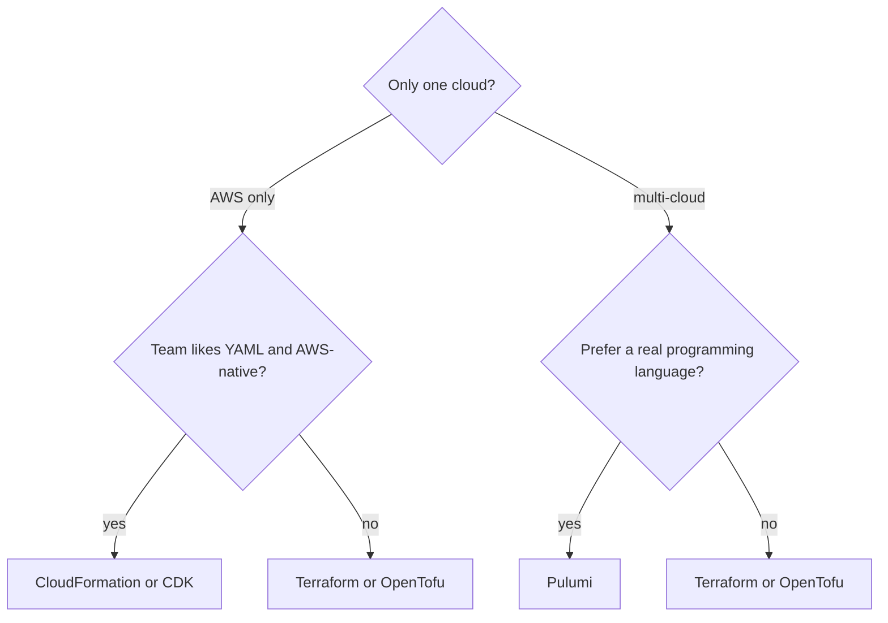
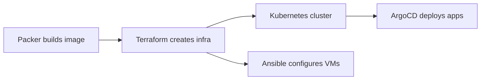

# 🧰 CloudFormation, Pulumi, and Choosing Tools

> In one line: Terraform is not the only IaC tool. Pick the one that fits your cloud, your team's skills, and your needs.

## 🧠 Simple explanation

Choosing an IaC tool is like choosing a vehicle. A bicycle, a car, and a truck can all move you. The right one depends on the road and the load. Here are the most common options.



## 🔑 Key concepts

- **AWS CloudFormation**: AWS's own IaC service. You write templates in YAML or JSON. AWS runs them as a *stack*. Only for AWS.
- **AWS CDK**: write infrastructure in TypeScript, Python, Java and more. It creates CloudFormation templates for you.
- **Pulumi**: write infrastructure in real languages (TypeScript, Python, Go, C#). Works across many clouds.
- **Terraform / OpenTofu**: HCL language, thousands of providers, large community.
- **Azure Bicep**: Azure's simpler language that compiles to ARM templates.
- **Crossplane**: manage cloud resources from inside Kubernetes using YAML.

| Tool | Language | Clouds | State kept by | Best for |
|------|----------|--------|---------------|----------|
| Terraform / OpenTofu | HCL | Many | You (S3, etc.) or HCP | General purpose, most jobs |
| CloudFormation | YAML / JSON | AWS | AWS | AWS-only shops |
| AWS CDK | TS, Python, Java | AWS | AWS (CloudFormation) | Developers on AWS |
| Pulumi | TS, Python, Go, C# | Many | Pulumi Cloud or self-hosted | Dev-heavy teams |
| Bicep | Bicep | Azure | Azure | Azure-only shops |
| Ansible | YAML | Many | None | Configuring servers |

## 🛠️ Hands-on

### CloudFormation example

`bucket.yaml`:

```yaml
AWSTemplateFormatVersion: "2010-09-09"
Description: One S3 bucket with versioning
Parameters:
  BucketName:
    Type: String
Resources:
  LogsBucket:
    Type: AWS::S3::Bucket
    Properties:
      BucketName: !Ref BucketName
      VersioningConfiguration:
        Status: Enabled
Outputs:
  BucketArn:
    Value: !GetAtt LogsBucket.Arn
```

```bash
aws cloudformation deploy \
  --template-file bucket.yaml \
  --stack-name demo-bucket \
  --parameter-overrides BucketName=my-demo-bucket-12345

aws cloudformation describe-stacks --stack-name demo-bucket
aws cloudformation delete-stack --stack-name demo-bucket
```

Change sets work like a Terraform plan:

```bash
aws cloudformation create-change-set --stack-name demo-bucket \
  --change-set-name preview --template-body file://bucket.yaml \
  --parameters ParameterKey=BucketName,ParameterValue=my-demo-bucket-12345
```

### Pulumi example (Python)

```bash
pulumi new aws-python
```

`__main__.py`:

```python
import pulumi
import pulumi_aws as aws

bucket = aws.s3.BucketV2("logs")
aws.s3.BucketVersioningV2(
    "logs-versioning",
    bucket=bucket.id,
    versioning_configuration={"status": "Enabled"},
)

pulumi.export("bucket_name", bucket.id)
```

```bash
pulumi preview
pulumi up
pulumi destroy
```

### Same bucket in Terraform, for comparison

```hcl
resource "aws_s3_bucket" "logs" {
  bucket = "my-demo-bucket-12345"
}

resource "aws_s3_bucket_versioning" "logs" {
  bucket = aws_s3_bucket.logs.id
  versioning_configuration {
    status = "Enabled"
  }
}
```

### How to choose: a short checklist

1. **Which clouds do you use?** Only AWS: CloudFormation or CDK are fine. More than one: Terraform, OpenTofu, or Pulumi.
2. **Who writes the code?** Ops people often like HCL or YAML. Developers often like Pulumi or CDK.
3. **What skills does the team have?** Using what people already know beats a "perfect" tool.
4. **Hiring market?** Terraform appears in the most job posts.
5. **License and cost?** Terraform uses the BUSL license. OpenTofu is open source under the Linux Foundation. Check what your company allows.
6. **Need server configuration too?** Add Ansible, or bake images with Packer.

A common real-world stack:



## ⚠️ Common mistakes

- **Picking a tool because it is popular.** Pick it because it fits your team.
- **Using two tools for the same resource.** Two owners fight each other.
- **Ignoring the learning curve of CDK and Pulumi.** Real languages are powerful but easy to over-complicate.
- **Using Ansible to create large cloud estates.** It can, but Terraform tracks state better.
- **Not testing.** Use `terraform validate`, `tflint`, `checkov`, or `cfn-lint` in your pipeline.

## ✅ Quick recap

- CloudFormation is AWS-native. Pulumi uses real languages. Terraform and OpenTofu are the most common general choice.
- Provisioning tools create resources. Ansible configures what runs inside them.
- Choose by cloud, team skill, and hiring, then stay consistent.

🎉 You finished this repo. Go back to the [README](../README.md).
