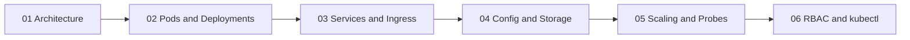

<h1 align="center">☸️ Kubernetes Guide</h1>

<p align="center"><b>Run, scale, and heal your containers automatically.</b></p>

<p align="center">
  
  
  
  
</p>

---

## 🎯 Why this repo

Running one container is easy. Running hundreds, keeping them alive, updating them with no downtime, and letting them talk to each other is hard. Kubernetes (also written K8s) does this work for you. This repo explains Kubernetes in plain English: how the cluster is built, how to run apps, how traffic reaches them, how to store config and data, how to scale, and how to control who can do what.

## 🗺️ Learning path



## 📚 Table of contents

| # | Topic | What you will learn |
|---|-------|---------------------|
| 01 | [Kubernetes architecture](docs/01-kubernetes-architecture.md) | Control plane, worker nodes, and how they talk |
| 02 | [Pods, Deployments and ReplicaSets](docs/02-pods-deployments-replicasets.md) | The basic building blocks for running apps |
| 03 | [Services, Ingress and networking](docs/03-services-ingress-networking.md) | Stable addresses and traffic from the outside |
| 04 | [ConfigMaps, Secrets and storage](docs/04-configmaps-secrets-storage-pv-pvc.md) | Settings, passwords, and persistent data |
| 05 | [Scaling, probes and rolling updates](docs/05-scaling-hpa-probes-rolling-updates.md) | Autoscale, health checks, zero-downtime updates |
| 06 | [RBAC, namespaces and kubectl cheatsheet](docs/06-rbac-namespaces-and-kubectl-cheatsheet.md) | Organize and secure the cluster, daily commands |

## ⚡ Quick cheat sheet

```bash
kubectl get pods -A                         # all pods, all namespaces
kubectl get all -n myapp                    # main objects in a namespace
kubectl apply -f app.yaml                   # create or update from a file
kubectl describe pod web-abc                # details and events (great for debugging)
kubectl logs -f web-abc                     # follow logs
kubectl exec -it web-abc -- sh              # shell inside a pod
kubectl rollout status deploy/web           # watch a rollout
kubectl rollout undo deploy/web             # roll back
kubectl scale deploy/web --replicas=5       # scale manually
kubectl port-forward svc/web 8080:80        # test locally
kubectl delete -f app.yaml                  # remove what the file created
```

---

<p align="center">Part of the DevOps Hub by <a href="https://github.com/Akhilgoud01">@Akhilgoud01</a> — ⭐ star if it helped</p>
