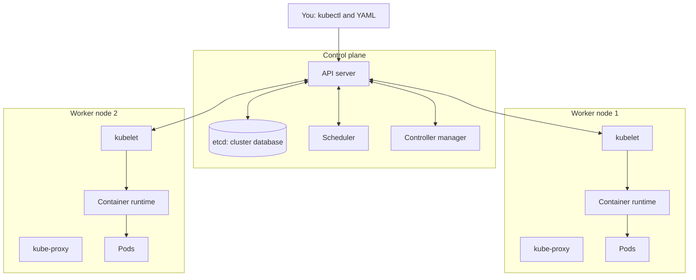
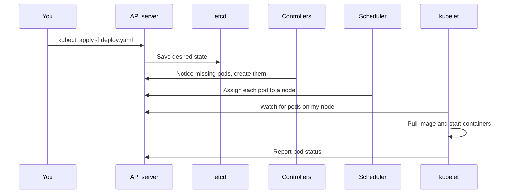

# 🏗️ 01 · Kubernetes Architecture

> **In one line:** A Kubernetes cluster has a control plane that makes decisions and worker nodes that run your containers.

## 🧠 Simple explanation

Think of a busy restaurant. The **control plane** is the management office: it takes orders, decides which cook does what, and checks that everything is on track. The **worker nodes** are the kitchen stations where the cooking (running containers) really happens. You never walk into the kitchen to tell a cook what to do. You write your order (a YAML file) and give it to the office. The office makes it happen and keeps fixing things if a cook calls in sick.

This idea is called **desired state**. You say "I want 3 copies of my app running." Kubernetes keeps checking and fixes any difference between what you want and what exists.



## 🔑 Key concepts

### Control plane components

- **API server (`kube-apiserver`)**: the front door. Every command, tool, and component talks to it. It checks who you are and what you may do.
- **etcd**: a small, reliable key-value database. It stores the whole cluster state. Back it up.
- **Scheduler (`kube-scheduler`)**: picks the best node for each new pod, based on free CPU, memory, and rules you set.
- **Controller manager**: runs many control loops. Each loop compares desired state with real state and fixes the gap (for example, "3 replicas wanted, only 2 running, so start one").
- **Cloud controller manager**: talks to your cloud (load balancers, disks, nodes). Only present on cloud clusters.

### Worker node components

- **kubelet**: the node's agent. It receives pod specs from the API server and makes sure the containers run and stay healthy.
- **Container runtime**: the software that actually runs containers, such as `containerd` or CRI-O.
- **kube-proxy**: sets up network rules so traffic to a Service reaches the right pods.

### Other words you will meet

- **Cluster**: the control plane plus all nodes.
- **Node**: one machine (physical or virtual) that runs pods.
- **Pod**: the smallest unit you deploy. One or more containers together.
- **Namespace**: a virtual folder that splits one cluster into parts.
- **Manifest**: a YAML file describing the desired state of an object.

### What happens when you create a Deployment



## 🛠️ Hands-on

### Start a local cluster

Pick one tool. Both run a real cluster on your laptop.

```bash
# Option 1: minikube
minikube start
# Option 2: kind (Kubernetes in Docker)
kind create cluster --name demo
```

### Explore the cluster

```bash
kubectl cluster-info                  # where is the API server?
kubectl get nodes -o wide             # list nodes
kubectl get pods -n kube-system       # control plane and system pods
kubectl describe node <node-name>     # CPU, memory, pods on the node
kubectl api-resources | head -20      # all object types you can create
```

### Watch the control loop heal things

```bash
kubectl create deployment hello --image=nginx:alpine --replicas=3
kubectl get pods -w                   # in terminal 1: watch

# in terminal 2: delete exactly one pod
kubectl delete pod "$(kubectl get pods -l app=hello -o name | head -1)"
```

A new pod appears within seconds. The ReplicaSet controller saw "2 of 3" and fixed it.

### Clean up

```bash
kubectl delete deployment hello
```

## ⚠️ Common mistakes

- **Running only one control plane node in production.** If it dies, you cannot manage the cluster. Use three.
- **Not backing up etcd.** It holds everything.
- **Changing things by hand on a node.** The kubelet and controllers may undo it.
- **Mixing up desired and actual state.** `kubectl apply` records what you want, not what is happening right now.
- **Ignoring `kube-system` pods.** If they are unhealthy, the whole cluster suffers.

## ✅ Quick recap

- Control plane decides. Worker nodes run.
- The API server is the single entry point. etcd stores the state.
- Controllers constantly move real state toward desired state.
- kubelet runs pods on each node. kube-proxy handles Service networking.

➡️ **Next:** [02 · Pods, Deployments and ReplicaSets](02-pods-deployments-replicasets.md)
