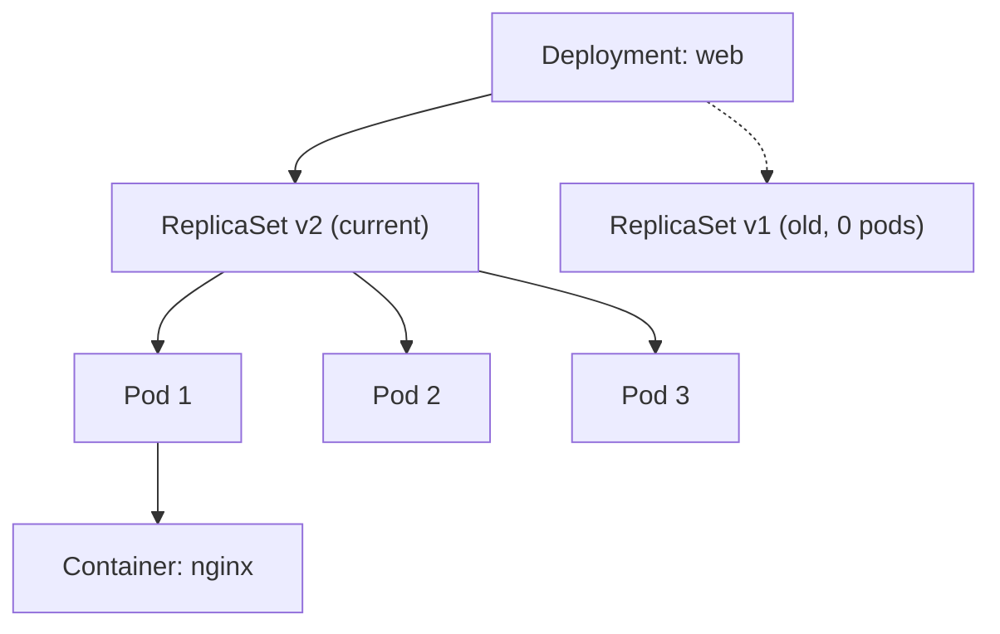
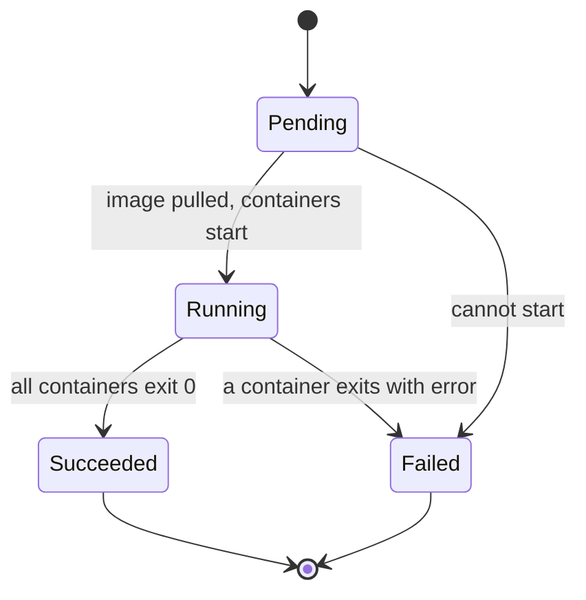

# 🫛 02 · Pods, Deployments and ReplicaSets

> **In one line:** A Pod runs your containers, a ReplicaSet keeps the right number of Pods alive, and a Deployment manages ReplicaSets so you can update safely.

## 🧠 Simple explanation

Imagine a delivery company. A **Pod** is one delivery van with its driver and cargo. A **ReplicaSet** is the dispatcher who makes sure there are always exactly 3 vans on the road: if one breaks, send another. A **Deployment** is the fleet manager who handles upgrades: "replace old vans with new models, a few at a time, and keep deliveries going."

You almost never create Pods directly. You create a Deployment and let it do the rest.



## 🔑 Key concepts

- **Pod**: the smallest deployable unit. One or more containers that share the same network (one IP) and can share storage. Usually one main container per Pod.
- **Sidecar**: a helper container in the same Pod (for logs, proxy, and so on).
- **Pods are mortal**: when a Pod dies, it is replaced by a new one with a new name and a new IP.
- **ReplicaSet**: keeps a set number of identical Pods running.
- **Deployment**: adds rolling updates and rollbacks on top of ReplicaSets. Best choice for stateless apps.
- **Labels**: key-value tags on objects, like `app: web`. **Selectors** use labels to find objects.
- **Other controllers**: `StatefulSet` (stable identity and storage, like databases), `DaemonSet` (one Pod per node, like log agents), `Job` and `CronJob` (run to completion, on a schedule).

### Pod lifecycle



Common status messages you will see: `CrashLoopBackOff` (container keeps crashing), `ImagePullBackOff` (cannot get the image), `Pending` (no node fits yet).

## 🛠️ Hands-on

### A simple Pod (for learning only)

```yaml
# pod.yaml
apiVersion: v1
kind: Pod
metadata:
  name: hello-pod
  labels:
    app: hello
spec:
  containers:
    - name: web
      image: nginx:1.27-alpine
      ports:
        - containerPort: 80
```

```bash
kubectl apply -f pod.yaml
kubectl get pod hello-pod -o wide
kubectl delete pod hello-pod        # gone for good, nobody recreates it
```

### A real Deployment

```yaml
# deployment.yaml
apiVersion: apps/v1
kind: Deployment
metadata:
  name: web
spec:
  replicas: 3
  selector:
    matchLabels:
      app: web              # must match the template labels below
  template:
    metadata:
      labels:
        app: web
    spec:
      containers:
        - name: web
          image: nginx:1.27-alpine
          ports:
            - containerPort: 80
          resources:
            requests:
              cpu: "100m"
              memory: "64Mi"
            limits:
              cpu: "250m"
              memory: "128Mi"
```

```bash
kubectl apply -f deployment.yaml
kubectl get deploy,rs,pods -l app=web
```

### Update and roll back

```bash
kubectl set image deployment/web web=nginx:1.27.1-alpine
kubectl rollout status deployment/web
kubectl rollout history deployment/web
kubectl rollout undo deployment/web            # back to the previous version
```

### Debug a broken Pod

```bash
kubectl get pods
kubectl describe pod <name>        # read the Events section at the bottom
kubectl logs <name>                # current logs
kubectl logs <name> --previous     # logs of the crashed container
kubectl exec -it <name> -- sh
```

## ⚠️ Common mistakes

- **Creating bare Pods in production.** If the node dies, they are not rescheduled.
- **Using the `latest` tag.** You cannot tell which version runs. Pin a version.
- **Selector and template labels do not match.** The Deployment is rejected.
- **No resource requests and limits.** The scheduler guesses badly and one app can starve others.
- **Running a database in a plain Deployment.** Use a StatefulSet with persistent storage.
- **Storing data in the container filesystem.** It is lost when the Pod is replaced.

## ✅ Quick recap

- Pod = smallest unit, short-lived. ReplicaSet = keeps N Pods. Deployment = updates and rollbacks.
- Labels and selectors connect objects.
- Always set image versions and resource requests and limits.
- Use `describe` and `logs` first when something breaks.

➡️ **Next:** [03 · Services, Ingress and networking](03-services-ingress-networking.md)
