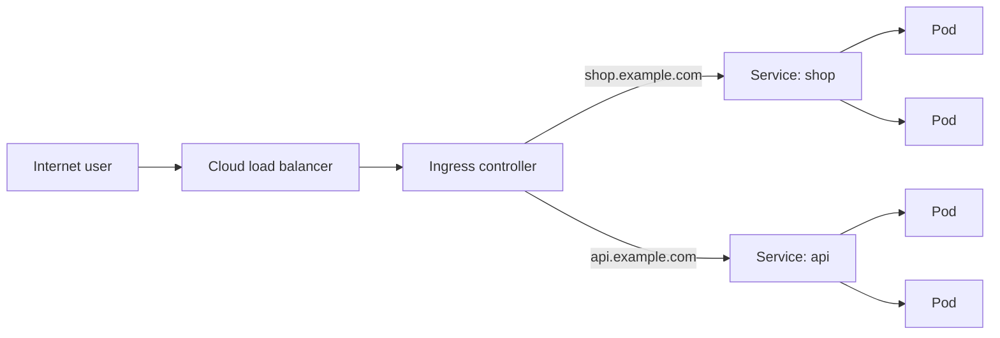

# 🌐 03 · Services, Ingress and Networking

> **In one line:** A Service gives a group of changing Pods one stable address, and an Ingress routes outside web traffic to the right Service.

## 🧠 Simple explanation

Pods come and go, and each new Pod has a new IP. If other apps had to track those IPs, nothing would work. A **Service** is like a company's main phone number: callers dial one number, and the call is passed to whichever employee is free. An **Ingress** is the reception desk at the building entrance: "Sales? Go to floor 2. Support? Go to floor 3." It looks at the web address and path and sends visitors to the right Service.



## 🔑 Key concepts

### Kubernetes network rules

- Every Pod gets its own IP.
- Any Pod can reach any other Pod by IP, without NAT (unless blocked by a policy).
- This is provided by a **CNI plugin** (Calico, Cilium, Flannel, and others).

### Service types

| Type | What it does | Use for |
|------|--------------|---------|
| `ClusterIP` (default) | Internal virtual IP, reachable only inside the cluster | Service-to-service calls |
| `NodePort` | Opens the same port (30000-32767) on every node | Quick tests, simple setups |
| `LoadBalancer` | Asks the cloud for an external load balancer | Exposing one service publicly |
| `ExternalName` | Maps to an external DNS name | Pointing to outside services |
| Headless (`clusterIP: None`) | No virtual IP, DNS returns Pod IPs | StatefulSets, custom discovery |

### How a Service finds Pods

A Service uses a **selector** (labels). Kubernetes keeps a list of healthy matching Pod IPs (EndpointSlices) and spreads traffic across them.

### DNS inside the cluster

Every Service gets a name: `<service>.<namespace>.svc.cluster.local`. Inside the same namespace you can use just `<service>`.

### Ingress

- **Ingress**: the rules (host and path to Service).
- **Ingress controller**: the program that obeys the rules (NGINX Ingress, Traefik, HAProxy, cloud-specific ones). You must install one. Without it, Ingress objects do nothing.
- Also handles TLS (HTTPS) certificates.
- The newer **Gateway API** is the modern, more flexible successor.

### Network Policy

A firewall for Pods. By default all Pods can talk to each other. A NetworkPolicy limits that (needs a CNI that supports it).

## 🛠️ Hands-on

### Deployment + ClusterIP Service

```yaml
# web.yaml
apiVersion: apps/v1
kind: Deployment
metadata:
  name: web
spec:
  replicas: 2
  selector:
    matchLabels: { app: web }
  template:
    metadata:
      labels: { app: web }
    spec:
      containers:
        - name: web
          image: nginx:1.27-alpine
          ports:
            - containerPort: 80
---
apiVersion: v1
kind: Service
metadata:
  name: web
spec:
  type: ClusterIP
  selector:
    app: web
  ports:
    - port: 80          # the Service port
      targetPort: 80    # the container port
```

```bash
kubectl apply -f web.yaml
kubectl get svc web
kubectl get endpointslices -l kubernetes.io/service-name=web
```

### Test it

```bash
# From your laptop
kubectl port-forward svc/web 8080:80
curl http://localhost:8080

# From inside the cluster
kubectl run tmp --rm -it --image=busybox:1.36 -- wget -qO- http://web
```

### Ingress with host and path rules

```yaml
apiVersion: networking.k8s.io/v1
kind: Ingress
metadata:
  name: web-ingress
spec:
  ingressClassName: nginx
  tls:
    - hosts: ["shop.example.com"]
      secretName: shop-tls
  rules:
    - host: shop.example.com
      http:
        paths:
          - path: /
            pathType: Prefix
            backend:
              service:
                name: web
                port:
                  number: 80
```

```bash
# Install the NGINX ingress controller with Helm (one option)
helm upgrade --install ingress-nginx ingress-nginx \
  --repo https://kubernetes.github.io/ingress-nginx \
  --namespace ingress-nginx --create-namespace
kubectl get ingress
```

### Block traffic with a NetworkPolicy

```yaml
apiVersion: networking.k8s.io/v1
kind: NetworkPolicy
metadata:
  name: allow-only-frontend
spec:
  podSelector:
    matchLabels: { app: web }
  policyTypes: [Ingress]
  ingress:
    - from:
        - podSelector:
            matchLabels: { role: frontend }
      ports:
        - port: 80
```

## ⚠️ Common mistakes

- **Service selector does not match Pod labels.** Result: no endpoints, no traffic. Check `kubectl get endpoints`.
- **Wrong `targetPort`.** The Service looks fine but connections fail.
- **Creating an Ingress without an Ingress controller.** Nothing happens.
- **Using NodePort in production** for everything. Use Ingress or LoadBalancer.
- **One LoadBalancer per service.** This costs a lot. Put many services behind one Ingress.
- **Assuming a Network Policy works.** It needs a CNI that enforces it.

## ✅ Quick recap

- Services give stable names and IPs and balance load across Pods.
- ClusterIP is internal, NodePort and LoadBalancer expose externally.
- Ingress routes web traffic by host and path, and needs a controller.
- Use NetworkPolicy to restrict who can talk to whom.

➡️ **Next:** [04 · ConfigMaps, Secrets and storage](04-configmaps-secrets-storage-pv-pvc.md)
