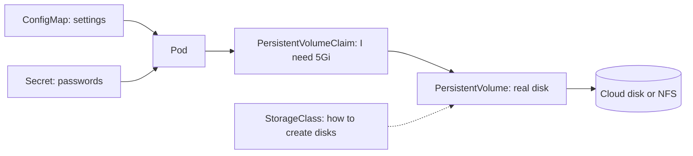
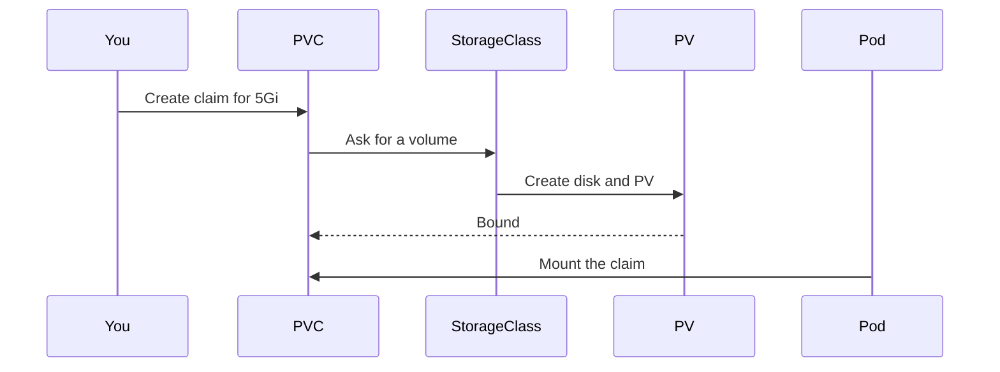

# 🗄️ 04 · ConfigMaps, Secrets and Storage

> **In one line:** ConfigMaps and Secrets keep settings out of your image, and PersistentVolumes keep data alive after a Pod dies.

## 🧠 Simple explanation

Your app is like an employee. The **image** is the employee's training: it should not change per workplace. The **ConfigMap** is the notice board with settings ("the office opens at 9"). The **Secret** is the locked drawer with passwords. **Storage** is the filing cabinet: Pods are temporary staff, but the cabinet stays even when the staff changes.



## 🔑 Key concepts

### Configuration

- **ConfigMap**: non-secret settings (URLs, feature flags, config files).
- **Secret**: sensitive values (passwords, tokens, keys). Stored **base64-encoded, which is NOT encryption**. Enable encryption at rest and tight RBAC, or use an external secrets tool.
- Both can be given to a Pod as **environment variables** or as **files** in a mounted volume. Mounted files update automatically after a short delay. Environment variables do not.

### Storage

- **Volume**: a folder available to containers in a Pod. Some types (`emptyDir`) die with the Pod.
- **PersistentVolume (PV)**: a piece of real storage in the cluster (cloud disk, NFS).
- **PersistentVolumeClaim (PVC)**: a request for storage by a user. "I need 5Gi, one node at a time."
- **StorageClass**: a template that creates PVs on demand (dynamic provisioning).
- **Access modes**: `ReadWriteOnce` (one node), `ReadOnlyMany`, `ReadWriteMany` (many nodes, needs shared storage), `ReadWriteOncePod`.
- **Reclaim policy**: `Delete` removes the disk when the PVC is deleted. `Retain` keeps it.



## 🛠️ Hands-on

### ConfigMap

```bash
kubectl create configmap app-config \
  --from-literal=LOG_LEVEL=info \
  --from-literal=API_URL=https://api.example.com
```

```yaml
apiVersion: v1
kind: ConfigMap
metadata:
  name: app-files
data:
  app.properties: |
    mode=production
    retries=3
```

### Secret

```bash
kubectl create secret generic db-secret \
  --from-literal=DB_USER=admin \
  --from-literal=DB_PASSWORD='S3cr3t!'

kubectl get secret db-secret -o jsonpath='{.data.DB_PASSWORD}' | base64 -d
```

### Use them in a Pod

```yaml
apiVersion: v1
kind: Pod
metadata:
  name: demo
spec:
  containers:
    - name: app
      image: busybox:1.36
      command: ["sh", "-c", "env | sort; cat /etc/config/app.properties; sleep 3600"]
      envFrom:
        - configMapRef:
            name: app-config          # all keys become env vars
      env:
        - name: DB_PASSWORD
          valueFrom:
            secretKeyRef:
              name: db-secret
              key: DB_PASSWORD
      volumeMounts:
        - name: cfg
          mountPath: /etc/config
          readOnly: true
  volumes:
    - name: cfg
      configMap:
        name: app-files
```

### Persistent storage

```yaml
apiVersion: v1
kind: PersistentVolumeClaim
metadata:
  name: data-pvc
spec:
  accessModes: ["ReadWriteOnce"]
  resources:
    requests:
      storage: 5Gi
  # storageClassName: standard     # omit to use the cluster default
---
apiVersion: v1
kind: Pod
metadata:
  name: writer
spec:
  containers:
    - name: app
      image: busybox:1.36
      command: ["sh", "-c", "date >> /data/log.txt; sleep 3600"]
      volumeMounts:
        - name: storage
          mountPath: /data
  volumes:
    - name: storage
      persistentVolumeClaim:
        claimName: data-pvc
```

```bash
kubectl get storageclass
kubectl get pvc,pv
kubectl delete pod writer && kubectl apply -f pod.yaml   # data still there
```

### StatefulSet with per-Pod disks

```yaml
volumeClaimTemplates:        # inside a StatefulSet spec
  - metadata:
      name: data
    spec:
      accessModes: ["ReadWriteOnce"]
      resources:
        requests:
          storage: 10Gi
```

## ⚠️ Common mistakes

- **Thinking base64 is security.** Anyone with read access can decode it. Restrict access, encrypt at rest, or use Vault or External Secrets.
- **Committing Secret YAML to Git.** Use Sealed Secrets, SOPS, or an external secret store.
- **Expecting env vars to refresh** after a ConfigMap changes. Restart the Pods (or mount as files).
- **Using `emptyDir` for important data.** It is deleted with the Pod.
- **Wrong access mode.** `ReadWriteOnce` disks cannot be mounted on many nodes at once.
- **Forgetting backups.** A PV is not a backup.

## ✅ Quick recap

- ConfigMap = settings. Secret = sensitive values (protect them properly).
- Inject as env vars or mounted files.
- PVC asks for storage. PV is the real disk. StorageClass creates disks on demand.
- Pods die, persistent volumes stay.

➡️ **Next:** [05 · Scaling, probes and rolling updates](05-scaling-hpa-probes-rolling-updates.md)
