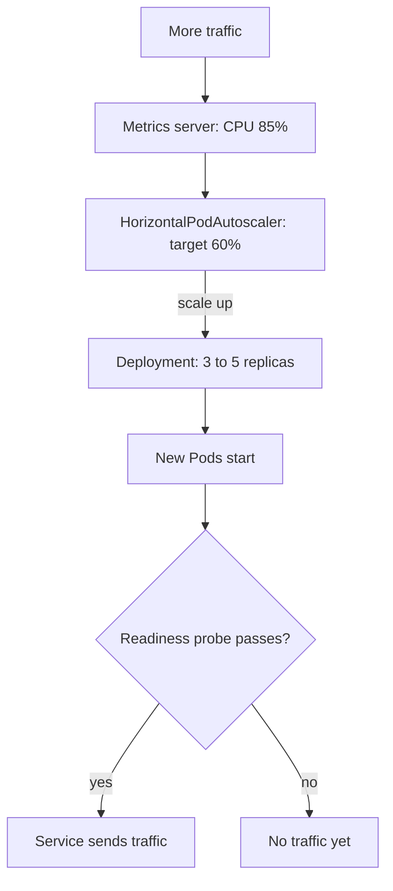
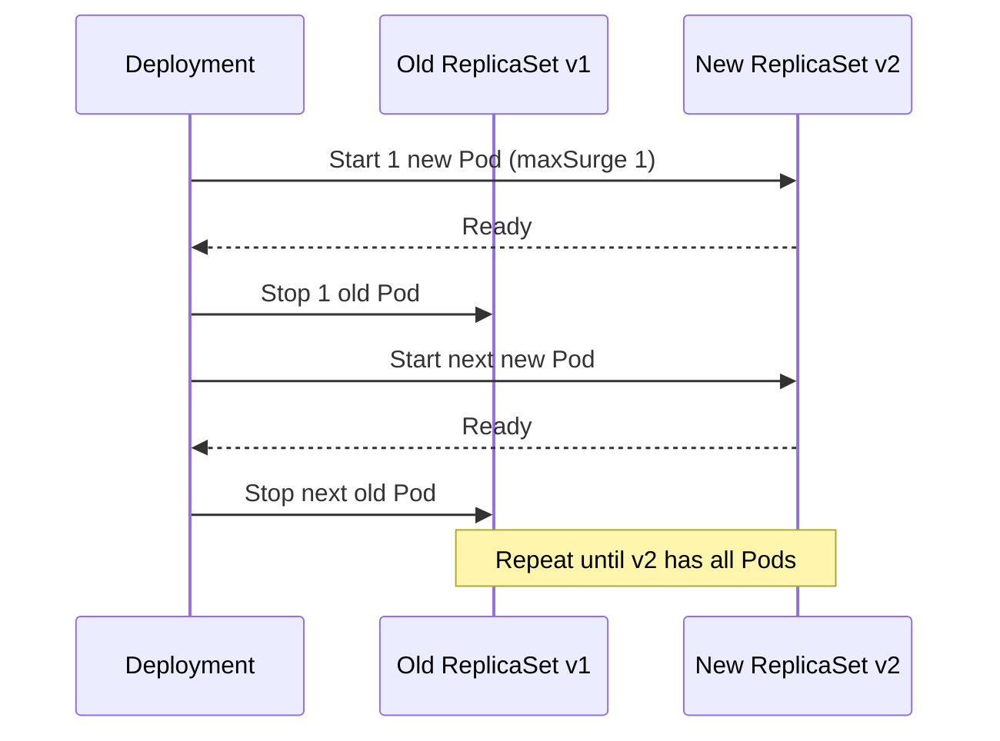

# 📈 05 · Scaling, Probes and Rolling Updates

> **In one line:** Probes tell Kubernetes if your app is healthy, autoscalers add or remove Pods with demand, and rolling updates replace versions without downtime.

## 🧠 Simple explanation

Think of a supermarket. **Probes** are the manager asking each cashier "Are you alive?" and "Are you ready for customers?" **Autoscaling** is opening more checkout lanes when the queue grows and closing them when it is quiet. A **rolling update** is changing the cashier uniforms one lane at a time, so the shop never closes.



## 🔑 Key concepts

### Probes

| Probe | Question | If it fails |
|-------|----------|-------------|
| **Startup** | Has the app finished starting? | Keep waiting; disables the other probes until it passes |
| **Liveness** | Is the app stuck or dead? | Kubernetes **restarts** the container |
| **Readiness** | Can the app take traffic now? | Pod is **removed from Service** (not restarted) |

Probe types: `httpGet`, `tcpSocket`, `exec` (run a command), and `grpc`.

### Resource requests and limits

- **Request**: the amount the scheduler reserves for the Pod.
- **Limit**: the maximum. Over the memory limit, the container is killed (`OOMKilled`). Over the CPU limit, it is slowed (throttled).

### Autoscaling

- **HPA (Horizontal Pod Autoscaler)**: changes the number of Pods based on CPU, memory, or custom metrics. Needs the **metrics-server**.
- **VPA (Vertical Pod Autoscaler)**: adjusts Pod requests and limits.
- **Cluster Autoscaler / Karpenter**: adds or removes **nodes** when Pods cannot fit or nodes are empty.

### Rolling update strategy

- **`maxUnavailable`**: how many Pods may be down during the update.
- **`maxSurge`**: how many extra Pods may be created above the desired count.
- Other option: `Recreate` (stop all, then start all, with downtime).



## 🛠️ Hands-on

### Deployment with probes, resources and update strategy

```yaml
apiVersion: apps/v1
kind: Deployment
metadata:
  name: api
spec:
  replicas: 3
  strategy:
    type: RollingUpdate
    rollingUpdate:
      maxUnavailable: 0
      maxSurge: 1
  selector:
    matchLabels: { app: api }
  template:
    metadata:
      labels: { app: api }
    spec:
      containers:
        - name: api
          image: myrepo/api:1.0.0
          ports:
            - containerPort: 8080
          resources:
            requests: { cpu: "200m", memory: "128Mi" }
            limits:   { cpu: "500m", memory: "256Mi" }
          startupProbe:
            httpGet: { path: /healthz, port: 8080 }
            failureThreshold: 30
            periodSeconds: 2
          readinessProbe:
            httpGet: { path: /ready, port: 8080 }
            periodSeconds: 5
          livenessProbe:
            httpGet: { path: /healthz, port: 8080 }
            periodSeconds: 10
            failureThreshold: 3
```

### Horizontal Pod Autoscaler

```bash
# Install metrics-server if needed (minikube: minikube addons enable metrics-server)
kubectl top pods

kubectl autoscale deployment api --cpu-percent=60 --min=3 --max=10
kubectl get hpa -w
```

Or as YAML:

```yaml
apiVersion: autoscaling/v2
kind: HorizontalPodAutoscaler
metadata:
  name: api
spec:
  scaleTargetRef:
    apiVersion: apps/v1
    kind: Deployment
    name: api
  minReplicas: 3
  maxReplicas: 10
  metrics:
    - type: Resource
      resource:
        name: cpu
        target:
          type: Utilization
          averageUtilization: 60
```

### Generate load to watch it scale

```bash
kubectl run load --rm -it --image=busybox:1.36 -- \
  sh -c 'while true; do wget -q -O- http://api:8080 >/dev/null; done'
```

### Rolling update and rollback

```bash
kubectl set image deployment/api api=myrepo/api:1.1.0
kubectl rollout status deployment/api
kubectl rollout pause deployment/api        # stop midway to check
kubectl rollout resume deployment/api
kubectl rollout undo deployment/api         # go back if it is bad
```

## ⚠️ Common mistakes

- **No readiness probe.** Traffic reaches Pods that are not ready, so users see errors during updates.
- **Liveness probe that checks dependencies** (like a database). A DB outage restarts every Pod. Keep liveness simple.
- **Liveness probe too aggressive** on a slow-starting app. Use a startup probe.
- **HPA without CPU requests.** Utilization percentage cannot be computed.
- **Setting `minReplicas: 1`** for important services. One Pod means downtime on any restart.
- **Memory limit too low.** Constant `OOMKilled` restarts.

## ✅ Quick recap

- Readiness controls traffic. Liveness controls restarts. Startup protects slow starters.
- Requests are for scheduling, limits are the ceiling.
- HPA scales Pods, Cluster Autoscaler scales nodes.
- Rolling updates with `maxUnavailable: 0` give zero-downtime releases, and `rollout undo` is your safety net.

➡️ **Next:** [06 · RBAC, namespaces and kubectl cheatsheet](06-rbac-namespaces-and-kubectl-cheatsheet.md)
