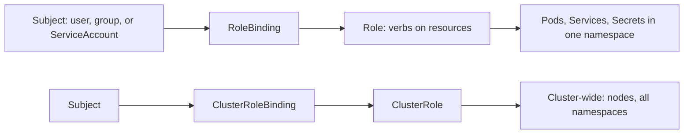

# 🔐 06 · RBAC, Namespaces and kubectl Cheatsheet

> **In one line:** Namespaces split a cluster into separate areas, RBAC decides who may do what, and kubectl is the tool you use every day.

## 🧠 Simple explanation

A cluster is a big office building. **Namespaces** are the floors: Team A on floor 1, Team B on floor 2, each with their own rooms. **RBAC** (Role-Based Access Control) is the key-card system: a card (Role) says "may open these doors," and you hand the card to a person or a robot (the subject) with a **binding**. **kubectl** is how you talk to the building manager.



## 🔑 Key concepts

### Namespaces

- Group and separate objects. Names must be unique **inside** a namespace, not across.
- Default ones: `default`, `kube-system` (system parts), `kube-public`, `kube-node-lease`.
- Use them per team, per app, or per environment (dev, staging, prod).
- Combine with **ResourceQuota** (limit total CPU, memory, and object count) and **LimitRange** (default and maximum per Pod).
- A namespace is **not** a strong security wall by itself. Pair it with RBAC and NetworkPolicy.

### RBAC building blocks

- **Role**: permissions inside one namespace.
- **ClusterRole**: permissions cluster-wide, or on cluster-level objects like nodes.
- **RoleBinding**: gives a Role (or ClusterRole) to a subject **in one namespace**.
- **ClusterRoleBinding**: gives a ClusterRole to a subject across the whole cluster.
- **ServiceAccount**: an identity for Pods (apps), not humans.
- **Verbs**: `get`, `list`, `watch`, `create`, `update`, `patch`, `delete`.
- RBAC is **additive**: there are no deny rules. If no rule allows it, it is denied.

### Contexts

A **kubeconfig** file (`~/.kube/config`) stores clusters, users, and **contexts** (cluster + user + default namespace). You switch between clusters by switching context.

## 🛠️ Hands-on

### Namespaces and quotas

```bash
kubectl create namespace dev
kubectl get ns
kubectl config set-context --current --namespace=dev   # default to dev
```

```yaml
apiVersion: v1
kind: ResourceQuota
metadata:
  name: dev-quota
  namespace: dev
spec:
  hard:
    requests.cpu: "4"
    requests.memory: 8Gi
    limits.cpu: "8"
    limits.memory: 16Gi
    pods: "20"
```

### Read-only access for one app (ServiceAccount + Role)

```yaml
apiVersion: v1
kind: ServiceAccount
metadata:
  name: pod-reader
  namespace: dev
---
apiVersion: rbac.authorization.k8s.io/v1
kind: Role
metadata:
  name: pod-reader
  namespace: dev
rules:
  - apiGroups: [""]
    resources: ["pods", "pods/log"]
    verbs: ["get", "list", "watch"]
---
apiVersion: rbac.authorization.k8s.io/v1
kind: RoleBinding
metadata:
  name: read-pods
  namespace: dev
subjects:
  - kind: ServiceAccount
    name: pod-reader
    namespace: dev
roleRef:
  kind: Role
  name: pod-reader
  apiGroup: rbac.authorization.k8s.io
```

### Test permissions

```bash
kubectl auth can-i list pods -n dev --as=system:serviceaccount:dev:pod-reader   # yes
kubectl auth can-i delete pods -n dev --as=system:serviceaccount:dev:pod-reader # no
kubectl auth can-i --list -n dev
```

### Contexts

```bash
kubectl config get-contexts
kubectl config use-context kind-demo
kubectl config current-context
```

### kubectl cheatsheet

```bash
# Look
kubectl get pods -o wide                          # more columns
kubectl get pod web -o yaml                       # full object
kubectl get pods -l app=web                       # filter by label
kubectl get events --sort-by=.lastTimestamp       # recent events
kubectl top nodes && kubectl top pods             # usage (needs metrics-server)
kubectl explain deployment.spec.strategy          # built-in docs

# Change
kubectl apply -f dir/                             # apply a whole folder
kubectl edit deploy/web                           # edit live (avoid in prod)
kubectl label pod web tier=frontend
kubectl scale deploy/web --replicas=4
kubectl rollout restart deploy/web
kubectl delete pod web --grace-period=0 --force   # last resort

# Debug
kubectl describe pod web
kubectl logs web -c sidecar --tail=100
kubectl exec -it web -- sh
kubectl debug -it web --image=busybox:1.36 --target=web
kubectl port-forward pod/web 8080:80
kubectl cp web:/tmp/file.txt ./file.txt

# Generate YAML fast
kubectl create deploy web --image=nginx --dry-run=client -o yaml > web.yaml
kubectl diff -f web.yaml                          # preview changes
```

### Handy shortcuts

```bash
alias k=kubectl
source <(kubectl completion bash)       # tab completion
complete -o default -F __start_kubectl k
# Short names: po pods, svc services, deploy deployments, ns namespaces, cm configmaps, pvc persistentvolumeclaims
```

## ⚠️ Common mistakes

- **Giving `cluster-admin` to everyone.** Use the least privilege that works.
- **Using the `default` namespace and `default` ServiceAccount for everything.** Create specific ones.
- **Wildcards (`*`) in RBAC rules.** They grant more than you think.
- **Running `kubectl` against the wrong cluster.** Check `current-context` before deleting anything. Prompts that show the context help.
- **Using `kubectl edit` in production.** Changes are not in Git and are lost or cause drift.
- **Thinking namespaces isolate the network.** They do not. Add NetworkPolicies.

## ✅ Quick recap

- Namespaces organize and can have quotas.
- RBAC = Role (what) + Binding (who). Additive, least privilege.
- Use ServiceAccounts for apps and `kubectl auth can-i` to verify.
- Learn `get`, `describe`, `logs`, `exec`, `apply`, `rollout` first.

🎉 **You finished the Kubernetes guide.** Next, try [Helm and GitOps](../../helm-and-gitops/README.md) to deploy apps in a cleaner way.

⬅️ **Back:** [05 · Scaling, probes and rolling updates](05-scaling-hpa-probes-rolling-updates.md)
