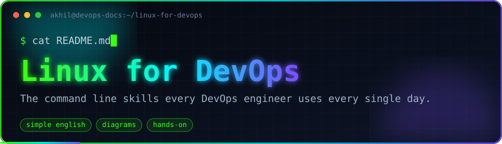

  
  
  
  

---

## 💡 Why this repo

Almost every server, container, and cloud machine runs Linux. If you can move around the terminal, manage users and services, search logs, and fix slow servers, you can handle most DevOps tasks. This repo teaches those skills in plain English with diagrams and copy-paste commands.

## 🗺️ Learning path

## 📚 Table of contents

| # | Doc | What you will learn |
|---|-----|---------------------|
| 01 | [Linux Basics and Filesystem](docs/01-linux-basics-and-filesystem.md) | Shell, navigation, the directory tree |
| 02 | [Users, Permissions, Ownership](docs/02-users-permissions-ownership.md) | chmod, chown, sudo, groups |
| 03 | [Processes and systemd](docs/03-processes-and-services-systemd.md) | ps, top, kill, and managing services |
| 04 | [Package Management and cron](docs/04-package-management-and-cron.md) | apt, yum/dnf, scheduled jobs |
| 05 | [Text Processing: grep, sed, awk](docs/05-text-processing-grep-sed-awk.md) | Search and transform logs fast |
| 06 | [SSH and Troubleshooting Performance](docs/06-ssh-and-troubleshooting-performance.md) | Remote access and finding slow spots |

## 🧾 Quick cheat sheet

| Task | Command |
|------|---------|
| Where am I? | `pwd` |
| List files with details | `ls -lah` |
| Change permission | `chmod 640 file` |
| Change owner | `sudo chown user:group file` |
| Show running processes | `ps aux` or `top` |
| Start / status of a service | `sudo systemctl start nginx` / `systemctl status nginx` |
| Search text in files | `grep -rni "error" /var/log` |
| Disk / memory | `df -h` / `free -h` |
| Follow a log | `tail -f /var/log/syslog` |
| Connect to a server | `ssh user@host` |

---

Part of the DevOps Hub by <a href="https://github.com/Akhilgoud01">@Akhilgoud01</a> — ⭐ star if it helped

