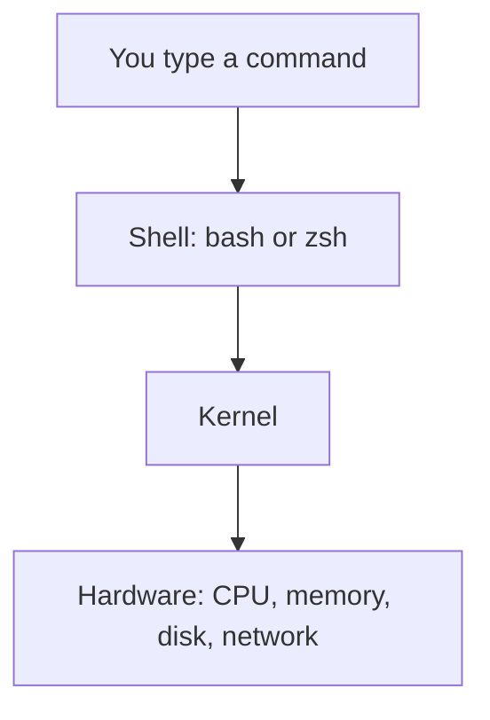
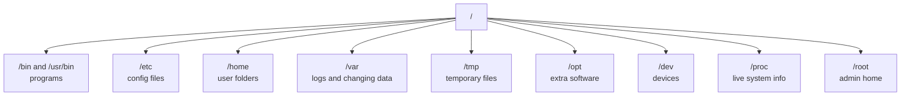

# 🐧 Linux Basics and the Filesystem

> **In one line:** Linux is an operating system you control mostly through a text shell, and everything on it lives in one big tree of folders that starts at `/`.

## 🧠 Simple explanation

Think of a building. The **kernel** is the building's engine room (it talks to the hardware). The **shell** is the reception desk where you type requests. The **filesystem** is the floor plan: every room (folder) and cabinet (file) has an address, called a **path**.

On Linux there are no drive letters like `C:`. There is one tree. The top is `/` (called "root").



## 🌳 The directory tree



| Path | What lives there |
|------|------------------|
| `/etc` | Configuration, for example `/etc/nginx/nginx.conf` |
| `/var/log` | Log files, for example `/var/log/syslog` |
| `/home/alice` | Alice's personal files |
| `/tmp` | Temporary files, often cleared on reboot |
| `/proc` | A virtual view of processes and kernel info |
| `/usr/bin` | Most user programs |

## 🔑 Key concepts

- **Everything is a file** (files, folders, devices, even running process info).
- **Absolute path** starts with `/` (`/etc/hosts`). **Relative path** starts from where you are (`../logs`).
- **Special names:** `.` is the current folder, `..` is the parent, `~` is your home.
- **Hidden files** start with a dot (`.bashrc`).
- **Case sensitive:** `File.txt` and `file.txt` are different.
- **Distribution (distro):** a packaged version of Linux, such as Ubuntu, Debian, RHEL, Rocky, Amazon Linux.

## 🛠️ Hands-on

### Move around

```bash
pwd                 # print current folder
ls                  # list files
ls -lah             # long format, hidden files, human sizes
cd /etc             # go to /etc
cd ..               # up one level
cd ~                # home
cd -                # back to the previous folder
```

### Create, copy, move, delete

```bash
mkdir -p demo/logs          # create nested folders
touch demo/notes.txt        # create an empty file
cp demo/notes.txt demo/copy.txt
mv demo/copy.txt demo/logs/ # move
rm demo/logs/copy.txt       # delete a file
rm -r demo                  # delete a folder and everything inside (careful!)
```

### Look inside files

```bash
cat /etc/os-release         # print whole file
less /var/log/syslog        # scroll (q to quit)
head -n 10 file.txt         # first 10 lines
tail -n 10 file.txt         # last 10 lines
tail -f /var/log/syslog     # follow new lines live
wc -l file.txt              # count lines
```

### Find things

```bash
find /etc -name "*.conf"            # find by name
find . -type f -size +100M          # files bigger than 100 MB
which python3                       # where is this command?
man ls                              # manual page (q to quit)
ls --help                           # quick help
```

### Pipes and redirects

```bash
ls -l | wc -l               # pipe: send output of one command into another
echo "hello" > out.txt      # write (overwrite)
echo "more" >> out.txt      # append
command 2> errors.txt       # save error messages only
command > all.txt 2>&1      # save both normal output and errors
```

### Environment variables

```bash
echo $HOME
export APP_ENV=production
env | grep APP_ENV
```

## ⚠️ Common mistakes

- **`rm -rf /` or `rm -rf *` in the wrong folder.** Always run `pwd` first and double-check.
- **Forgetting quotes around names with spaces.** Use `"my file.txt"`.
- **Editing files in `/etc` without a backup.** Run `cp file file.bak` first.
- **Using `>` when you meant `>>`.** `>` erases the file first.
- **Confusing relative and absolute paths** inside scripts and cron jobs.

## ✅ Quick recap

- Linux has one tree starting at `/`.
- `/etc` is config, `/var/log` is logs, `/home` is users.
- Learn `ls`, `cd`, `cp`, `mv`, `rm`, `cat`, `less`, `tail -f`, `find`.
- Pipes (`|`) connect small commands into powerful ones.

➡️ Next: [02 - Users, Permissions, Ownership](02-users-permissions-ownership.md)
