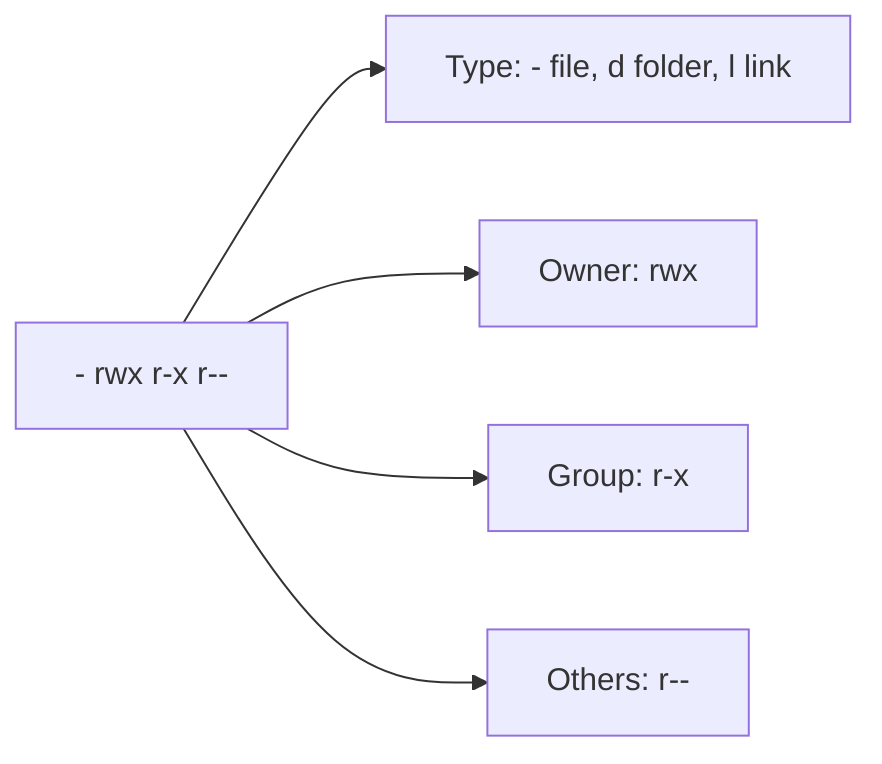
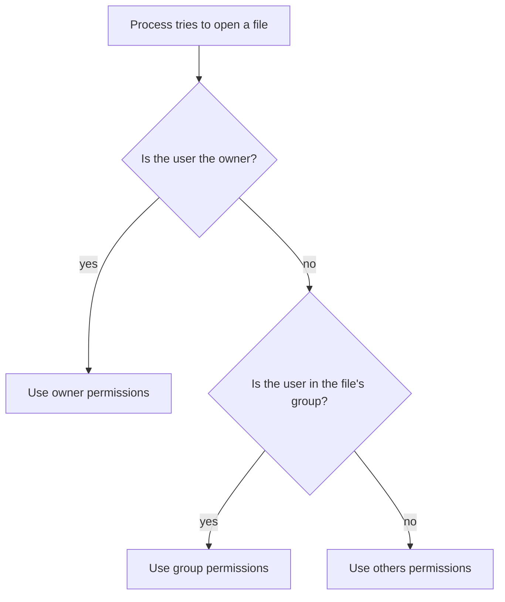

# 🔐 Users, Permissions, and Ownership

> **In one line:** Every file has an owner, a group, and three sets of read/write/execute permissions that decide who can do what.

## 🧠 Simple explanation

Imagine an office building with key cards. Each room has rules: the **owner** of the room can do anything, the **team** (group) can do some things, and **visitors** (others) can do very little. Linux works like this for every file.

## 🧩 How permissions look

Run `ls -l`:

```text
-rwxr-xr--  1 alice devs  1204 Oct 31 10:00 deploy.sh
```



| Letter | Meaning on a file | Meaning on a folder | Number |
|--------|-------------------|---------------------|--------|
| `r` | read content | list names | 4 |
| `w` | change content | create or delete files inside | 2 |
| `x` | run as a program | enter (cd) | 1 |

Add the numbers per group: `rwx` = 4+2+1 = **7**, `r-x` = **5**, `r--` = **4**. So `-rwxr-xr--` is **754**.

## 🔑 Key concepts

- **User:** an account. **Group:** a set of users sharing access.
- **root:** the superuser who can do anything (UID 0).
- **sudo:** run one command with admin power. Safer than logging in as root.
- **Owner / group / others:** the three permission classes.
- **umask:** the default permissions removed from new files.
- **Special bits:** `setuid`, `setgid`, and the **sticky bit** (used on `/tmp` so users cannot delete each other's files).



## 🛠️ Hands-on

### Users and groups

```bash
whoami                         # my username
id                             # my user id and groups
sudo useradd -m -s /bin/bash bob     # create user with home folder
sudo passwd bob                # set password
sudo groupadd devs             # create a group
sudo usermod -aG devs bob      # add bob to devs (-a is important: append!)
groups bob
sudo userdel -r bob            # delete user and home
```

### Change permissions

```bash
chmod 755 script.sh            # rwxr-xr-x
chmod 640 secret.txt           # rw-r-----
chmod u+x script.sh            # add execute for the owner
chmod g-w file.txt             # remove write for the group
chmod -R 750 /opt/app          # recursive (careful)
```

### Change owner

```bash
sudo chown alice file.txt              # change owner
sudo chown alice:devs file.txt         # owner and group
sudo chown -R www-data:www-data /var/www/html
```

### sudo

```bash
sudo apt update                # run one command as root
sudo -i                        # open a root shell (use sparingly)
sudo visudo                    # safely edit /etc/sudoers
```

Example line giving the `devs` group passwordless access to restart nginx only:

```text
%devs ALL=(root) NOPASSWD: /usr/bin/systemctl restart nginx
```

### SSH key file rules (a classic)

```bash
chmod 700 ~/.ssh
chmod 600 ~/.ssh/id_ed25519
chmod 644 ~/.ssh/id_ed25519.pub
```

### Quick table of common modes

| Mode | Meaning | Use for |
|------|---------|---------|
| 644 | owner rw, others r | normal files |
| 600 | owner rw only | secrets, private keys |
| 755 | owner rwx, others rx | scripts, folders |
| 700 | owner only | private folders |

## ⚠️ Common mistakes

- **`chmod 777`** "to make it work". It lets everyone change the file. Find the real cause instead.
- **`usermod -G` without `-a`.** It replaces all groups and can lock you out of sudo.
- **Running everything as root.** One typo can destroy the system.
- **Wrong SSH key permissions.** SSH refuses keys that others can read.
- **Forgetting that folders need `x`** to be entered.

## ✅ Quick recap

- Permissions are `r`, `w`, `x` for owner, group, and others (4, 2, 1).
- `chmod` changes permissions, `chown` changes owner and group.
- Prefer `sudo` for single admin tasks. Never use `777`.
- Use groups to share access cleanly.

⬅️ Previous: [01 - Basics and Filesystem](01-linux-basics-and-filesystem.md) | ➡️ Next: [03 - Processes and systemd](03-processes-and-services-systemd.md)
