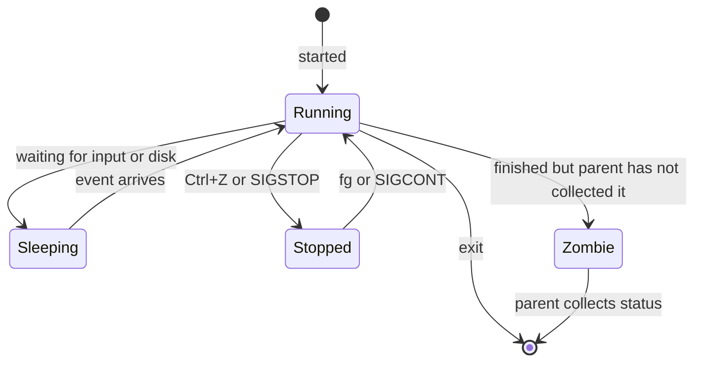
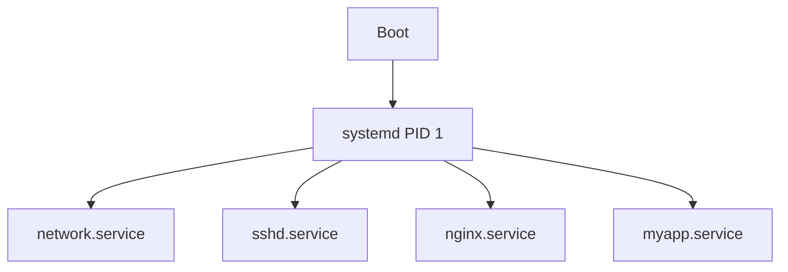

# ⚙️ Processes and Services (systemd)

> **In one line:** A process is a running program, and systemd is the manager that starts, stops, and restarts the long-running programs (services) on a modern Linux server.

## 🧠 Simple explanation

A program on disk is like a recipe in a book. When you cook it, it becomes a **process**. Each process gets a number (PID). A **service** (or daemon) is a process that keeps running in the background, like a restaurant's oven that stays on all day. **systemd** is the kitchen manager: it turns ovens on at opening time, restarts them if they break, and keeps notes in a log.

## 🔄 Process life



## 🔑 Key concepts

- **PID:** process ID. **PPID:** parent process ID. PID 1 is the first process (systemd).
- **Foreground / background:** `command &` runs in the background.
- **Signals:** messages to processes. `SIGTERM (15)` asks nicely to stop. `SIGKILL (9)` forces it. `SIGHUP (1)` often means "reload config".
- **Unit:** a thing systemd manages. Types: `.service`, `.timer`, `.socket`, `.mount`.
- **Enabled vs active:** *enabled* = starts at boot. *active* = running right now.
- **journald:** systemd's log system, read with `journalctl`.



## 🛠️ Hands-on

### Look at processes

```bash
ps aux                          # all processes
ps aux | grep nginx             # find one
ps -ef --forest                 # tree view
top                             # live view (q to quit)
htop                            # nicer top, if installed
pgrep -a nginx                  # find PIDs by name
```

### Stop processes

```bash
kill 1234                       # polite stop (SIGTERM)
kill -9 1234                    # force kill (last resort)
pkill nginx                     # by name
killall python3
```

### Foreground and background

```bash
sleep 300 &                     # run in the background
jobs                            # list background jobs
fg %1                           # bring job 1 to the front
nohup ./long_task.sh > out.log 2>&1 &   # keep running after logout
```

### Manage services with systemctl

```bash
sudo systemctl start nginx
sudo systemctl stop nginx
sudo systemctl restart nginx
sudo systemctl reload nginx        # reload config without dropping connections
sudo systemctl enable nginx        # start at boot
sudo systemctl enable --now nginx  # enable and start in one go
systemctl status nginx             # state plus last log lines
systemctl is-active nginx
systemctl list-units --type=service --state=running
systemctl --failed                 # what is broken?
```

### Read logs with journalctl

```bash
journalctl -u nginx                 # logs for one service
journalctl -u nginx -f              # follow live
journalctl -u nginx --since "1 hour ago"
journalctl -p err -b                # errors since last boot
```

### Write your own service

Create `/etc/systemd/system/myapp.service`:

```ini
[Unit]
Description=My Demo App
After=network.target

[Service]
Type=simple
User=www-data
WorkingDirectory=/opt/myapp
ExecStart=/usr/bin/python3 /opt/myapp/app.py
Restart=on-failure
RestartSec=5
Environment=APP_ENV=production

[Install]
WantedBy=multi-user.target
```

```bash
sudo systemctl daemon-reload          # tell systemd about the new file
sudo systemctl enable --now myapp
systemctl status myapp
```

## ⚠️ Common mistakes

- **Jumping to `kill -9`.** It skips cleanup. Try `kill` first.
- **Forgetting `daemon-reload`** after editing a unit file.
- **Enabling but not starting** (or starting but not enabling). They are separate.
- **Not reading `journalctl`** when a service fails. The reason is almost always there.
- **Using relative paths in `ExecStart`.** Use full paths.

## ✅ Quick recap

- A process is a running program; a service is a long-running background process.
- `ps`, `top`, and `kill` inspect and control processes.
- `systemctl` manages services; `journalctl` shows their logs.
- Unit files in `/etc/systemd/system` define your own services.

⬅️ Previous: [02 - Users, Permissions, Ownership](02-users-permissions-ownership.md) | ➡️ Next: [04 - Package Management and cron](04-package-management-and-cron.md)
