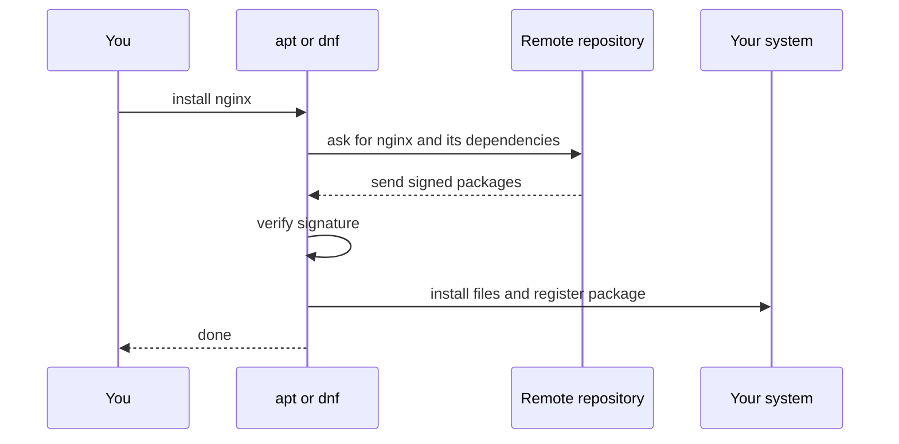
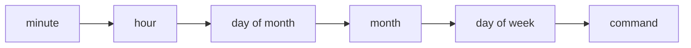

# 📦 Package Management and cron

> **In one line:** Package managers install and update software safely from trusted sources, and cron runs commands automatically on a schedule.

## 🧠 Simple explanation

A package manager is like an app store for your server. Instead of downloading files from random websites, you ask the store for "nginx" and it installs it, plus everything nginx needs (dependencies), and tells you when updates exist.

Cron is like an alarm clock for commands: "Every night at 2 AM, run the backup script."

## 🏪 How a package manager works



| Family | Distros | Tool | Package file |
|--------|---------|------|--------------|
| Debian | Debian, Ubuntu | `apt`, `dpkg` | `.deb` |
| Red Hat | RHEL, Rocky, Alma, Fedora, Amazon Linux | `dnf` (or `yum`), `rpm` | `.rpm` |

## 🔑 Key concepts

- **Repository (repo):** a server holding packages.
- **Dependency:** other packages needed to make one work.
- **Update vs upgrade:** on apt, `update` refreshes the *list* of packages; `upgrade` installs newer versions.
- **Signature:** proves the package was not changed.
- **Pinning versions:** locking a package to a known version to avoid surprises.
- **cron:** the scheduler. **crontab:** the table of scheduled jobs.

## 🛠️ Hands-on: packages

### Ubuntu / Debian (apt)

```bash
sudo apt update                       # refresh package list
sudo apt upgrade -y                   # install updates
sudo apt install -y nginx curl git    # install
apt search redis                      # search
apt show nginx                        # details
sudo apt remove nginx                 # remove (keep config)
sudo apt purge nginx                  # remove with config
sudo apt autoremove -y                # clean unused dependencies
dpkg -l | grep nginx                  # is it installed?
```

### RHEL / Rocky / Amazon Linux (dnf)

```bash
sudo dnf check-update
sudo dnf install -y nginx
sudo dnf remove nginx
dnf search redis
rpm -qa | grep nginx
```

### Add a repository safely (concept)

Always import the vendor's signing key and verify it. Prefer the official docs of the tool you are installing.

### Hold a version

```bash
sudo apt-mark hold nginx              # do not upgrade this one
sudo apt-mark unhold nginx
```

## 🛠️ Hands-on: cron

### Cron time format

```text
┌───────── minute (0-59)
│ ┌─────── hour (0-23)
│ │ ┌───── day of month (1-31)
│ │ │ ┌─── month (1-12)
│ │ │ │ ┌─ day of week (0-6, Sunday=0)
│ │ │ │ │
* * * * *  command
```



| Schedule | Meaning |
|----------|---------|
| `*/5 * * * *` | every 5 minutes |
| `0 2 * * *` | every day at 02:00 |
| `30 3 * * 1` | every Monday at 03:30 |
| `0 0 1 * *` | first day of each month at midnight |
| `@reboot` | once at boot |

### Manage jobs

```bash
crontab -e            # edit your jobs
crontab -l            # list them
sudo crontab -u bob -l
```

Example crontab:

```bash
# Daily backup at 2 AM, log output, and always use full paths
0 2 * * * /usr/local/bin/backup.sh >> /var/log/backup.log 2>&1

# Clean temp files every Sunday at 4 AM
0 4 * * 0 find /tmp -type f -mtime +7 -delete
```

Check that cron ran your job:

```bash
grep CRON /var/log/syslog          # Debian/Ubuntu
journalctl -u cron                 # or: journalctl -u crond on RHEL
```

### Modern option: systemd timers

```ini
# /etc/systemd/system/backup.timer
[Unit]
Description=Run backup daily

[Timer]
OnCalendar=*-*-* 02:00:00
Persistent=true

[Install]
WantedBy=timers.target
```

```bash
sudo systemctl enable --now backup.timer
systemctl list-timers
```

## ⚠️ Common mistakes

- **Forgetting `apt update`** before `apt install`, then getting "package not found".
- **Cron's tiny environment.** `PATH` is minimal; use full paths for commands and scripts.
- **No logging in cron jobs.** Redirect with `>> file 2>&1`, or you will never see errors.
- **Wrong timezone.** Cron uses the server time. Check with `date`.
- **Installing with `curl | sudo bash` from unknown sites.** Review scripts first.
- **Mixing apt and manual installs** of the same tool.

## ✅ Quick recap

- `apt` (Debian family) and `dnf` (Red Hat family) install and update software.
- `update` refreshes lists; `upgrade` installs new versions.
- Cron format is: minute, hour, day, month, weekday.
- Use full paths and log output in cron jobs; consider systemd timers.

⬅️ Previous: [03 - Processes and systemd](03-processes-and-services-systemd.md) | ➡️ Next: [05 - Text Processing: grep, sed, awk](05-text-processing-grep-sed-awk.md)
