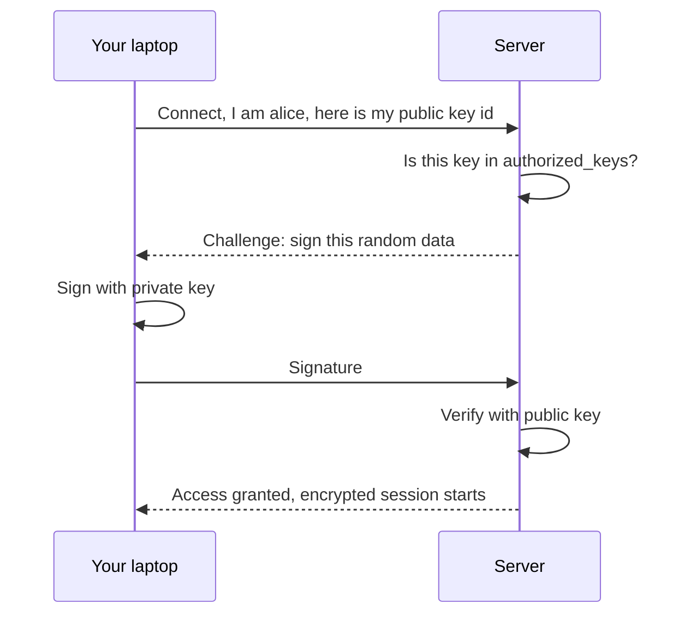
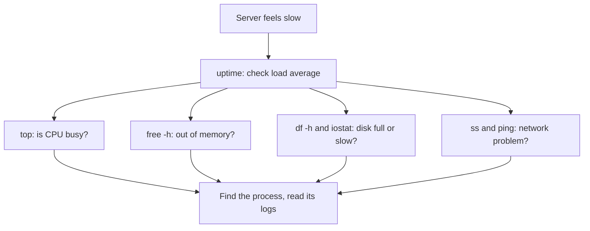

# 🔧 SSH and Troubleshooting Performance

> **In one line:** SSH is the safe way to log in to remote servers, and a short checklist of commands (CPU, memory, disk, network) finds why a server is slow.

## 🧠 Simple explanation

**SSH** is a secure phone line to another computer. Everything you type is encrypted. Instead of a password you can use a **key pair**: a *private key* (your secret key, never shared) and a *public key* (a lock you place on servers). Only your private key opens that lock.

**Troubleshooting** is like being a doctor. You check vital signs in a fixed order: CPU (heart), memory (lungs), disk (stomach), network (circulation).

## 🔐 How SSH key login works



## 🔑 Key concepts

- **Key pair:** `id_ed25519` (private) and `id_ed25519.pub` (public).
- **authorized_keys:** file on the server listing allowed public keys (`~/.ssh/authorized_keys`).
- **known_hosts:** your laptop's list of servers it has already trusted.
- **Bastion / jump host:** a hardened server used as the single entry to a private network.
- **Port forwarding (tunnel):** reach a private service through SSH.
- **Load average:** average number of processes waiting for CPU over 1, 5, and 15 minutes.

## 🛠️ Hands-on: SSH

```bash
# 1. Create a key pair (ed25519 is modern and short)
ssh-keygen -t ed25519 -C "you@example.com"

# 2. Copy your public key to the server
ssh-copy-id user@203.0.113.10

# 3. Connect
ssh user@203.0.113.10
ssh -i ~/.ssh/id_ed25519 -p 2222 user@203.0.113.10

# 4. Run one command remotely
ssh user@host "df -h"

# 5. Copy files
scp ./file.txt user@host:/tmp/
scp -r ./folder user@host:/tmp/
rsync -avz ./folder/ user@host:/opt/folder/

# 6. Jump through a bastion
ssh -J user@bastion.example.com user@10.0.1.20

# 7. Local port forward: open localhost:5432 to a private database
ssh -L 5432:db.internal:5432 user@bastion.example.com
```

Save typing with `~/.ssh/config`:

```text
Host web1
    HostName 203.0.113.10
    User ubuntu
    IdentityFile ~/.ssh/id_ed25519

Host private-*
    ProxyJump bastion
    User ubuntu

Host bastion
    HostName bastion.example.com
    User ubuntu
```

Now `ssh web1` is enough.

### Harden the SSH server

Edit `/etc/ssh/sshd_config`, then test and reload:

```text
PermitRootLogin no
PasswordAuthentication no
PubkeyAuthentication yes
```

```bash
sudo sshd -t                       # check syntax first!
sudo systemctl reload ssh          # service is "sshd" on RHEL
```

Keep your current session open while you test a second login, so you cannot lock yourself out.

## 🩺 Hands-on: performance checklist



```bash
uptime                       # load average: 3 numbers
top                          # press 1 for per-CPU, M sort by memory, P by CPU
free -h                      # memory (look at "available", not "free")
df -h                        # disk space per filesystem
df -i                        # inode usage (full inodes also stop file creation)
du -sh /var/* | sort -h      # which folder is big?
iostat -xz 1 3               # disk speed (package: sysstat)
vmstat 1 5                   # CPU, memory, swap, IO in one view
ss -tulpn                    # listening ports and their processes
dmesg -T | tail -50          # kernel messages (OOM killer shows up here)
journalctl -p err -b         # errors since boot
lsof -i :80                  # who is using port 80?
```

How to read the results:

| Symptom | Likely meaning | Next step |
|---------|----------------|-----------|
| Load average higher than CPU cores | CPU or IO is saturated | `top`, then `iostat` |
| Low "available" memory, swap in use | Memory pressure | find big process with `top` (sort by `M`) |
| `df -h` shows 100 percent | Disk full | `du -sh`, clear old logs |
| High `%wa` in top | Waiting on disk | `iostat`, check slow disk |
| "Out of memory: Killed process" in `dmesg` | OOM killer stopped something | add memory or fix a leak |

## ⚠️ Common mistakes

- **Sharing or committing a private key.** Treat `id_ed25519` like a password. Never push it to Git.
- **Leaving password login on** for internet-facing servers.
- **Restarting SSH without testing** the config, then losing access.
- **Reading "free" memory instead of "available".** Linux uses spare memory for cache, which is good.
- **Deleting big log files that a process still has open.** Space is not freed until the process restarts; truncate with `: > file` instead.
- **Guessing instead of measuring.** Check one resource at a time with data.

## ✅ Quick recap

- Use SSH keys, disable password login, and use `~/.ssh/config` for shortcuts.
- Bastion hosts and port forwarding reach private resources safely.
- Troubleshoot in order: `uptime`, `top`, `free`, `df`, `iostat`, `ss`, logs.
- Always find the process and read its log before changing anything.

🎉 You finished Linux for DevOps. Next, explore [git-and-github](../../git-and-github/README.md).

⬅️ Previous: [05 - Text Processing: grep, sed, awk](05-text-processing-grep-sed-awk.md)
