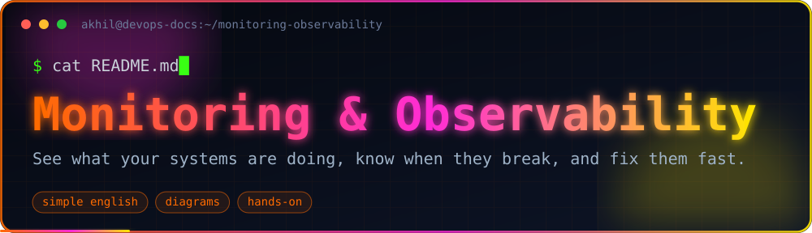

<p align="center"></p>

<p align="center">
  
  
  
</p>

---|-----|---------------------|
| 01 | [Monitoring vs observability](docs/01-monitoring-vs-observability.md) | Metrics, logs, traces, golden signals, SLOs |
| 02 | [Prometheus and PromQL](docs/02-prometheus-and-promql.md) | Scraping, exporters, queries |
| 03 | [Grafana dashboards and alerting](docs/03-grafana-dashboards-and-alerting.md) | Build dashboards and useful alerts |
| 04 | [Logging with ELK and Loki](docs/04-logging-elk-loki.md) | Collect, store, and search logs |
| 05 | [Tracing, OpenTelemetry, and incident response](docs/05-tracing-opentelemetry-and-incident-response.md) | Traces, on-call, runbooks, postmortems |

## ⚡ Quick cheat sheet

```promql
up                                              # is the target alive?
rate(http_requests_total[5m])                   # requests per second
sum by (job) (rate(http_requests_total[5m]))
histogram_quantile(0.95, sum by (le) (rate(http_request_duration_seconds_bucket[5m])))
```

```bash
docker compose up -d      # run the demo stack from doc 02 and 03
curl -s localhost:9090/-/healthy
```

---
Part of the DevOps Hub by [@Akhilgoud01](https://github.com/Akhilgoud01) — ⭐ star if it helped
