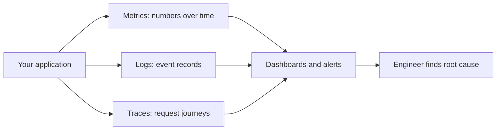
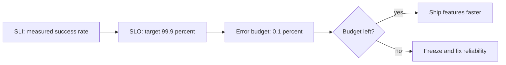
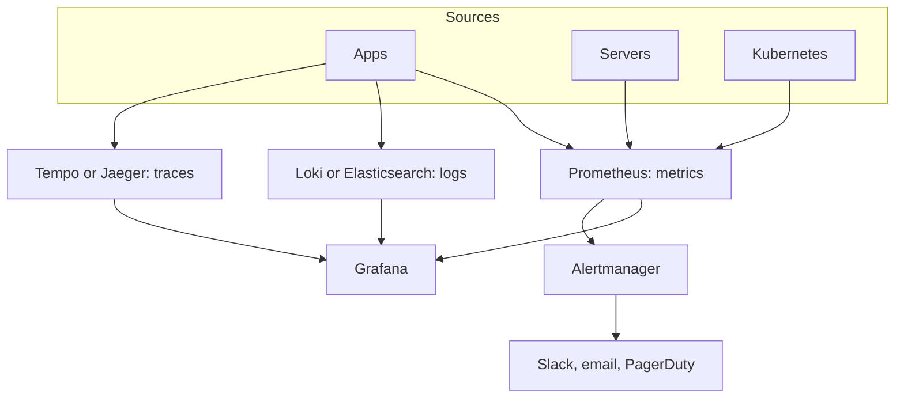

# 🔭 Monitoring vs Observability

> In one line: Monitoring tells you *that* something is wrong. Observability helps you find out *why*, using metrics, logs, and traces.

## 🧠 Simple explanation

Think about a car. The dashboard lights (engine, fuel, temperature) are **monitoring**. They warn you about problems you already expected. If the car makes a strange noise that has no light, a mechanic plugs in a scanner, reads detailed data, and listens closely. That deeper ability to ask new questions is **observability**.



## 🔑 Key concepts

### The three pillars

| Pillar | What it is | Good for | Example |
|--------|-----------|----------|---------|
| **Metrics** | Numbers sampled over time | Trends, alerts, capacity | CPU is 85 percent, 120 requests per second |
| **Logs** | Text records of events | Details of what happened | `ERROR payment failed for order 42` |
| **Traces** | The path of one request across services | Finding the slow or failing step | Checkout took 2.3s, 1.8s was in the database |

### Monitoring vs observability

| Point | Monitoring | Observability |
|-------|-----------|---------------|
| Question | "Is it broken?" | "Why is it broken?" |
| Based on | Known problems, set thresholds | Rich data, unknown problems |
| Output | Alerts, dashboards | Ability to explore and debug |

### The Four Golden Signals (from Google SRE)

1. **Latency**: how long requests take (track errors separately from successes).
2. **Traffic**: how much demand there is (requests per second).
3. **Errors**: how many requests fail.
4. **Saturation**: how full the system is (CPU, memory, disk, queue length).

Other helpful models:
- **RED** for services: Rate, Errors, Duration.
- **USE** for resources: Utilization, Saturation, Errors.

### SLI, SLO, SLA, and error budget

- **SLI** (indicator): a measurement, such as "percent of requests under 300 ms".
- **SLO** (objective): a target for an SLI, such as "99.9 percent over 30 days".
- **SLA** (agreement): a contract with customers, with penalties.
- **Error budget**: how much failure the SLO allows. At 99.9 percent, you may fail 0.1 percent of the time (about 43 minutes per 30 days).



### A typical monitoring stack



## 🛠️ Hands-on

Try a tiny stack locally. Save as `docker-compose.yml`:

```yaml
services:
  prometheus:
    image: prom/prometheus:latest
    ports: ["9090:9090"]
    volumes:
      - ./prometheus.yml:/etc/prometheus/prometheus.yml:ro
  node-exporter:
    image: prom/node-exporter:latest
    ports: ["9100:9100"]
  grafana:
    image: grafana/grafana:latest
    ports: ["3000:3000"]
```

`prometheus.yml`:

```yaml
global:
  scrape_interval: 15s
scrape_configs:
  - job_name: prometheus
    static_configs:
      - targets: ["prometheus:9090"]
  - job_name: node
    static_configs:
      - targets: ["node-exporter:9100"]
```

```bash
docker compose up -d
curl -s localhost:9100/metrics | head -n 5     # raw metrics
```

Open Prometheus at `http://localhost:9090` and run the query `up`. Open Grafana at `http://localhost:3000` (login `admin` / `admin`, then change it).

Quick check of an error budget:

```bash
# SLO 99.9 percent over 30 days, how many minutes of downtime allowed?
python3 -c "print(30*24*60*(1-0.999))"
```

## ⚠️ Common mistakes

- **Collecting everything and looking at nothing.** Start with golden signals.
- **Alerting on causes instead of symptoms.** Alert when users are hurt (high error rate), not on every CPU spike.
- **No baseline.** Without normal values, you cannot spot abnormal ones.
- **Averages only.** Averages hide slow requests. Use percentiles (p95, p99).
- **Logs without structure.** Plain text is hard to search. Use JSON logs with fields.

## ✅ Quick recap

- Metrics show trends, logs show details, traces show request paths.
- Use the golden signals: latency, traffic, errors, saturation.
- SLOs and error budgets turn reliability into a clear target.
- Monitor symptoms that affect users first.

➡️ Next: [02 - Prometheus and PromQL](02-prometheus-and-promql.md)
