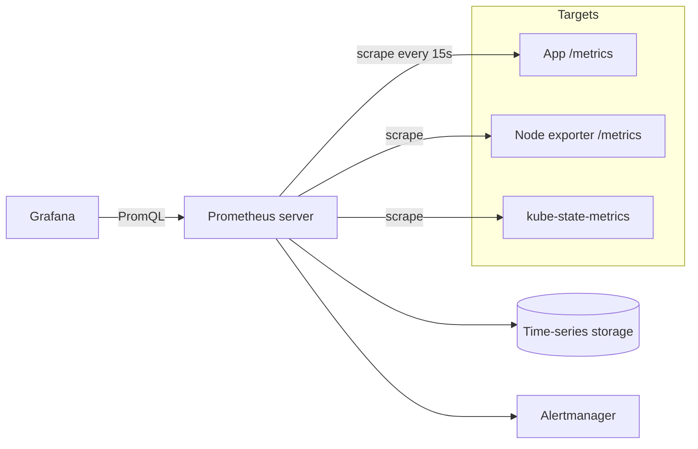
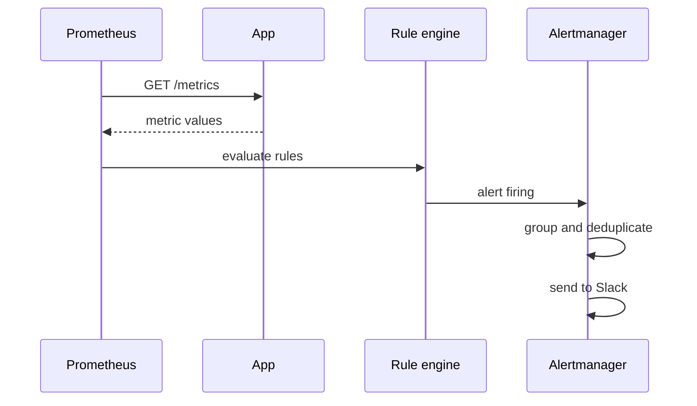

# 🔥 Prometheus and PromQL

> In one line: Prometheus collects numbers (metrics) from your apps on a schedule, stores them, and lets you query them with PromQL.

## 🧠 Simple explanation

Imagine a teacher who walks around the class every 15 seconds and writes each student's temperature in a notebook. That teacher is Prometheus. The notebook is its time-series database. PromQL is the way you ask questions like "Which student's temperature went up in the last 5 minutes?"

Prometheus uses a **pull** model: it visits each target and reads its `/metrics` page.



## 🔑 Key concepts

- **Metric**: a named number, such as `http_requests_total`.
- **Label**: a key and value that splits a metric, such as `method="GET"`.
- **Time series**: one metric name plus one set of labels, over time.
- **Target**: something Prometheus scrapes.
- **Exporter**: a small program that exposes metrics for software that does not have them (node_exporter, mysqld_exporter, blackbox_exporter).
- **Scrape interval**: how often Prometheus collects.
- **Alerting rule**: a PromQL expression that fires when true.
- **Alertmanager**: groups, silences, and routes alerts to Slack, email, or PagerDuty.
- **Pushgateway**: for short batch jobs that cannot be scraped. Use with care.

### Metric types

| Type | Meaning | Example |
|------|---------|---------|
| Counter | Only goes up (resets on restart) | `http_requests_total` |
| Gauge | Goes up and down | `memory_usage_bytes` |
| Histogram | Counts values in buckets, good for percentiles | `request_duration_seconds_bucket` |
| Summary | Pre-calculated percentiles on the client | `rpc_duration_seconds` |

## 🛠️ Hands-on

### 1. Prometheus config

`prometheus.yml`:

```yaml
global:
  scrape_interval: 15s
  evaluation_interval: 15s

rule_files:
  - alerts.yml

alerting:
  alertmanagers:
    - static_configs:
        - targets: ["alertmanager:9093"]

scrape_configs:
  - job_name: node
    static_configs:
      - targets: ["node-exporter:9100"]

  - job_name: my-app
    metrics_path: /metrics
    static_configs:
      - targets: ["app:8000"]
```

### 2. Expose metrics from a Python app

```bash
pip install prometheus-client
```

```python
from prometheus_client import start_http_server, Counter, Histogram
import random, time

REQUESTS = Counter("app_requests_total", "Total requests", ["status"])
LATENCY = Histogram("app_request_seconds", "Request time in seconds")

start_http_server(8000)

while True:
    with LATENCY.time():
        time.sleep(random.random() / 5)
    REQUESTS.labels(status=random.choice(["200", "200", "200", "500"])).inc()
```

Check it: `curl localhost:8000/metrics`.

### 3. PromQL you will use every day

```promql
# Is the target up? (1 = yes, 0 = no)
up

# Requests per second over the last 5 minutes
rate(app_requests_total[5m])

# Total requests per second, grouped by status label
sum by (status) (rate(app_requests_total[5m]))

# Error percentage
100 * sum(rate(app_requests_total{status="500"}[5m]))
    / sum(rate(app_requests_total[5m]))

# 95th percentile latency
histogram_quantile(0.95, sum by (le) (rate(app_request_seconds_bucket[5m])))

# CPU used percent per machine (node_exporter)
100 - (avg by (instance) (rate(node_cpu_seconds_total{mode="idle"}[5m])) * 100)

# Memory used percent
100 * (1 - node_memory_MemAvailable_bytes / node_memory_MemTotal_bytes)

# Disk space left below 10 percent
node_filesystem_avail_bytes / node_filesystem_size_bytes < 0.10
```

Reading tips:
- `[5m]` is a *range vector*: the last 5 minutes of data.
- `rate()` turns a counter into a per-second speed. Always use `rate()` on counters.
- `sum by (label)` combines series and keeps the label you name.

### 4. Alerting rules

`alerts.yml`:

```yaml
groups:
  - name: app-alerts
    rules:
      - alert: InstanceDown
        expr: up == 0
        for: 2m
        labels:
          severity: critical
        annotations:
          summary: "{{ $labels.instance }} is down"

      - alert: HighErrorRate
        expr: |
          sum(rate(app_requests_total{status="500"}[5m]))
          / sum(rate(app_requests_total[5m])) > 0.05
        for: 5m
        labels:
          severity: warning
        annotations:
          summary: "More than 5 percent of requests are failing"
```

`for: 5m` means the condition must stay true for five minutes. This avoids noisy alerts.

Validate your files:

```bash
promtool check config prometheus.yml
promtool check rules alerts.yml
```

### 5. On Kubernetes

```bash
helm repo add prometheus-community https://prometheus-community.github.io/helm-charts
helm install monitoring prometheus-community/kube-prometheus-stack -n monitoring --create-namespace
```

This installs Prometheus, Alertmanager, Grafana, node exporters, and ready-made dashboards. Use a `ServiceMonitor` object to tell Prometheus to scrape your app.



## ⚠️ Common mistakes

- **Using a counter without `rate()`.** A raw counter just climbs forever.
- **High-cardinality labels** such as user ID or full URL. They create millions of series and crash Prometheus.
- **Too-short `rate()` windows.** Use at least 4 times the scrape interval.
- **Alerting with no `for:`.** One bad scrape wakes you at night.
- **Treating Prometheus as long-term storage.** Use Thanos, Mimir, or remote write for months or years of data.

## ✅ Quick recap

- Prometheus pulls metrics from `/metrics` endpoints.
- Counters need `rate()`. Histograms give percentiles.
- Alert rules plus Alertmanager route problems to people.
- Keep label values low in variety.

➡️ Next: [03 - Grafana dashboards and alerting](03-grafana-dashboards-and-alerting.md)
