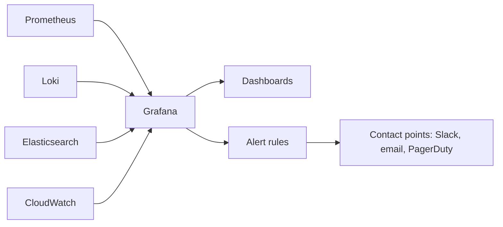
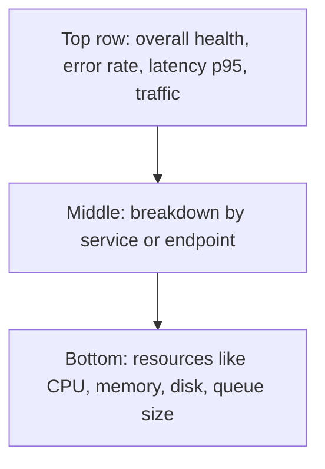
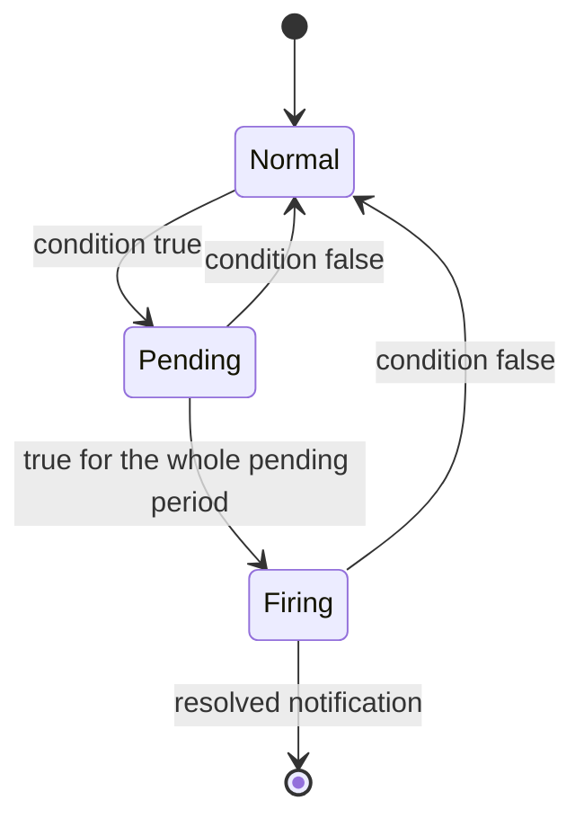

# 📊 Grafana Dashboards and Alerting

> In one line: Grafana draws graphs from many data sources and can alert you when numbers look wrong.

## 🧠 Simple explanation

Prometheus is the notebook full of numbers. Grafana is the nice poster made from that notebook. It does not store the data. It asks data sources (Prometheus, Loki, Elasticsearch, cloud monitors) and turns the answers into charts, tables, and gauges.



## 🔑 Key concepts

- **Data source**: where Grafana reads data.
- **Dashboard**: a page of panels.
- **Panel**: one chart or table (time series, stat, gauge, bar, table, logs).
- **Variable**: a drop-down on the dashboard (for example `$namespace`) so one dashboard fits many services.
- **Folder**: groups dashboards and sets who can see them.
- **Alert rule**: a query plus a condition and a wait time.
- **Contact point**: where a notification goes.
- **Notification policy**: routing rules, based on labels, that choose the contact point.
- **Provisioning**: loading data sources and dashboards from files, so they live in Git.

### What makes a good dashboard



Rules of thumb:
1. One dashboard, one purpose (overview, service detail, infrastructure).
2. Put the most important numbers at the top.
3. Always label units (ms, %, req/s).
4. Use colors for meaning (green good, red bad). Do not decorate.
5. Add a link from the overview to deeper dashboards.

## 🛠️ Hands-on

### 1. Run Grafana and connect Prometheus

```yaml
services:
  grafana:
    image: grafana/grafana:latest
    ports: ["3000:3000"]
    volumes:
      - ./provisioning/datasources:/etc/grafana/provisioning/datasources:ro
      - grafana-data:/var/lib/grafana
volumes:
  grafana-data:
```

`provisioning/datasources/prometheus.yml`:

```yaml
apiVersion: 1
datasources:
  - name: Prometheus
    type: prometheus
    access: proxy
    url: http://prometheus:9090
    isDefault: true
```

### 2. Build your first dashboard

1. Open `http://localhost:3000`, then **Dashboards** and **New dashboard**.
2. Click **Add visualization**, choose the Prometheus data source.
3. Paste a query, for example:

```promql
sum by (status) (rate(app_requests_total[5m]))
```

4. Pick **Time series**, set the unit to `requests/sec`, and give the panel a clear title.
5. Add a second panel with the latency query:

```promql
histogram_quantile(0.95, sum by (le) (rate(app_request_seconds_bucket[5m])))
```

6. Save the dashboard.

Import a ready-made dashboard: **Dashboards**, **New**, **Import**, then enter an ID from grafana.com (for example `1860` for the Node Exporter Full dashboard).

### 3. Use a variable

Create a variable `instance` with the query:

```promql
label_values(node_cpu_seconds_total, instance)
```

Then use it in a panel:

```promql
100 - avg(rate(node_cpu_seconds_total{instance="$instance", mode="idle"}[5m])) * 100
```

### 4. Create an alert in Grafana

1. Go to **Alerting**, **Alert rules**, **New alert rule**.
2. Query A: the error-rate query from doc 02.
3. Condition: "is above 5".
4. Evaluate every `1m`, pending period `5m`.
5. Add labels such as `severity=warning` and `team=platform`.
6. Add a clear summary and a link to a runbook.



### 5. Contact point for Slack (as provisioning file)

```yaml
apiVersion: 1
contactPoints:
  - orgId: 1
    name: slack-platform
    receivers:
      - uid: slack1
        type: slack
        settings:
          url: https://hooks.slack.com/services/XXX/YYY/ZZZ
```

(Keep real webhook URLs in secrets, not in Git.)

### 6. Dashboards as code

Export JSON from the UI (**Share**, **Export**) and keep it in Git. Load it with provisioning:

```yaml
apiVersion: 1
providers:
  - name: default
    folder: Platform
    type: file
    options:
      path: /var/lib/grafana/dashboards
```

### 7. Good alert design

| Do | Do not |
|----|--------|
| Alert on user pain: high errors, slow responses | Alert on every CPU spike |
| Make each alert actionable with a runbook link | Send alerts nobody can act on |
| Use severity: page for urgent, ticket for slow-burn | Page for everything |
| Add `for` time to avoid flapping | Fire on one bad data point |
| Alert on SLO burn rate | Use many overlapping alerts |

## ⚠️ Common mistakes

- **Dashboards with 40 panels.** Nobody reads them. Keep it focused.
- **No units or titles.** Panels become guesswork.
- **Editing dashboards only in the UI.** Changes vanish if the container is rebuilt. Use provisioning.
- **Too many alerts.** Alert fatigue makes people ignore real problems.
- **Default admin password left unchanged.**

## ✅ Quick recap

- Grafana reads data from sources and shows panels and alerts.
- Use variables so one dashboard serves many services.
- Alerts should be few, clear, and actionable.
- Keep dashboards and rules in Git with provisioning.

➡️ Next: [04 - Logging with ELK and Loki](04-logging-elk-loki.md)
