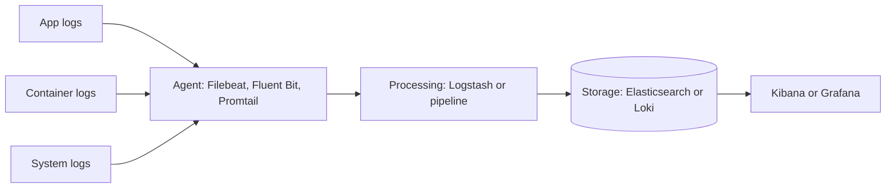
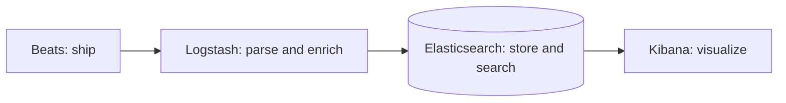
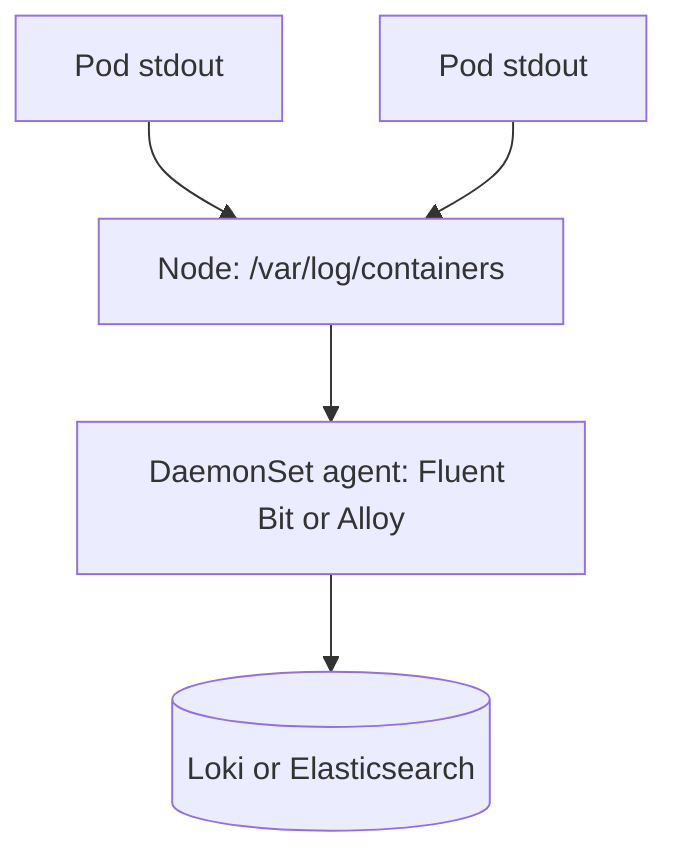

# 📝 Logging with ELK and Loki

> In one line: Centralized logging collects logs from every server and container into one searchable place, using stacks like ELK or Loki.

## 🧠 Simple explanation

Imagine each classroom keeps its own diary. When something goes wrong, you would have to walk into every room and read each diary. Centralized logging is a school office that collects a copy of every diary, sorts it, and lets you search "show me every mention of the broken window".



## 🔑 Key concepts

- **Log**: a timestamped record of an event.
- **Structured log**: a log in a fixed format such as JSON. Easy to search and filter.
- **Log level**: DEBUG, INFO, WARN, ERROR, FATAL.
- **Agent / shipper**: software on each node that reads logs and sends them on (Filebeat, Fluent Bit, Promtail, Fluentd).
- **Index**: in Elasticsearch, where documents are stored and made searchable.
- **Retention**: how long logs are kept.
- **Correlation ID / trace ID**: an ID added to every log line of one request so you can follow it across services.

### ELK vs Loki

| Point | ELK / Elastic Stack | Grafana Loki |
|-------|--------------------|--------------|
| Parts | Elasticsearch, Logstash, Kibana, Beats | Loki, Promtail or Alloy, Grafana |
| Indexing | Indexes full text | Indexes only labels, stores log text compressed |
| Cost and size | Heavier, needs more storage and RAM | Lighter and cheaper |
| Search power | Very strong full-text search and analytics | Simple label filters, then text search |
| Best for | Deep search, security analytics | Kubernetes, pairing with Prometheus and Grafana |

### The ELK parts



## 🛠️ Hands-on

### 1. Write structured logs

Python example:

```python
import json, logging, sys, time

class JsonFormatter(logging.Formatter):
    def format(self, record):
        return json.dumps({
            "time": time.strftime("%Y-%m-%dT%H:%M:%S"),
            "level": record.levelname,
            "service": "checkout",
            "message": record.getMessage(),
        })

handler = logging.StreamHandler(sys.stdout)
handler.setFormatter(JsonFormatter())
log = logging.getLogger("app")
log.addHandler(handler)
log.setLevel(logging.INFO)

log.info("order created")
log.error("payment failed")
```

In containers, write logs to **stdout and stderr**. The platform collects them.

### 2. Loki with Grafana (local)

`docker-compose.yml`:

```yaml
services:
  loki:
    image: grafana/loki:latest
    ports: ["3100:3100"]
    command: -config.file=/etc/loki/local-config.yaml
  promtail:
    image: grafana/promtail:latest
    volumes:
      - /var/log:/var/log:ro
      - ./promtail.yml:/etc/promtail/config.yml:ro
    command: -config.file=/etc/promtail/config.yml
  grafana:
    image: grafana/grafana:latest
    ports: ["3000:3000"]
```

`promtail.yml`:

```yaml
server:
  http_listen_port: 9080
positions:
  filename: /tmp/positions.yaml
clients:
  - url: http://loki:3100/loki/api/v1/push
scrape_configs:
  - job_name: system
    static_configs:
      - targets: [localhost]
        labels:
          job: varlogs
          __path__: /var/log/*.log
```

Add Loki as a data source in Grafana (`http://loki:3100`), then use **Explore** and run LogQL:

```logql
{job="varlogs"}
{job="varlogs"} |= "error"
{job="varlogs"} | json | level="ERROR"
sum by (level) (count_over_time({job="varlogs"} | json [5m]))
```

Note: Grafana Alloy is the newer collector from Grafana and replaces Promtail for new setups. Promtail still works for learning.

### 3. ELK quick start (single node, for learning)

```yaml
services:
  elasticsearch:
    image: docker.elastic.co/elasticsearch/elasticsearch:8.15.0
    environment:
      - discovery.type=single-node
      - xpack.security.enabled=false
      - ES_JAVA_OPTS=-Xms1g -Xmx1g
    ports: ["9200:9200"]
  kibana:
    image: docker.elastic.co/kibana/kibana:8.15.0
    environment:
      - ELASTICSEARCH_HOSTS=http://elasticsearch:9200
    ports: ["5601:5601"]
```

Turn security off only on a local test machine. Send a test document and search it:

```bash
curl -s -X POST localhost:9200/app-logs/_doc -H 'Content-Type: application/json' \
  -d '{"level":"ERROR","service":"checkout","message":"payment failed"}'

curl -s 'localhost:9200/app-logs/_search?q=level:ERROR&pretty'
```

In Kibana, create a **data view** for `app-logs*`, then search in **Discover**.

### 4. Logging in Kubernetes



Run the agent as a **DaemonSet** so one copy runs on every node. Quick look without any stack:

```bash
kubectl logs deploy/web -n demo --tail=50
kubectl logs deploy/web -n demo -f
kubectl logs pod/web-abc123 -n demo --previous    # logs of the crashed container
```

### 5. Retention and cost

| Action | Why |
|--------|-----|
| Set retention (for example 14 days hot, 90 days cold) | Controls storage cost |
| Drop DEBUG logs in production | Cuts volume |
| Never log passwords, tokens, or personal data | Security and privacy |
| Sample very noisy logs | Cuts volume |

## ⚠️ Common mistakes

- **Logging secrets or personal data.** Mask them before they are written.
- **Unstructured logs with no request ID.** You cannot follow one request.
- **Keeping all logs forever.** Storage gets expensive. Set lifecycle rules.
- **High-cardinality Loki labels** (user ID, request ID). Put them in the log text, not in labels.
- **Writing logs to files inside containers.** They vanish when the container goes. Use stdout.

## ✅ Quick recap

- Centralize logs so you search in one place.
- Use JSON logs, log to stdout, and add a request ID.
- ELK for powerful search, Loki for light and cheap, label-based logging.
- Set retention and never log secrets.

➡️ Next: [05 - Tracing, OpenTelemetry, and incident response](05-tracing-opentelemetry-and-incident-response.md)
