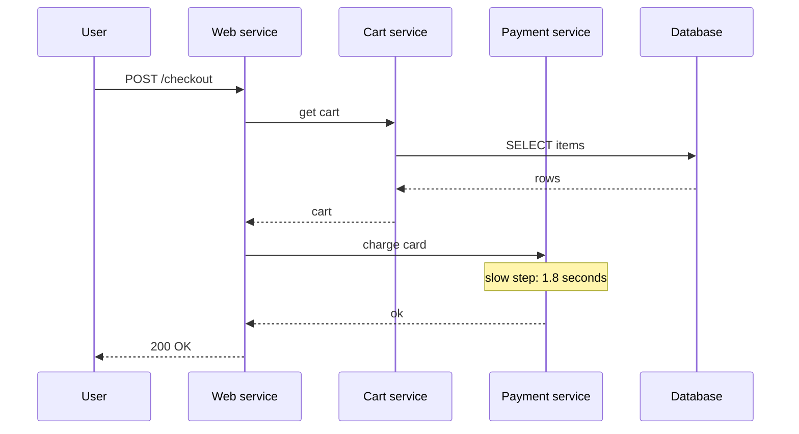
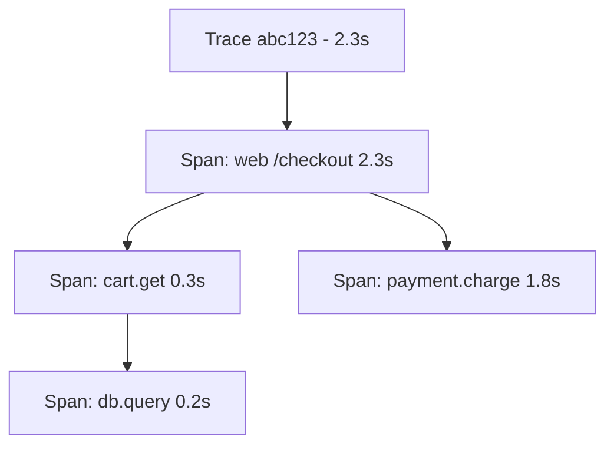
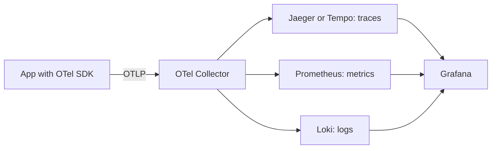
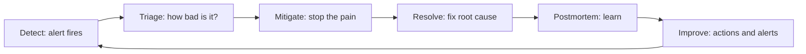

# 🧭 Tracing, OpenTelemetry, and Incident Response

> In one line: Tracing shows the path of one request through many services, OpenTelemetry is the standard way to collect it, and good incident habits turn outages into learning.

## 🧠 Simple explanation

Order a pizza and follow it: taken at the counter, sent to the kitchen, baked, boxed, handed to the rider, delivered. If the pizza is late, a timeline of each step shows where time was lost. A **trace** is that timeline for a software request.



## 🔑 Key concepts

### Tracing words

- **Trace**: the full journey of one request. It has a unique **trace ID**.
- **Span**: one step inside a trace (an HTTP call, a database query). It has a start time, a duration, and a **parent span**.
- **Context propagation**: passing the trace ID from service to service in HTTP headers (the standard header is `traceparent`).
- **Sampling**: keeping only some traces (for example 10 percent) to save cost.
- **Instrumentation**: adding code or an agent that creates spans.



### OpenTelemetry (OTel)

OpenTelemetry is a vendor-neutral open standard for producing **traces, metrics, and logs**. You instrument once and send the data to any backend (Jaeger, Tempo, Prometheus, Datadog, and more).

- **SDK / API**: libraries inside your app.
- **OTLP**: the protocol used to send data.
- **Collector**: a service that receives, processes, and exports telemetry.
- **Auto-instrumentation**: agents that add tracing without code changes for common frameworks.



## 🛠️ Hands-on

### 1. Run Jaeger and send a trace from Python

```bash
docker run -d --name jaeger \
  -p 16686:16686 -p 4317:4317 -p 4318:4318 \
  jaegertracing/all-in-one:latest

pip install opentelemetry-sdk opentelemetry-exporter-otlp-proto-grpc
```

`trace_demo.py`:

```python
from opentelemetry import trace
from opentelemetry.sdk.resources import Resource
from opentelemetry.sdk.trace import TracerProvider
from opentelemetry.sdk.trace.export import BatchSpanProcessor
from opentelemetry.exporter.otlp.proto.grpc.trace_exporter import OTLPSpanExporter
import time

provider = TracerProvider(resource=Resource.create({"service.name": "demo-checkout"}))
provider.add_span_processor(
    BatchSpanProcessor(OTLPSpanExporter(endpoint="http://localhost:4317", insecure=True))
)
trace.set_tracer_provider(provider)
tracer = trace.get_tracer(__name__)

with tracer.start_as_current_span("checkout"):
    with tracer.start_as_current_span("get-cart"):
        time.sleep(0.1)
    with tracer.start_as_current_span("charge-card") as span:
        span.set_attribute("payment.provider", "demo")
        time.sleep(0.5)

provider.shutdown()
```

```bash
python3 trace_demo.py
```

Open `http://localhost:16686`, pick the service `demo-checkout`, and click **Find Traces**.

### 2. Auto-instrument without code changes

```bash
pip install opentelemetry-distro opentelemetry-exporter-otlp
opentelemetry-bootstrap -a install
OTEL_SERVICE_NAME=my-api OTEL_EXPORTER_OTLP_ENDPOINT=http://localhost:4317 \
  opentelemetry-instrument python app.py
```

### 3. A minimal Collector config

```yaml
receivers:
  otlp:
    protocols:
      grpc:
      http:
processors:
  batch: {}
exporters:
  otlp/jaeger:
    endpoint: jaeger:4317
    tls:
      insecure: true
service:
  pipelines:
    traces:
      receivers: [otlp]
      processors: [batch]
      exporters: [otlp/jaeger]
```

### 4. Incident response: the lifecycle



Key rule: **mitigate first, investigate later.** Roll back, fail over, or turn off a feature flag before searching for the deep cause.

### 5. On-call basics

- A **rotation** shares the load (for example, one week per person).
- Use **primary** and **secondary** responders and a clear **escalation path**.
- Tools: PagerDuty, Opsgenie, Grafana OnCall.
- Roles in a big incident: **Incident commander** (leads), **communications** (updates people), **operations** (fixes).
- Set **severity levels**:

| Level | Meaning | Example | Response |
|-------|---------|---------|----------|
| SEV1 | Full outage or data loss | Site down | Page now, all hands |
| SEV2 | Major feature broken | Checkout failing for many | Page now |
| SEV3 | Minor issue, workaround exists | Slow reports | Fix in working hours |

### 6. A runbook template

```markdown
# Runbook: HighErrorRate on checkout

## What this alert means
More than 5 percent of checkout requests return 5xx for 5 minutes.

## Impact
Customers cannot pay.

## First checks
1. Open dashboard: Checkout Overview.
2. Did a deploy happen in the last hour? `kubectl rollout history deploy/checkout`
3. Check the database and payment provider status page.

## Fixes
- Bad deploy: `kubectl rollout undo deploy/checkout`
- DB connections full: restart pods, then raise the pool limit.

## Escalate to
Payments team on-call, if not fixed in 15 minutes.
```

### 7. A blameless postmortem template

```markdown
# Postmortem: Checkout outage on 2026-10-12

- Status: complete
- Severity: SEV2
- Duration: 38 minutes
- Impact: about 12 percent of checkouts failed

## Summary
(2 or 3 plain sentences)

## Timeline (UTC)
- 10:02 Deploy v1.8.0 starts
- 10:07 Alert HighErrorRate fires
- 10:12 On-call confirms, starts rollback
- 10:40 Error rate back to normal

## Root cause
(What failed in the system and why it was possible)

## What went well / what went badly / where we got lucky

## Action items
| Action | Owner | Due |
|--------|-------|-----|
| Add a canary stage to the deploy | Platform | 2026-11-01 |
| Add an alert on DB connection saturation | SRE | 2026-10-25 |
```

Blameless means we ask "how did the system let this happen?" and not "who made the mistake?". People then share facts freely, and the same problem is less likely to return.

## ⚠️ Common mistakes

- **No trace ID in logs.** Add it, so you can jump from a log line to a trace.
- **Tracing 100 percent of traffic at high volume.** Costs balloon. Sample.
- **Not propagating headers** through queues or custom clients. Traces then break into pieces.
- **Debugging before mitigating.** Customers keep suffering while you investigate.
- **Postmortems that blame people**, or action items with no owner and date.
- **Alerts with no runbook.** The person on call at 3 AM needs steps, not mysteries.

## ✅ Quick recap

- A trace is a request's journey. It is made of spans.
- OpenTelemetry is the vendor-neutral standard to collect traces, metrics, and logs.
- During incidents: detect, triage, mitigate, resolve, learn.
- Runbooks help during the incident, blameless postmortems help afterwards.

🎉 You finished this repo. Go back to the [README](../README.md).
