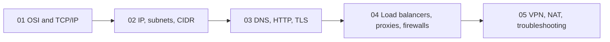

<h1 align="center">🌍 Networking for DevOps</h1>

<p align="center"><b>Understand how data travels, so you can fix it when it does not.</b></p>

<p align="center">
  
  
  
  
</p>

---

## 🎯 Why this repo

Almost every outage story ends with "it was the network" or "it was DNS." Cloud, Docker, and Kubernetes all sit on top of networking. If you understand IP addresses, DNS, HTTPS, load balancers, and the basic debugging tools, you can find problems in minutes instead of hours. This repo teaches these ideas in simple English with diagrams and commands you can run.

## 🗺️ Learning path



## 📚 Table of contents

| # | Topic | What you will learn |
|---|-------|---------------------|
| 01 | [OSI and TCP/IP](docs/01-osi-and-tcp-ip.md) | The layers, TCP vs UDP, ports |
| 02 | [IP addresses, subnets and CIDR](docs/02-ip-subnets-cidr.md) | How addresses and networks are planned |
| 03 | [DNS, HTTP, HTTPS and TLS](docs/03-dns-http-https-tls.md) | Names to IPs, web requests, encryption |
| 04 | [Load balancers, proxies and firewalls](docs/04-load-balancers-proxies-firewalls.md) | Spread, hide, and protect traffic |
| 05 | [VPN, NAT and troubleshooting tools](docs/05-vpn-nat-and-troubleshooting-tools.md) | Private links and the debugging toolbox |

## ⚡ Quick cheat sheet

```bash
ip addr                         # my IP addresses
ip route                        # routing table
ping -c 4 8.8.8.8               # is the host reachable?
dig example.com +short          # DNS lookup
curl -I https://example.com     # HTTP headers only
curl -v https://example.com     # full connection details, TLS included
traceroute example.com          # path of hops (tracepath on some systems)
ss -tulpn                       # listening ports and owning programs
nc -vz host 443                 # is the TCP port open?
sudo tcpdump -i any port 53     # watch DNS packets live
```

---

<p align="center">Part of the DevOps Hub by <a href="https://github.com/Akhilgoud01">@Akhilgoud01</a> — ⭐ star if it helped</p>
