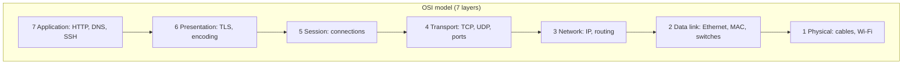
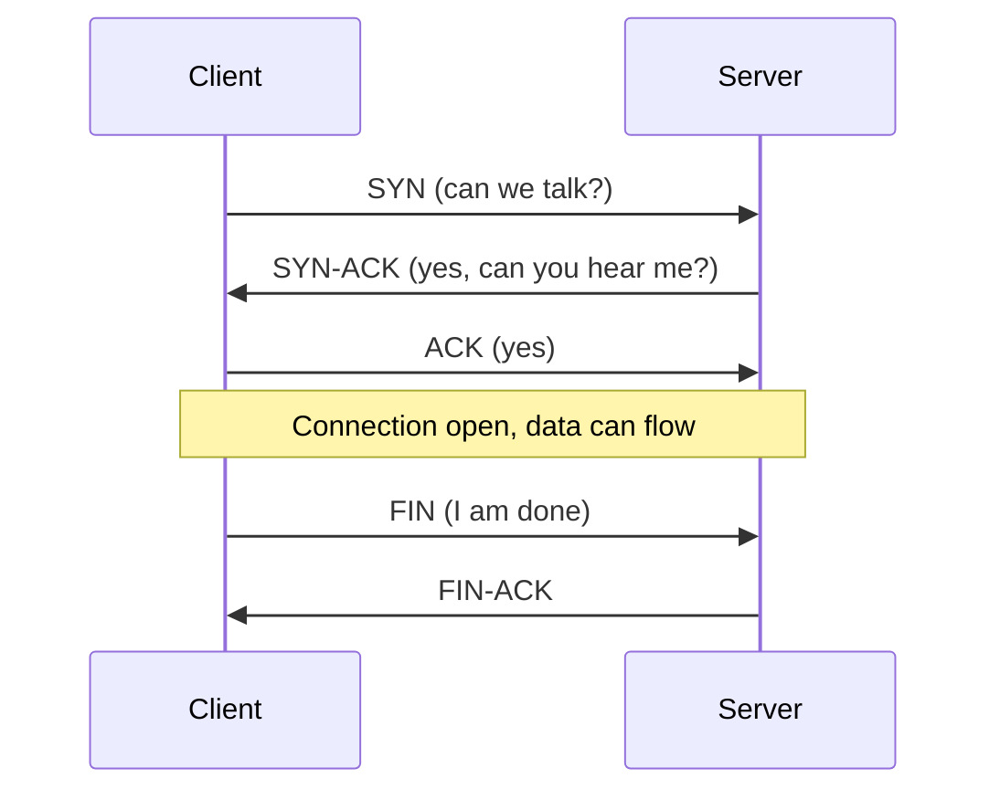

# 🧅 01 · OSI Model and TCP/IP

> **In one line:** Networking is split into layers, and each layer does one job, so problems can be found one layer at a time.

## 🧠 Simple explanation

Think about sending a parcel. You write a letter (the data). You put it in an envelope with the address (IP). A courier decides which road to take (routing). A truck drives on the road (physical link). At the other end, it is unpacked in the reverse order. Each step only cares about its own job. Network layers work the same way.

The **OSI model** has 7 layers. The **TCP/IP model**, which the real internet uses, groups them into 4. Engineers use both: OSI for talking, TCP/IP for how it really works.



| TCP/IP layer | OSI layers | Examples |
|---|---|---|
| Application | 5, 6, 7 | HTTP, HTTPS, DNS, SSH, SMTP |
| Transport | 4 | TCP, UDP |
| Internet | 3 | IP, ICMP, routers |
| Link | 1, 2 | Ethernet, Wi-Fi, ARP, switches |

## 🔑 Key concepts

- **Encapsulation**: each layer wraps the data from above with its own header. The receiver unwraps in reverse.
- **Packet / frame / segment**: the names for data units at the IP, link, and transport layers.
- **MAC address**: hardware address on the local network (layer 2).
- **IP address**: logical address used to reach hosts across networks (layer 3).
- **Port**: a number (0 to 65535) that picks the program on a host (layer 4). Examples: 22 SSH, 80 HTTP, 443 HTTPS, 53 DNS, 5432 PostgreSQL.
- **Switch**: connects devices in one network using MAC addresses (layer 2).
- **Router**: connects different networks using IP addresses (layer 3).
- **TCP**: reliable, ordered, connection-based. Used by web, SSH, databases.
- **UDP**: fast, no guarantees, no connection. Used by DNS queries, video calls, games.
- **ICMP**: control messages. `ping` uses it.

### TCP three-way handshake



### TCP vs UDP

| | TCP | UDP |
|---|---|---|
| Connection | Yes (handshake) | No |
| Delivery guaranteed | Yes, with retries | No |
| Order kept | Yes | No |
| Speed | Slower | Faster |
| Use | Web, email, SSH, databases | DNS, streaming, VoIP |

## 🛠️ Hands-on

### See your network layers on a real machine

```bash
ip link                         # layer 2: interfaces and MAC addresses
ip addr                         # layer 3: IP addresses
ip route                        # layer 3: where packets go next
ip neigh                        # ARP table: IP to MAC mapping
ss -tan                         # layer 4: TCP connections and states
```

### Watch a handshake

```bash
# Terminal 1: capture traffic to a website's port 443
sudo tcpdump -n -i any 'tcp port 443 and host example.com' -c 10

# Terminal 2: make a request
curl -sI https://example.com > /dev/null
```

Look for `Flags [S]`, `[S.]`, and `[.]`. That is SYN, SYN-ACK, ACK.

### Test each layer when something is broken

```bash
ping -c 2 127.0.0.1             # is my own network stack ok?
ping -c 2 <gateway-ip>          # layer 3 to the local router
ping -c 2 8.8.8.8               # reach the internet by IP
ping -c 2 google.com            # DNS working too?
nc -vz google.com 443           # layer 4: port open?
curl -I https://google.com      # layer 7: web server answers?
```

If an earlier step fails, the problem is at that layer or below.

### Common ports to remember

| Port | Protocol |
|---|---|
| 22 | SSH |
| 53 | DNS |
| 80 / 443 | HTTP / HTTPS |
| 25 / 587 | SMTP |
| 3306 | MySQL |
| 5432 | PostgreSQL |
| 6379 | Redis |
| 6443 | Kubernetes API |

## ⚠️ Common mistakes

- **Learning the OSI layers by heart but never testing them.** Use the commands above.
- **Saying "ping fails, so the server is down."** Many servers block ICMP on purpose. Test the real port with `nc` or `curl`.
- **Confusing a port being "closed" with "filtered".** Closed gives a quick refusal. Filtered (firewall) just times out.
- **Using UDP for something that must not lose data.**
- **Forgetting that every layer can fail** (cable, IP, firewall, app).

## ✅ Quick recap

- Layers split the job. Debug from the bottom up (or top down) one layer at a time.
- IP finds the machine, the port finds the program.
- TCP is reliable. UDP is fast.
- `ping`, `nc`, `curl` test different layers.

➡️ **Next:** [02 · IP addresses, subnets and CIDR](02-ip-subnets-cidr.md)
