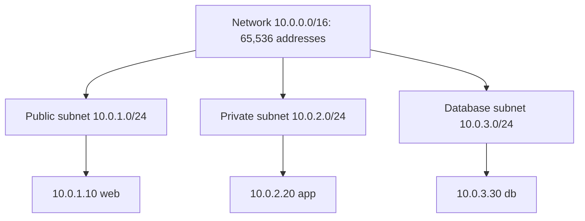
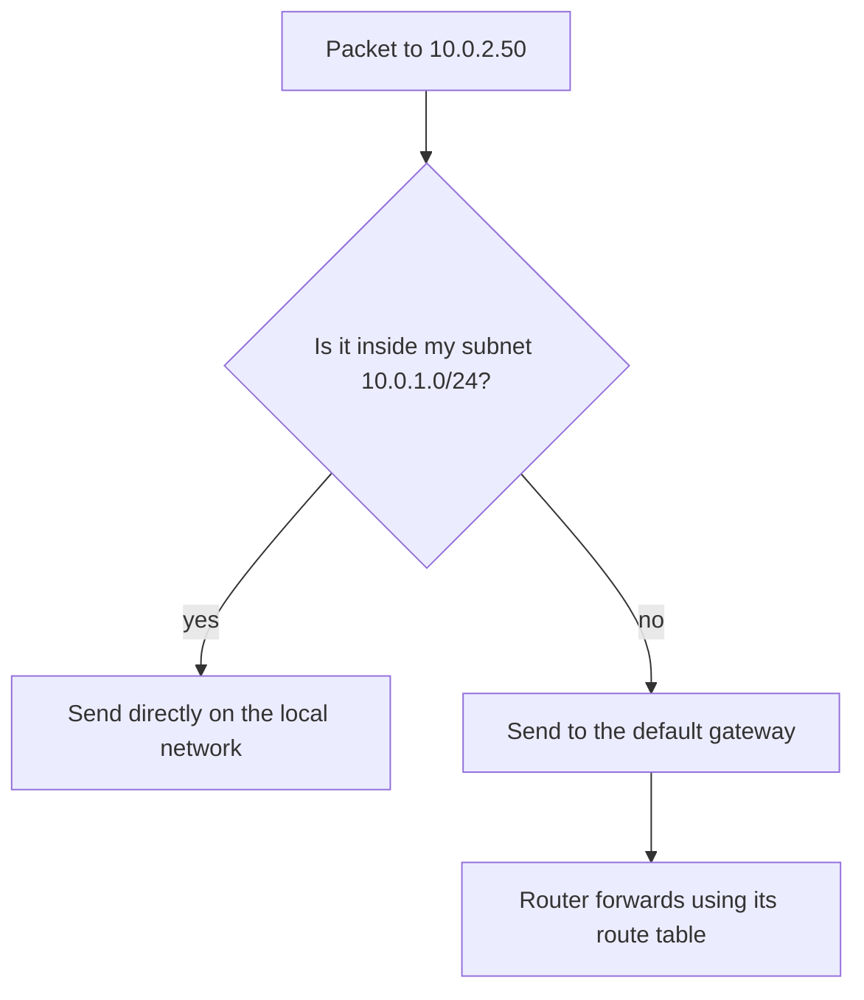

# 🔢 02 · IP Addresses, Subnets and CIDR

> **In one line:** An IP address identifies a device, and CIDR notation like `10.0.0.0/24` describes a block of addresses that form a network.

## 🧠 Simple explanation

An IP address is like a postal address: `10.0.1.25` = a specific house. A **subnet** is a street: all houses share the first part of the address. **CIDR** (say "cider") is a short way to write how long the street prefix is. In `10.0.1.0/24`, the first 24 bits are the "street" and the last 8 bits are the "house numbers", so there are 256 addresses on this street.



## 🔑 Key concepts

### IPv4

- 32 bits written as four numbers (0-255) called octets: `192.168.1.10`.
- About 4.3 billion addresses in total, which is not enough, so we use NAT and IPv6.

### IPv6

- 128 bits in hex: `2001:db8::1`. A huge address space. Adoption is growing and cloud providers support it.

### Private address ranges (RFC 1918)

| Range | CIDR | Typical use |
|---|---|---|
| 10.0.0.0 to 10.255.255.255 | `10.0.0.0/8` | Big companies, cloud VPCs |
| 172.16.0.0 to 172.31.255.255 | `172.16.0.0/12` | Medium networks, Docker default |
| 192.168.0.0 to 192.168.255.255 | `192.168.0.0/16` | Home networks |

These are not routable on the public internet.

### CIDR in practice

`/N` means the first N bits are the network part. Addresses in the block = 2^(32 - N).

| CIDR | Addresses | Usable on a classic LAN | Common use |
|---|---|---|---|
| `/32` | 1 | 1 | A single host |
| `/30` | 4 | 2 | Point-to-point links |
| `/28` | 16 | 14 | Small subnet |
| `/24` | 256 | 254 | Typical subnet (mask 255.255.255.0) |
| `/20` | 4,096 | 4,094 | Larger subnet |
| `/16` | 65,536 | 65,534 | A whole VPC |
| `/8` | 16,777,216 | | Huge block |

Classic networks lose 2 addresses: the **network address** (first) and the **broadcast** (last). **AWS reserves 5 per subnet** (first four and last one).

### Other words

- **Subnet mask**: another way to write the prefix. `/24` = `255.255.255.0`.
- **Gateway**: the router address a host sends traffic to for outside networks.
- **Public vs private IP**: public is reachable from the internet. Private is only inside.
- **Loopback**: `127.0.0.1` means "this machine".
- **Link-local**: `169.254.0.0/16`, auto-assigned when DHCP fails. Cloud metadata services also use `169.254.169.254`.
- **DHCP**: automatically hands out IP addresses.

### How a host decides where to send a packet



## 🛠️ Hands-on

### Calculate a subnet quickly

```bash
# With ipcalc (sudo apt install ipcalc)
ipcalc 10.0.1.0/24

# With Python, no install needed
python3 - <<'EOF'
import ipaddress
net = ipaddress.ip_network("10.0.0.0/16")
print("Total addresses:", net.num_addresses)
for sub in list(net.subnets(new_prefix=24))[:3]:
    print(sub, "hosts:", sub.num_addresses - 2)
print(ipaddress.ip_address("10.0.1.25") in ipaddress.ip_network("10.0.1.0/24"))
EOF
```

### Plan a VPC with non-overlapping subnets

| Subnet | CIDR | AZ | Purpose |
|---|---|---|---|
| public-a | `10.0.1.0/24` | a | Load balancers, NAT |
| public-b | `10.0.2.0/24` | b | Load balancers, NAT |
| private-a | `10.0.11.0/24` | a | App servers |
| private-b | `10.0.12.0/24` | b | App servers |
| data-a | `10.0.21.0/24` | a | Databases |
| data-b | `10.0.22.0/24` | b | Databases |

### Look at your own addressing

```bash
ip -4 addr show                 # my IPs and prefixes
ip route show default           # my default gateway
curl -s https://ifconfig.me     # my public IP as the internet sees it
```

### Terraform example

```hcl
resource "aws_vpc" "main" {
  cidr_block = "10.0.0.0/16"
}

resource "aws_subnet" "public_a" {
  vpc_id            = aws_vpc.main.id
  cidr_block        = "10.0.1.0/24"
  availability_zone = "us-east-1a"
}
```

## ⚠️ Common mistakes

- **Overlapping CIDR ranges** between VPCs or with the office network. It blocks peering and VPNs later. Plan ahead.
- **Choosing a VPC that is too small.** Resizing is painful. `/16` is a common start.
- **Using the default `172.17.0.0/16` Docker range** where it clashes with company networks.
- **Mixing up `/24` and `/32`.** `/32` is one address.
- **Forgetting the reserved addresses** in the subnet size (AWS reserves 5).
- **Using a public IP range for private use.**

## ✅ Quick recap

- An IP identifies a host. A subnet groups hosts. CIDR writes the size.
- `/24` = 256 addresses, `/16` = 65,536. Bigger number after the slash = smaller network.
- Use private ranges inside, and never overlap them.
- Plan subnets by role (public, private, data) and by availability zone.

➡️ **Next:** [03 · DNS, HTTP, HTTPS and TLS](03-dns-http-https-tls.md)
