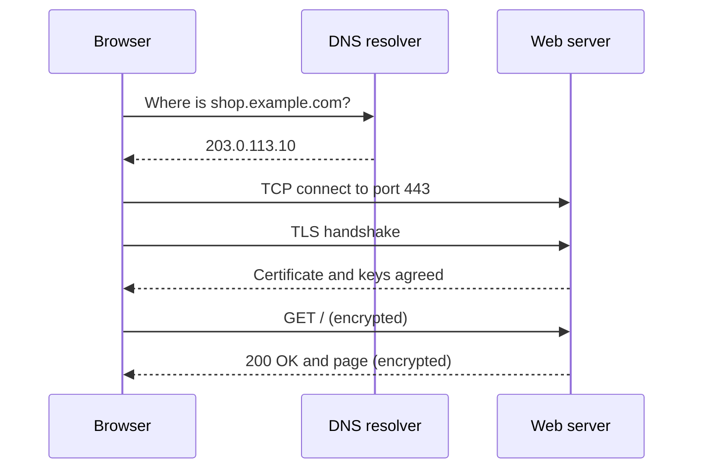
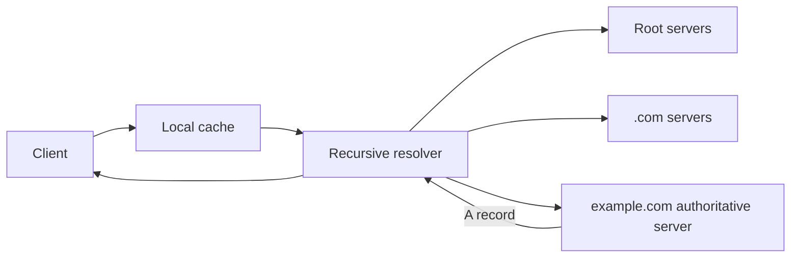
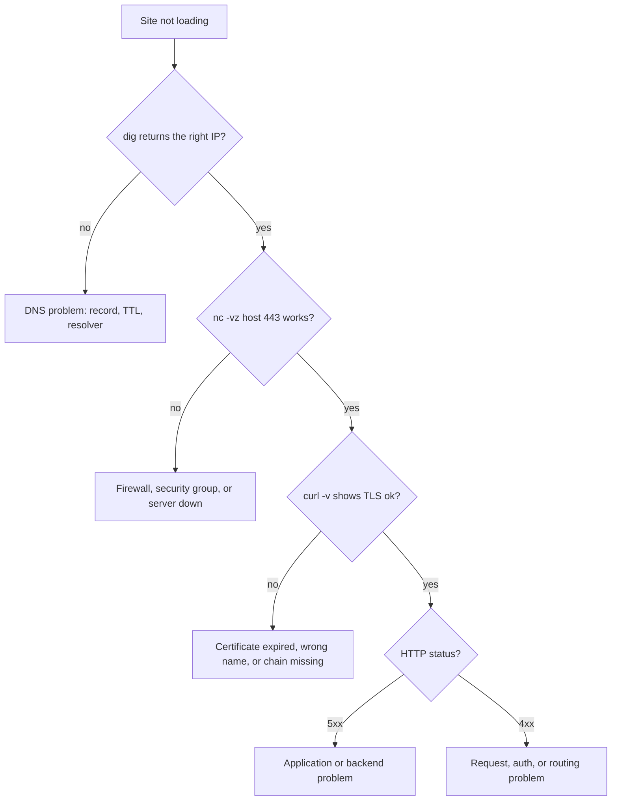

# 🔎 03 · DNS, HTTP, HTTPS and TLS

> **In one line:** DNS turns names into IP addresses, HTTP is how browsers and servers talk, and TLS makes that talk private and trusted.

## 🧠 Simple explanation

**DNS** is the phone book of the internet. You know the name (`example.com`), and DNS tells you the number (`93.184.216.34`). **HTTP** is the language of a conversation: "Please give me this page." "Here it is." **HTTPS** is the same conversation inside a locked, sealed tube. **TLS** is the lock and the ID card check that builds that tube.



## 🔑 Key concepts

### DNS

- **Resolver**: the server that looks names up for you (your ISP, `8.8.8.8`, `1.1.1.1`, or your cloud's resolver). It caches answers.
- **Authoritative server**: the one that holds the real records for a domain.
- **TTL (time to live)**: how long an answer may be cached, in seconds.
- **Record types**:

| Record | Meaning | Example |
|---|---|---|
| A | Name to IPv4 | `app.example.com -> 203.0.113.10` |
| AAAA | Name to IPv6 | `app -> 2001:db8::10` |
| CNAME | Alias to another name | `www -> app.example.com` |
| MX | Mail servers | `10 mail.example.com` |
| TXT | Text, used for verification and SPF | `"v=spf1 ..."` |
| NS | Which servers are authoritative | `ns1.provider.com` |

(You cannot use a CNAME at the bare domain `example.com`; clouds offer an "alias" record for that.)



### HTTP

- A request has a **method**, a **path**, **headers**, and an optional **body**.
- Common methods: `GET` (read), `POST` (create), `PUT` and `PATCH` (update), `DELETE`.
- **Status codes**:

| Code | Meaning |
|---|---|
| 200 | OK |
| 301 / 302 | Redirect |
| 400 | Bad request |
| 401 / 403 | Not logged in / not allowed |
| 404 | Not found |
| 429 | Too many requests |
| 500 | Server error |
| 502 | Bad gateway (proxy got a bad answer) |
| 503 | Service unavailable |
| 504 | Gateway timeout |

- HTTP/1.1 sends one request at a time per connection. HTTP/2 multiplexes many. HTTP/3 uses QUIC over UDP.

### TLS and certificates

- **TLS** gives: encryption (nobody can read), integrity (nobody can change), and authentication (you are talking to the real server).
- A **certificate** links a domain name to a public key and is signed by a **Certificate Authority (CA)**. Browsers trust a list of CAs.
- **Chain of trust**: server cert, intermediate CA, root CA.
- **Let's Encrypt** gives free automated certificates. Certificates expire (usually 90 days to 1 year), so automate renewal.
- **mTLS**: both sides show certificates. Used between services.

## 🛠️ Hands-on

### DNS

```bash
dig example.com                    # full answer
dig +short example.com A           # only the IP
dig +short example.com MX
dig @1.1.1.1 example.com           # ask a specific resolver
dig +trace example.com             # walk root -> TLD -> authoritative
dig -x 8.8.8.8 +short              # reverse lookup
nslookup example.com               # alternative tool
cat /etc/resolv.conf               # which resolver this machine uses
```

### HTTP with curl

```bash
curl -I https://example.com                        # response headers
curl -v https://example.com 2>&1 | head -40        # connection and TLS details
curl -s -o /dev/null -w "%{http_code} %{time_total}s\n" https://example.com
curl -X POST https://httpbin.org/post \
  -H "Content-Type: application/json" \
  -d '{"name":"devops"}'
curl --resolve app.example.com:443:203.0.113.10 https://app.example.com   # test a server before DNS changes
curl -L http://example.com                         # follow redirects
```

### Inspect a certificate

```bash
openssl s_client -connect example.com:443 -servername example.com </dev/null 2>/dev/null \
  | openssl x509 -noout -subject -issuer -dates

# Days until expiry check
echo | openssl s_client -connect example.com:443 -servername example.com 2>/dev/null \
  | openssl x509 -noout -enddate
```

### Create a self-signed certificate for testing

```bash
openssl req -x509 -newkey rsa:2048 -nodes -days 30 \
  -keyout test.key -out test.crt -subj "/CN=localhost"
```

### Debug flow when "the site is down"



## ⚠️ Common mistakes

- **Forgetting DNS caching.** After a change, old answers live until the TTL ends. Lower the TTL **before** a planned migration.
- **Expired certificates.** Automate renewal and monitor expiry.
- **Certificate name mismatch.** The cert must include the exact hostname (SAN).
- **Missing intermediate certificate** in the server config. Works in some browsers, fails in `curl`.
- **Blaming the app when DNS is the cause** (or the reverse). Check DNS first.
- **Putting secrets in URLs.** URLs are logged. Use headers or a body.

## ✅ Quick recap

- DNS maps names to IPs. Records: A, AAAA, CNAME, MX, TXT, NS. TTL controls caching.
- HTTP status codes tell you where to look: 4xx client side, 5xx server side.
- TLS encrypts and proves identity using certificates from trusted CAs.
- Tools: `dig`, `curl -v`, `openssl s_client`.

➡️ **Next:** [04 · Load balancers, proxies and firewalls](04-load-balancers-proxies-firewalls.md)
