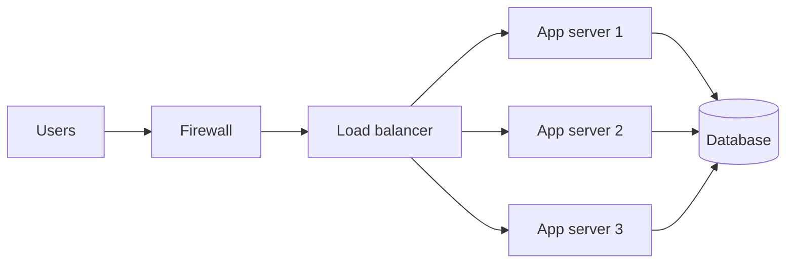
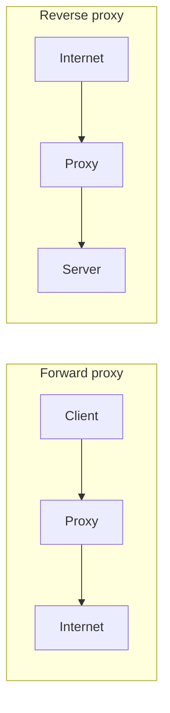

# ⚖️ 04 · Load Balancers, Proxies and Firewalls

> **In one line:** Load balancers spread traffic over many servers, proxies stand in the middle of a connection, and firewalls decide what is allowed in or out.

## 🧠 Simple explanation

Picture a popular restaurant. The **host at the door** sends each guest to a free table so no waiter gets overloaded: that is a **load balancer**. A **proxy** is like a personal assistant who makes calls for you or answers calls for your boss, so the other side never talks to the real person. A **firewall** is the **security guard** with a list: "These people may enter, these may not."



## 🔑 Key concepts

### Load balancers

- **Layer 4 (transport)**: balances TCP/UDP by IP and port. Very fast, does not read HTTP. Examples: AWS NLB.
- **Layer 7 (application)**: understands HTTP. Can route by host, path, or header, and handle TLS. Examples: AWS ALB, NGINX, HAProxy, Envoy.
- **Algorithms**:

| Algorithm | How it picks |
|---|---|
| Round robin | Servers in turn |
| Least connections | Server with the fewest active connections |
| IP hash | Same client IP goes to the same server |
| Weighted | Stronger servers get more |

- **Health checks**: the LB probes each server (for example `GET /health`) and stops sending traffic to failed ones.
- **TLS termination**: the LB decrypts HTTPS so the servers do not have to.
- **Sticky sessions**: keep a user on the same server. Prefer stateless apps and a shared session store instead.
- **Global load balancing**: DNS or anycast routes users to the closest region.

### Proxies

- **Forward proxy**: sits in front of **clients**. Used for filtering, caching, and hiding client IPs. Example: Squid, a corporate proxy.
- **Reverse proxy**: sits in front of **servers**. Used for TLS, caching, routing, and protection. Examples: NGINX, Traefik, Envoy, CloudFront.
- Many tools are both a reverse proxy and a load balancer.
- **API gateway**: a reverse proxy with extras (auth, rate limits, routing to microservices).
- Headers like `X-Forwarded-For` carry the original client IP through proxies.



### Firewalls

- **Stateless** (like AWS Network ACL): checks every packet by itself. You need rules for both directions.
- **Stateful** (like AWS Security Group, iptables with conntrack): remembers connections, so reply traffic is allowed automatically.
- **Rules** have: source, destination, port, protocol, action (allow or deny). Default is usually **deny all inbound**.
- **WAF (Web Application Firewall)**: layer 7 protection against SQL injection, XSS, bots.
- **Principle**: open only what you need, from only who needs it.

## 🛠️ Hands-on

### NGINX as reverse proxy and load balancer

```nginx
# /etc/nginx/conf.d/app.conf
upstream app_servers {
    least_conn;
    server 10.0.2.10:8080 max_fails=3 fail_timeout=10s;
    server 10.0.2.11:8080 max_fails=3 fail_timeout=10s;
    server 10.0.2.12:8080 backup;
}

server {
    listen 80;
    server_name app.example.com;

    location / {
        proxy_pass http://app_servers;
        proxy_set_header Host $host;
        proxy_set_header X-Real-IP $remote_addr;
        proxy_set_header X-Forwarded-For $proxy_add_x_forwarded_for;
        proxy_set_header X-Forwarded-Proto $scheme;
    }
}
```

```bash
sudo nginx -t && sudo systemctl reload nginx     # test config, then reload
```

### Try load balancing with Docker

```bash
docker network create lbnet
docker run -d --name s1 --network lbnet -e NAME=one hashicorp/http-echo -text="server one"
docker run -d --name s2 --network lbnet hashicorp/http-echo -text="server two"
# Then point NGINX upstream at s1:5678 and s2:5678 and run curl repeatedly
```

### Firewall with UFW (simple) on Linux

```bash
sudo ufw default deny incoming
sudo ufw default allow outgoing
sudo ufw allow 22/tcp                 # SSH
sudo ufw allow 443/tcp                # HTTPS
sudo ufw allow from 10.0.0.0/16 to any port 5432 proto tcp   # DB only from the VPC
sudo ufw enable
sudo ufw status verbose
```

### Firewall with iptables (what UFW builds on)

```bash
sudo iptables -A INPUT -m conntrack --ctstate ESTABLISHED,RELATED -j ACCEPT
sudo iptables -A INPUT -p tcp --dport 22 -j ACCEPT
sudo iptables -A INPUT -i lo -j ACCEPT
sudo iptables -P INPUT DROP
sudo iptables -L -n -v
```

> Careful: set the SSH allow rule **before** changing the default policy to DROP, or you lock yourself out.

### AWS Security Group with Terraform

```hcl
resource "aws_security_group" "web" {
  name   = "web-sg"
  vpc_id = aws_vpc.main.id

  ingress {
    from_port   = 443
    to_port     = 443
    protocol    = "tcp"
    cidr_blocks = ["0.0.0.0/0"]
  }

  egress {
    from_port   = 0
    to_port     = 0
    protocol    = "-1"
    cidr_blocks = ["0.0.0.0/0"]
  }
}
```

## ⚠️ Common mistakes

- **Opening SSH (22) or a database port to `0.0.0.0/0`.** A top cause of breaches. Restrict by source.
- **No health checks** or a health check that always returns 200.
- **Terminating TLS at the LB but trusting `X-Forwarded-*` headers from anyone.** Only trust your own proxy.
- **Using sticky sessions to hide a stateful app.** It breaks scaling and failover.
- **Forgetting reply traffic** on a stateless firewall (NACL).
- **A single load balancer in one zone.** Spread across availability zones.
- **Locking yourself out** with a firewall change over SSH.

## ✅ Quick recap

- L4 load balancers are fast and simple. L7 load balancers understand HTTP.
- Forward proxy serves clients. Reverse proxy serves servers.
- Firewalls: default deny, allow only what is needed. Stateful tracks replies.
- Health checks and multi-zone setups give high availability.

➡️ **Next:** [05 · VPN, NAT and troubleshooting tools](05-vpn-nat-and-troubleshooting-tools.md)
