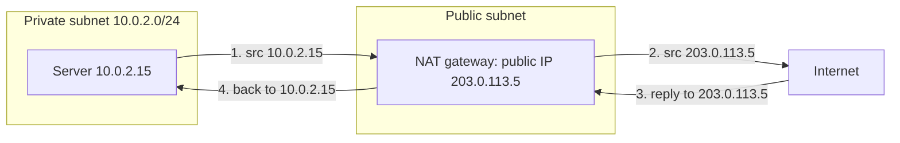
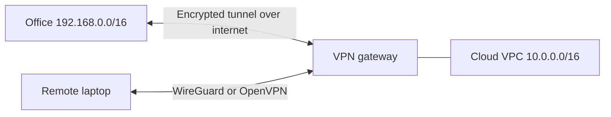
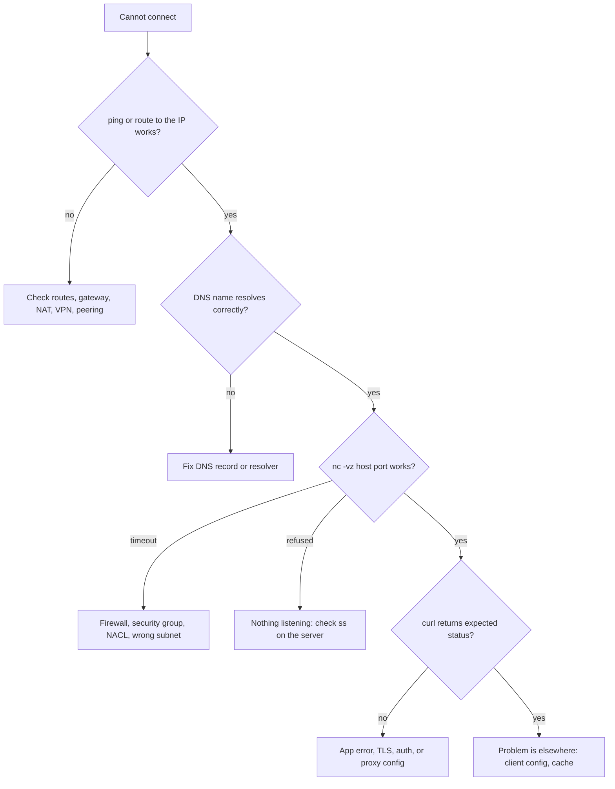

# 🧰 05 · VPN, NAT and Troubleshooting Tools

> **In one line:** NAT lets private machines reach the internet, a VPN builds a secure private tunnel across the internet, and a handful of command-line tools help you find any network problem.

## 🧠 Simple explanation

**NAT** is like an office receptionist. Many employees inside use one company phone number to call out. When a reply comes in, the receptionist remembers who called and passes it to the right desk. Outsiders only see the company number. A **VPN** is a private, sealed tunnel between two places, like a hidden underground corridor between two buildings, so everything inside is hidden from people on the street. **Troubleshooting tools** are your stethoscope and thermometer.



## 🔑 Key concepts

### NAT (Network Address Translation)

- Rewrites source or destination IP addresses as packets pass through.
- **SNAT / PAT (masquerade)**: many private hosts share one public IP for outbound traffic. This is what your home router and a cloud **NAT Gateway** do.
- **DNAT / port forwarding**: traffic coming to a public IP and port is sent to a private host.
- NAT is **not a firewall**, even though it blocks unsolicited inbound traffic as a side effect.
- Cloud pattern: servers in private subnets use a NAT Gateway in a public subnet to download updates. Nobody on the internet can start a connection to them.

### VPN (Virtual Private Network)

- Creates an encrypted tunnel between networks or between a user and a network.
- **Site-to-site VPN**: office network to cloud VPC. (AWS Site-to-Site VPN, Azure VPN Gateway.)
- **Client (remote access) VPN**: a laptop to the company network. (OpenVPN, WireGuard, AWS Client VPN.)
- **IPsec**: widely used for site-to-site. **WireGuard**: modern, fast, simple. **OpenVPN**: TLS-based and popular.
- **Split tunnel**: only company traffic goes through the VPN. **Full tunnel**: everything does.
- Related: **VPC peering** and **Transit Gateway** connect cloud networks privately. **Direct Connect / ExpressRoute** are dedicated private lines.
- **Bastion host / jump box** and tools like AWS SSM Session Manager give safe access to private servers.



## 🛠️ Hands-on: the troubleshooting toolbox

### ping: is the host reachable?

```bash
ping -c 4 8.8.8.8
```

Shows reachability and round-trip time. Remember that some hosts block ICMP.

### traceroute / mtr: where does the path break?

```bash
traceroute example.com          # or: tracepath example.com
mtr -rwc 20 example.com         # live path with loss per hop (sudo apt install mtr-tiny)
```

Stars (`* * *`) mean a hop does not answer. That alone is not always a problem. Look for where loss starts and continues.

### dig: DNS

```bash
dig +short example.com
dig @8.8.8.8 example.com        # compare with another resolver
```

### curl: HTTP and timings

```bash
curl -w "dns:%{time_namelookup} connect:%{time_connect} tls:%{time_appconnect} ttfb:%{time_starttransfer} total:%{time_total}\n" \
  -o /dev/null -s https://example.com
curl -v --max-time 5 http://10.0.2.15:8080/health
```

The timing line shows which phase is slow: DNS, TCP connect, TLS, or the app.

### ss: what is listening here?

```bash
ss -tulpn                       # listening TCP/UDP with process names (use sudo for all)
ss -tan state established       # active connections
ss -s                           # summary counts
```

If your app is not in the list, it is not listening. If it listens on `127.0.0.1` only, other machines cannot reach it. You want `0.0.0.0` or the right interface.

### nc (netcat): is the port open?

```bash
nc -vz db.internal 5432
nc -vz -w 3 10.0.2.15 22
```

### tcpdump: see the real packets

```bash
sudo tcpdump -i any -n port 53                       # DNS traffic
sudo tcpdump -i eth0 -n host 10.0.2.15 and port 8080 # one host and port
sudo tcpdump -i any -n -c 50 -w capture.pcap         # save for Wireshark
```

### Interface, route, and neighbor info

```bash
ip addr
ip route get 8.8.8.8            # which route and source IP would be used?
ip neigh
```

### A checklist for "I cannot connect to the server"



**Timeout** usually means something is dropping packets (firewall). **Connection refused** means the machine answered but no program listens on that port.

### Set up NAT on a Linux box (to learn how it works)

```bash
sudo sysctl -w net.ipv4.ip_forward=1
sudo iptables -t nat -A POSTROUTING -s 10.0.2.0/24 -o eth0 -j MASQUERADE
```

### Quick WireGuard example (client config)

```ini
# /etc/wireguard/wg0.conf
[Interface]
PrivateKey = <client-private-key>
Address = 10.8.0.2/32
DNS = 10.8.0.1

[Peer]
PublicKey = <server-public-key>
Endpoint = vpn.example.com:51820
AllowedIPs = 10.0.0.0/16          # only route the company network (split tunnel)
PersistentKeepalive = 25
```

```bash
sudo wg-quick up wg0
sudo wg show
```

Never commit real private keys to Git.

## ⚠️ Common mistakes

- **Guessing instead of testing in order.** Go layer by layer: IP, DNS, port, app.
- **Reading "timeout" and "refused" as the same thing.** They point to different causes.
- **Forgetting the route back.** In a VPN or peering, both sides need routes and matching firewall rules.
- **Overlapping CIDR ranges** across a VPN. Traffic goes to the wrong place.
- **A service bound to `127.0.0.1`** that you expect to reach from outside.
- **NAT Gateway per-GB costs ignored.** Heavy traffic through NAT can be expensive. Use VPC endpoints for AWS services.
- **Capturing traffic with secrets** and sharing the file. Packet captures may contain sensitive data.

## ✅ Quick recap

- NAT shares public IPs and hides private hosts. A VPN builds an encrypted tunnel between networks.
- Timeout = dropped by something. Refused = nobody listening.
- Core tools: `ping`, `traceroute`/`mtr`, `dig`, `curl -w`, `ss`, `nc`, `tcpdump`.
- Work from the bottom layer up and prove each step.

🎉 **You finished the networking guide.** Next, apply it in [Cloud Fundamentals](../../cloud-fundamentals/README.md) and [Kubernetes Guide](../../kubernetes-guide/README.md).

⬅️ **Back:** [04 · Load balancers, proxies and firewalls](04-load-balancers-proxies-firewalls.md)
