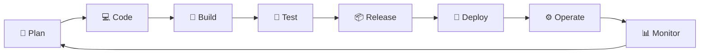
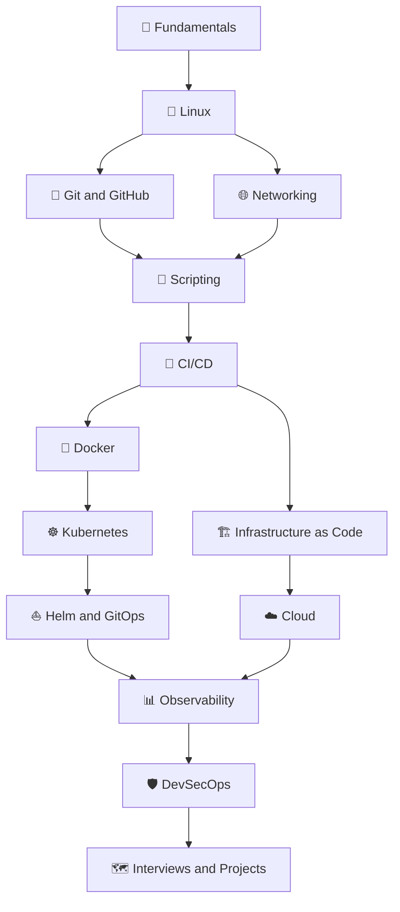

<!-- ===================== HEADER ===================== -->

 

---

## 👋 About me

I'm **Akhil**, a DevOps-focused engineer who loves turning slow, manual, error-prone work into fast, repeatable automation.

- 🔭 Learning and documenting the full DevOps toolchain, end to end
- 🌱 Currently deepening: **Kubernetes · Terraform · GitOps · Observability**
- 📚 I write every topic in **simple English with diagrams**, see the [DevOps Docs](https://github.com/Akhilgoud01/devops-docs) below
- 💬 Ask me about: CI/CD, Docker, Kubernetes, IaC, cloud, monitoring
- 🌐 Portfolio: [RachakondaAkhil-Portfolio](https://github.com/Akhilgoud01/RachakondaAkhil-Portfolio)

---

## 🔄 My DevOps loop

---

## 🧰 Tech stack

**☁️ Cloud & Infrastructure**

**📦 Containers & Orchestration**

**🔁 CI/CD & Version Control**

**📊 Monitoring & Observability**

**🛡️ Security**

**🧑‍💻 OS & Scripting**

---

## 📚 DevOps Hub

> Fourteen topic folders in one repo that cover DevOps from zero to production. Each has a README, topic docs, and Mermaid diagrams, all in simple English.

| | Topic | What you will learn |
|---|---|---|
| 🧭 | [**devops-fundamentals**](https://github.com/Akhilgoud01/devops-docs/tree/main/devops-fundamentals) | DevOps culture, lifecycle, Agile, deployment strategies, DORA, SRE |
| 🐧 | [**linux-for-devops**](https://github.com/Akhilgoud01/devops-docs/tree/main/linux-for-devops) | Filesystem, permissions, systemd, cron, grep/sed/awk, SSH |
| 🌿 | [**git-and-github**](https://github.com/Akhilgoud01/devops-docs/tree/main/git-and-github) | Git internals, branching, PRs, GitFlow, trunk-based, GitHub features |
| 🌐 | [**networking-for-devops**](https://github.com/Akhilgoud01/devops-docs/tree/main/networking-for-devops) | OSI, TCP/IP, subnets, DNS, TLS, load balancers, troubleshooting |
| 🐍 | [**scripting-bash-python**](https://github.com/Akhilgoud01/devops-docs/tree/main/scripting-bash-python) | Bash, Python, boto3, YAML/JSON for automation |
| 🔁 | [**cicd-pipelines**](https://github.com/Akhilgoud01/devops-docs/tree/main/cicd-pipelines) | GitHub Actions, Jenkins, GitLab CI, quality gates |
| 🐳 | [**docker-containers**](https://github.com/Akhilgoud01/devops-docs/tree/main/docker-containers) | Images, Dockerfile, multi-stage, networking, Compose, image security |
| ☸️ | [**kubernetes-guide**](https://github.com/Akhilgoud01/devops-docs/tree/main/kubernetes-guide) | Architecture, Pods, Services, storage, HPA, RBAC, kubectl |
| ⛵ | [**helm-and-gitops**](https://github.com/Akhilgoud01/devops-docs/tree/main/helm-and-gitops) | Helm, GitOps, Argo CD, Kustomize |
| 🏗️ | [**infrastructure-as-code**](https://github.com/Akhilgoud01/devops-docs/tree/main/infrastructure-as-code) | Terraform, Ansible, CloudFormation, Pulumi |
| ☁️ | [**cloud-fundamentals**](https://github.com/Akhilgoud01/devops-docs/tree/main/cloud-fundamentals) | Cloud models, AWS core services, VPC, IAM, Azure/GCP, cost |
| 📊 | [**monitoring-observability**](https://github.com/Akhilgoud01/devops-docs/tree/main/monitoring-observability) | Prometheus, Grafana, ELK/Loki, tracing, incident response |
| 🛡️ | [**devsecops-security**](https://github.com/Akhilgoud01/devops-docs/tree/main/devsecops-security) | Shift-left, secrets, container security, SAST/DAST, supply chain |
| 🗺️ | [**devops-roadmap-and-interviews**](https://github.com/Akhilgoud01/devops-docs/tree/main/devops-roadmap-and-interviews) | Roadmap, portfolio projects, interview Q&A, certifications |

### 🗺️ Suggested learning path

---

## 📈 GitHub stats

---

## 🎯 Currently working toward

- [x] Writing the DevOps Hub documentation
- [ ] Building end-to-end portfolio projects (CI/CD → Docker → Kubernetes → Terraform)
- [ ] Cloud and Kubernetes certifications
- [ ] Contributing to open-source DevOps tooling

---

## 🤝 Let's connect

<!-- Add your LinkedIn / email badge here if you want it public:

-->

*"Automate the boring stuff, monitor the important stuff."*

