<p align="center"></p>

<p align="center">
  
  
  
  
</p>

---

## 🎯 Why this repo

DevOps is about removing manual work. If you do something twice, write a script. Bash is perfect for gluing Linux commands together. Python is perfect when logic gets bigger, or when you must talk to APIs and cloud services. This repo teaches both in simple English, with small examples you can copy and run.

## 🗺️ Learning path


## 📚 Table of contents

| # | Topic | What you will learn |
|---|-------|---------------------|
| 01 | [Bash scripting basics](docs/01-bash-scripting-basics.md) | Variables, input, conditions, exit codes |
| 02 | [Bash automation patterns](docs/02-bash-automation-patterns.md) | Loops, functions, `set -euo pipefail`, traps |
| 03 | [Python for DevOps basics](docs/03-python-for-devops-basics.md) | Syntax, files, functions, virtual environments |
| 04 | [Python automation](docs/04-python-automation-boto3-requests-subprocess.md) | `boto3`, `requests`, `subprocess` |
| 05 | [YAML, JSON and config formats](docs/05-yaml-json-and-config-formats.md) | Reading and writing the formats DevOps tools use |

## ⚡ Quick cheat sheet

```bash
#!/usr/bin/env bash
set -euo pipefail            # safe mode: stop on errors, unset vars, pipe failures

name="${1:-world}"           # first argument, default "world"
echo "Hello, $name"

for f in *.log; do           # loop over files
  gzip "$f"
done

if [[ -f /etc/hosts ]]; then # test a file exists
  echo "found"
fi
```

```python
import json, subprocess, requests

r = requests.get("https://api.github.com", timeout=10)
r.raise_for_status()
print(r.json().keys())

out = subprocess.run(["uname", "-a"], capture_output=True, text=True, check=True)
print(out.stdout)
```

---

<p align="center">Part of the DevOps Hub by <a href="https://github.com/Akhilgoud01">@Akhilgoud01</a> — ⭐ star if it helped</p>
