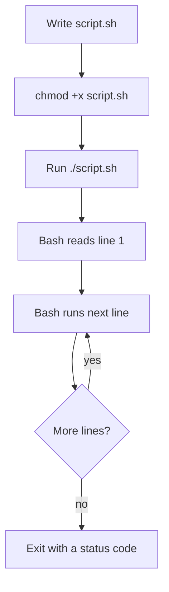

# 🐚 01 · Bash Scripting Basics

> **In one line:** A Bash script is a text file of Linux commands that run one after another, so you never type them by hand again.

## 🧠 Simple explanation

Think of a cooking recipe. Each line is one step. You write the recipe once, and anyone can cook the same dish the same way. A Bash script is a recipe for your computer.

You write commands in a file, make the file executable, and run it. Bash reads the file from top to bottom.



## 🔑 Key concepts

- **Shebang** (`#!/usr/bin/env bash`): first line. It tells Linux which program runs the file.
- **Variable**: a named box for a value. Set with `name=value` (no spaces). Read with `$name`.
- **Argument**: a value passed when you run the script. `$1` is the first, `$2` the second, `$@` is all of them.
- **Exit code**: a number every command returns. `0` means success. Anything else means failure. Read the last one with `$?`.
- **Quoting**: `"double quotes"` expand variables. `'single quotes'` do not. Always quote variables: `"$name"`.
- **Test**: `[[ ... ]]` checks things, like if a file exists or two strings match.
- **Pipe** (`|`): sends the output of one command into the next.
- **Redirect**: `>` writes to a file, `>>` appends, `2>` sends errors, `<` reads input.

## 🛠️ Hands-on

### Your first script

```bash
#!/usr/bin/env bash
# hello.sh - says hello
name="${1:-friend}"        # use the first argument, or "friend" if none
echo "Hello, $name!"
echo "Today is $(date +%A)"   # $(...) runs a command and uses its output
```

Run it:

```bash
chmod +x hello.sh
./hello.sh Akhil
```

### Reading input

```bash
read -r -p "Enter your service name: " svc
echo "You chose: $svc"
```

### Conditions

```bash
#!/usr/bin/env bash
file="/etc/hosts"

if [[ -f "$file" ]]; then
  echo "$file exists"
elif [[ -d "$file" ]]; then
  echo "$file is a directory"
else
  echo "$file is missing"
fi
```

Handy tests:

| Test | Meaning |
|------|---------|
| `-f path` | is a regular file |
| `-d path` | is a directory |
| `-z "$x"` | string is empty |
| `-n "$x"` | string is not empty |
| `"$a" == "$b"` | strings equal |
| `$a -eq $b` | numbers equal |
| `$a -gt $b` | number greater than |

### Exit codes

```bash
grep -q "root" /etc/passwd
echo "grep exit code: $?"      # 0 = found, 1 = not found

if ! command -v docker >/dev/null 2>&1; then
  echo "docker is not installed" >&2
  exit 1
fi
```

### Pipes and redirects

```bash
# Count how many users use bash
grep "/bin/bash" /etc/passwd | wc -l

# Save output, and errors, to files
ls /nonexistent > out.txt 2> err.txt

# Append a line to a log
echo "$(date) backup done" >> backup.log
```

### A small real script: disk check

```bash
#!/usr/bin/env bash
threshold=80
usage=$(df / --output=pcent | tail -1 | tr -dc '0-9')

if (( usage > threshold )); then
  echo "WARNING: disk is ${usage}% full"
  exit 1
fi
echo "Disk OK: ${usage}%"
```

## ⚠️ Common mistakes

- **Spaces around `=`.** `name = "x"` fails. Write `name="x"`.
- **Forgetting quotes.** `rm $dir` breaks if `$dir` has a space. Use `rm "$dir"`.
- **Missing shebang or `chmod +x`.** You get "permission denied" or the wrong shell runs it.
- **Using `[ ]` and `[[ ]]` mixed up.** Prefer `[[ ]]` in Bash. It is safer.
- **Ignoring exit codes.** A script keeps going after a failure unless you handle it (next doc).
- **Windows line endings (CRLF).** They cause `bad interpreter` errors. Fix with `dos2unix script.sh`.

## ✅ Quick recap

- A script is a file of commands with a shebang on line one.
- Variables: `x=1`, read with `"$x"`. Arguments are `$1`, `$2`, `$@`.
- Exit code `0` is success, anything else is failure.
- Use `[[ ]]` for tests, and pipes (`|`) to chain commands.

➡️ **Next:** [02 · Bash automation patterns](02-bash-automation-patterns.md)
