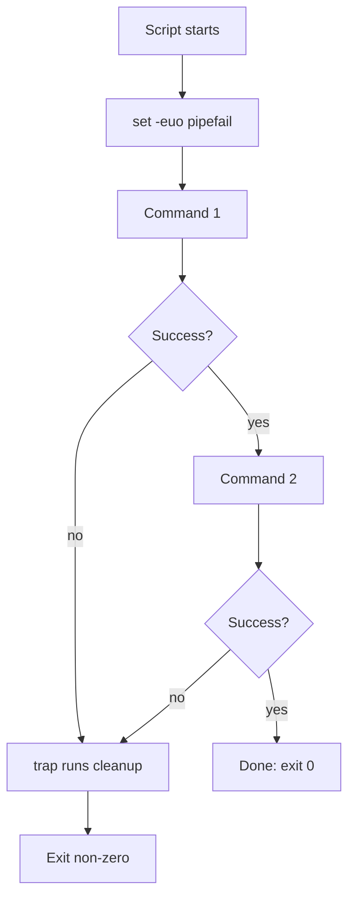

# 🔁 02 · Bash Automation Patterns

> **In one line:** Loops, functions, and safe error handling turn a simple script into a reliable automation tool.

## 🧠 Simple explanation

Imagine a factory line. A **loop** repeats the same job on many items. A **function** is a named machine you can reuse. **Error handling** is the emergency stop button: if something breaks, the line stops instead of making broken products.

By default, Bash keeps running even after a command fails. That is dangerous. One line fixes most of it:

```bash
set -euo pipefail
```



## 🔑 Key concepts

- **`set -e`**: exit immediately when a command fails.
- **`set -u`**: treat unset variables as errors (catches typos).
- **`set -o pipefail`**: a pipeline fails if any part fails, not only the last.
- **Function**: `name() { ...; }`. Arguments are `$1`, `$2` inside it. Use `local` for variables.
- **Loop**: `for`, `while`, and `until` repeat work.
- **`trap`**: runs a command when the script exits or gets a signal. Great for cleanup.
- **Idempotent**: running the script twice gives the same result as once. Good automation is idempotent.
- **`case`**: a neat way to handle many options.

## 🛠️ Hands-on

### Loops

```bash
# Loop over a list
for env in dev staging prod; do
  echo "Deploying to $env"
done

# Loop over files
for f in /var/log/*.log; do
  [[ -e "$f" ]] || continue      # skip if no match
  echo "Found $f"
done

# Loop over lines of a file
while IFS= read -r host; do
  ping -c1 -W1 "$host" >/dev/null && echo "$host up" || echo "$host down"
done < hosts.txt

# Counter loop
for ((i = 1; i <= 3; i++)); do
  echo "Attempt $i"
done
```

### Functions

```bash
log() {
  local level="$1"; shift
  echo "$(date '+%F %T') [$level] $*"
}

require_cmd() {
  command -v "$1" >/dev/null 2>&1 || { log ERROR "$1 not found"; exit 1; }
}

require_cmd curl
log INFO "Starting"
```

### Safe script template

```bash
#!/usr/bin/env bash
set -euo pipefail
IFS=$'\n\t'

tmp_dir="$(mktemp -d)"
cleanup() {
  rm -rf "$tmp_dir"
  echo "cleaned up"
}
trap cleanup EXIT                      # runs on success AND failure

usage() {
  echo "Usage: $0 <url>" >&2
  exit 2
}

[[ $# -eq 1 ]] || usage
url="$1"

curl -fsSL "$url" -o "$tmp_dir/page.html"
echo "Downloaded $(wc -c < "$tmp_dir/page.html") bytes"
```

### Retry pattern

```bash
retry() {
  local tries="$1"; shift
  local n=1
  until "$@"; do
    if (( n >= tries )); then
      echo "failed after $n tries" >&2
      return 1
    fi
    echo "retry $n/$tries..."
    sleep $((n * 2))
    ((n++))
  done
}

retry 5 curl -fsS https://example.com/health
```

### Handling options with `case`

```bash
action="${1:-help}"
case "$action" in
  start)  echo "starting" ;;
  stop)   echo "stopping" ;;
  status) echo "running" ;;
  *)      echo "Usage: $0 {start|stop|status}"; exit 1 ;;
esac
```

### Idempotent example

```bash
mkdir -p /opt/app/logs                # fine to run many times
id deploy >/dev/null 2>&1 || useradd deploy   # create only if missing
```

### Check your script

```bash
bash -n script.sh        # syntax check only
shellcheck script.sh     # finds common bugs (install shellcheck)
bash -x script.sh        # trace: print each command as it runs
```

## ⚠️ Common mistakes

- **`set -e` surprises.** It does not trigger inside `if` conditions or after `||`. Test your failure paths.
- **Unquoted variables in loops.** `for f in $(ls)` breaks on spaces. Use globs: `for f in *`.
- **Forgetting `local`.** Function variables leak into the whole script.
- **Parsing `ls` output.** Use globs or `find ... -print0`.
- **Hard-coded secrets.** Read them from environment variables or a secret manager.
- **No cleanup.** Temp files pile up. Use `trap ... EXIT`.

## ✅ Quick recap

- Start every script with `set -euo pipefail`.
- Use functions for reuse and `local` for safety.
- `trap cleanup EXIT` guarantees cleanup.
- Make scripts idempotent and lint them with ShellCheck.

➡️ **Next:** [03 · Python for DevOps basics](03-python-for-devops-basics.md)
