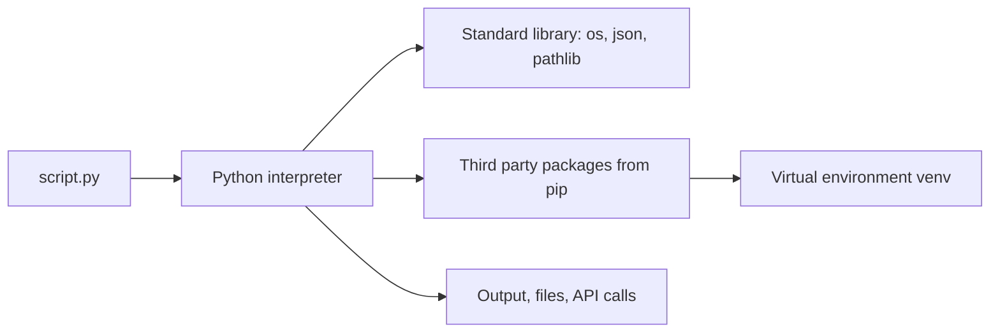

# 🐍 03 · Python for DevOps Basics

> **In one line:** Python is the go-to language when your automation needs real logic, APIs, or data handling.

## 🧠 Simple explanation

Bash is like a Swiss army knife: quick and handy for small jobs. Python is like a full workshop. When your script needs lists, dictionaries, error messages, tests, or calls to web services, Python is easier to read and safer to grow.

Python reads like English. Indentation (spaces at the start of a line) shows which lines belong together.



## 🔑 Key concepts

- **Variable types**: `str` (text), `int`, `float`, `bool`, `list`, `dict`, `tuple`, `set`.
- **List**: ordered items, `["a", "b"]`. **Dict**: key to value pairs, `{"name": "web"}`.
- **Function**: reusable block made with `def`.
- **Module / package**: a file or folder of Python code you `import`.
- **pip**: installs third-party packages.
- **Virtual environment (venv)**: an isolated folder of packages for one project, so projects do not clash.
- **Exception**: an error you can catch with `try` / `except`.
- **Context manager** (`with`): opens something and always closes it.
- **`pathlib`**: modern, friendly way to handle file paths.

## 🛠️ Hands-on

### Set up a project

```bash
python3 --version
python3 -m venv .venv
source .venv/bin/activate          # Windows: .venv\Scripts\activate
pip install requests
pip freeze > requirements.txt
deactivate
```

### Variables and data types

```python
service = "web"
port = 8080
healthy = True
servers = ["web1", "web2", "db1"]
config = {"env": "prod", "replicas": 3}

print(f"{service} runs on port {port}")   # f-string
print(config["env"])
servers.append("cache1")
```

### Conditions and loops

```python
for server in servers:
    if server.startswith("web"):
        print(f"{server} is a web server")
    elif server.startswith("db"):
        print(f"{server} is a database")
    else:
        print(f"{server} is something else")

# list comprehension: short way to build a list
web_only = [s for s in servers if s.startswith("web")]
```

### Functions

```python
def check_port(port: int) -> bool:
    """Return True if the port is in the allowed range."""
    return 1 <= port <= 65535

print(check_port(8080))   # True
print(check_port(70000))  # False
```

### Files with `pathlib`

```python
from pathlib import Path

log_dir = Path("/var/log")
for log in log_dir.glob("*.log"):
    size_kb = log.stat().st_size / 1024
    print(f"{log.name}: {size_kb:.1f} KB")

Path("report.txt").write_text("all good\n")
text = Path("report.txt").read_text()
```

### Errors

```python
try:
    with open("missing.txt") as f:
        data = f.read()
except FileNotFoundError:
    print("File not found, using defaults")
except PermissionError:
    print("No permission")
else:
    print("Read OK")
finally:
    print("This always runs")
```

### Environment variables and arguments

```python
import os
import argparse

parser = argparse.ArgumentParser(description="Greet a user")
parser.add_argument("--name", default="friend")
args = parser.parse_args()

token = os.environ.get("API_TOKEN")        # None if not set
print(f"Hello {args.name}")
```

### A complete tiny tool

```python
#!/usr/bin/env python3
"""Report disk usage and fail if too full."""
import shutil
import sys

THRESHOLD = 80

def main() -> int:
    total, used, _free = shutil.disk_usage("/")
    percent = used / total * 100
    print(f"Disk usage: {percent:.1f}%")
    return 1 if percent > THRESHOLD else 0

if __name__ == "__main__":
    sys.exit(main())
```

## ⚠️ Common mistakes

- **Installing packages globally.** Always use a `venv`.
- **Mixing tabs and spaces.** Use 4 spaces everywhere.
- **Bare `except:`.** It hides real bugs. Catch specific errors.
- **Hard-coding secrets** in the script. Use environment variables.
- **Mutable default arguments** like `def f(x=[])`. Use `None` instead.
- **Forgetting `if __name__ == "__main__":`** so importing runs your script by accident.

## ✅ Quick recap

- Use a virtual environment for every project.
- Lists and dicts are the daily tools.
- `pathlib`, `argparse`, and `os.environ` cover most script needs.
- Catch specific exceptions and return proper exit codes.

➡️ **Next:** [04 · Python automation](04-python-automation-boto3-requests-subprocess.md)
