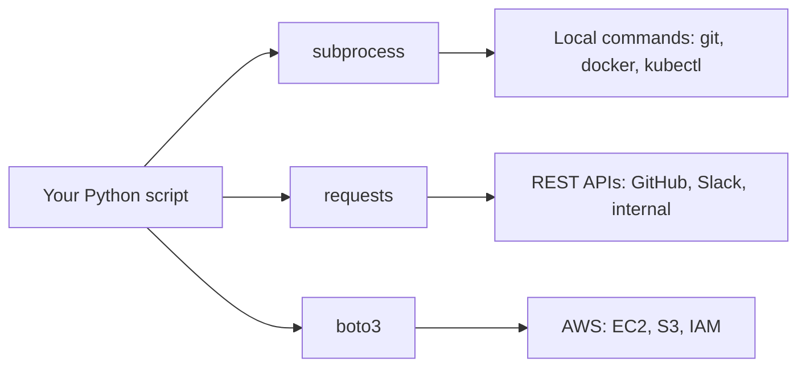

# 🤖 04 · Python Automation: boto3, requests, subprocess

> **In one line:** Three libraries let Python run commands (`subprocess`), call web APIs (`requests`), and control AWS (`boto3`).

## 🧠 Simple explanation

Imagine you are a manager with three assistants:

- **subprocess** runs commands on your computer, like typing in a terminal.
- **requests** phones other websites and services and brings back answers.
- **boto3** talks to Amazon Web Services and can create, list, or delete cloud things.

You give clear instructions, they do the work, and you check the results.



## 🔑 Key concepts

- **`subprocess.run`**: runs a command and waits. Returns an object with `returncode`, `stdout`, `stderr`.
- **`check=True`**: raise an error if the command fails.
- **REST API**: a web address that returns data (usually JSON).
- **HTTP methods**: `GET` read, `POST` create, `PUT` replace, `DELETE` remove.
- **Timeout**: always set one, or your script can hang forever.
- **boto3 client vs resource**: a *client* is low level and maps to API calls. A *resource* is a higher-level object style.
- **Credentials**: boto3 finds them from environment variables, `~/.aws/credentials`, or an IAM role. Never write keys in code.
- **Paginator**: handles APIs that return results in pages.

## 🛠️ Hands-on

```bash
python3 -m venv .venv && source .venv/bin/activate
pip install requests boto3
```

### subprocess

```python
import subprocess

# Safe: pass a list, not a string. No shell needed.
result = subprocess.run(
    ["git", "rev-parse", "--short", "HEAD"],
    capture_output=True,
    text=True,
    check=True,
)
print("Commit:", result.stdout.strip())

# Handle failure
try:
    subprocess.run(["ls", "/nonexistent"], check=True, capture_output=True, text=True)
except subprocess.CalledProcessError as e:
    print("Failed with code", e.returncode)
    print("stderr:", e.stderr)

# With a timeout
subprocess.run(["sleep", "1"], timeout=5)
```

### requests

```python
import os
import requests

# GET with a timeout
r = requests.get("https://api.github.com/repos/python/cpython", timeout=10)
r.raise_for_status()                      # error on 4xx / 5xx
data = r.json()
print(data["full_name"], data["stargazers_count"])

# Authenticated call, token from environment
token = os.environ["GITHUB_TOKEN"]
headers = {"Authorization": f"Bearer {token}", "Accept": "application/vnd.github+json"}
me = requests.get("https://api.github.com/user", headers=headers, timeout=10)
print(me.status_code)

# POST JSON (example: a chat webhook)
requests.post(os.environ["WEBHOOK_URL"], json={"text": "Deploy finished"}, timeout=10)
```

A simple health checker with retries:

```python
import time
import requests

def wait_healthy(url: str, tries: int = 5) -> bool:
    for i in range(1, tries + 1):
        try:
            if requests.get(url, timeout=3).status_code == 200:
                return True
        except requests.RequestException:
            pass
        time.sleep(2 * i)
    return False

print("healthy" if wait_healthy("https://example.com") else "unhealthy")
```

### boto3 (AWS)

Set credentials first (use `aws configure` or an IAM role):

```bash
aws configure
```

```python
import boto3

# List S3 buckets
s3 = boto3.client("s3")
for b in s3.list_buckets()["Buckets"]:
    print(b["Name"])

# Upload a file
s3.upload_file("report.txt", "my-bucket-name", "reports/report.txt")

# List running EC2 instances
ec2 = boto3.client("ec2", region_name="us-east-1")
resp = ec2.describe_instances(
    Filters=[{"Name": "instance-state-name", "Values": ["running"]}]
)
for res in resp["Reservations"]:
    for inst in res["Instances"]:
        name = next((t["Value"] for t in inst.get("Tags", []) if t["Key"] == "Name"), "-")
        print(inst["InstanceId"], inst["InstanceType"], name)

# Paginate big lists
paginator = s3.get_paginator("list_objects_v2")
for page in paginator.paginate(Bucket="my-bucket-name"):
    for obj in page.get("Contents", []):
        print(obj["Key"])
```

Handle AWS errors:

```python
from botocore.exceptions import ClientError

try:
    s3.head_bucket(Bucket="some-bucket")
except ClientError as e:
    print("AWS error:", e.response["Error"]["Code"])
```

### Putting it together

```python
# Tag every running instance with who last checked it
import boto3, subprocess

who = subprocess.run(["whoami"], capture_output=True, text=True, check=True).stdout.strip()
ec2 = boto3.client("ec2")
ids = [
    i["InstanceId"]
    for r in ec2.describe_instances(Filters=[{"Name": "instance-state-name", "Values": ["running"]}])["Reservations"]
    for i in r["Instances"]
]
if ids:
    ec2.create_tags(Resources=ids, Tags=[{"Key": "last-checked-by", "Value": who}])
```

## ⚠️ Common mistakes

- **`shell=True` with user input.** It allows command injection. Pass a list instead.
- **No timeout on `requests`.** The default is to wait forever.
- **Forgetting `raise_for_status()`.** A 500 error looks like success otherwise.
- **Access keys in code or Git.** Use roles, environment variables, or a secrets manager.
- **Not paginating.** AWS returns limited results per call.
- **Running destructive boto3 calls without a dry run.** Many EC2 calls accept `DryRun=True`.

## ✅ Quick recap

- `subprocess.run([...], check=True)` for commands.
- `requests` with `timeout` and `raise_for_status()` for APIs.
- `boto3` for AWS, using clients and paginators, credentials from the environment or a role.
- Catch errors and never hard-code secrets.

➡️ **Next:** [05 · YAML, JSON and config formats](05-yaml-json-and-config-formats.md)
