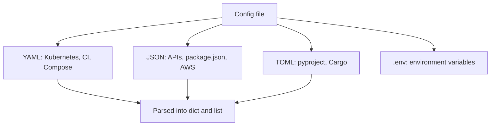

# 📄 05 · YAML, JSON and Config Formats

> **In one line:** DevOps tools are configured with text files, mostly YAML and JSON, so you must read and write them with confidence.

## 🧠 Simple explanation

A config file is a form you fill in for a tool. "How many copies of my app? Which image? Which port?" The format is just the layout of the form.

- **JSON** is strict and great for machines and APIs.
- **YAML** is friendly for humans and used by Kubernetes, GitHub Actions, Docker Compose, Ansible.
- **TOML / INI / .env** are simpler key-value styles.



## 🔑 Key concepts

- **Key / value**: a name and its data, `port: 8080`.
- **Mapping (object)**: a group of key/value pairs.
- **Sequence (array)**: an ordered list of items.
- **Scalar**: a single value, like a string, number, or boolean.
- **Indentation** (YAML only): spaces show structure. **Never use tabs.** Two spaces is the common style.
- **Comments**: YAML supports `# comment`. JSON does **not**.
- **Anchors** (YAML): `&name` and `*name` reuse a block.
- **Schema / validation**: rules saying what a file must look like.

## 🛠️ Hands-on

### The same data in three formats

YAML:

```yaml
# app.yaml
name: web
replicas: 3
ports:
  - 80
  - 443
env:
  LOG_LEVEL: info
  DEBUG: false
```

JSON:

```json
{
  "name": "web",
  "replicas": 3,
  "ports": [80, 443],
  "env": { "LOG_LEVEL": "info", "DEBUG": false }
}
```

TOML:

```toml
name = "web"
replicas = 3
ports = [80, 443]

[env]
LOG_LEVEL = "info"
DEBUG = false
```

### Useful YAML features

```yaml
# Multi-line text
script: |
  echo "line one"
  echo "line two"

# Folded text (becomes one line)
description: >
  This is a long sentence
  split over two lines.

# Anchors to avoid repeating yourself
defaults: &defaults
  image: nginx:1.27
  restart: always

web:
  <<: *defaults
  ports: ["80:80"]

# Multiple documents in one file
---
kind: A
---
kind: B
```

### YAML pitfalls to remember

```yaml
country: NO        # may be read as boolean false in YAML 1.1! Quote it:
country: "NO"
version: 1.10      # read as number 1.1. Quote it:
version: "1.10"
```

### Python: read and write

```bash
pip install pyyaml
```

```python
import json
import yaml   # PyYAML

# Read YAML (always safe_load, never load)
with open("app.yaml") as f:
    cfg = yaml.safe_load(f)
print(cfg["replicas"])

# Change and save as YAML
cfg["replicas"] = 5
with open("app.yaml", "w") as f:
    yaml.safe_dump(cfg, f, sort_keys=False)

# Convert YAML to JSON
print(json.dumps(cfg, indent=2))

# Read JSON
with open("data.json") as f:
    data = json.load(f)

# Read TOML (built in from Python 3.11)
import tomllib
with open("pyproject.toml", "rb") as f:
    project = tomllib.load(f)
```

### Command line tools: jq and yq

```bash
# jq: query JSON
curl -s https://api.github.com/repos/python/cpython | jq '.stargazers_count'
jq -r '.ports[]' app.json
jq '.replicas = 5' app.json

# yq: query and edit YAML
yq '.replicas' app.yaml
yq -i '.replicas = 5' app.yaml
yq -o=json '.' app.yaml       # YAML to JSON
```

### Validate before you deploy

```bash
# YAML syntax
python3 -c "import yaml,sys; yaml.safe_load(open('app.yaml')); print('valid YAML')"

# JSON syntax
jq empty data.json && echo "valid JSON"

# Lint YAML style
pip install yamllint
yamllint app.yaml

# Kubernetes manifest check (dry run)
kubectl apply --dry-run=client -f deployment.yaml
```

### .env files

```bash
# .env
DB_HOST=localhost
DB_PORT=5432
```

```bash
set -a; source .env; set +a      # load into the shell
echo "$DB_HOST"
```

## ⚠️ Common mistakes

- **Tabs in YAML.** They are illegal. Use spaces.
- **Wrong indentation.** One missing space changes the meaning or breaks the file.
- **Unquoted special values** like `NO`, `yes`, `1.10`, or `0123`.
- **Comments in JSON.** They make the file invalid.
- **Trailing commas in JSON.** Also invalid.
- **Using `yaml.load` on untrusted input.** Use `safe_load`.
- **Committing `.env` files with secrets.** Add them to `.gitignore`.

## ✅ Quick recap

- YAML for humans and DevOps tools, JSON for APIs, TOML/.env for simple settings.
- YAML relies on spaces for structure. No tabs.
- Use `yaml.safe_load`, `json`, `jq`, and `yq` to read and edit.
- Always validate and lint before you deploy.

🎉 **You finished this repo.** Next, put scripts into pipelines: see the **cicd-pipelines** repo.
